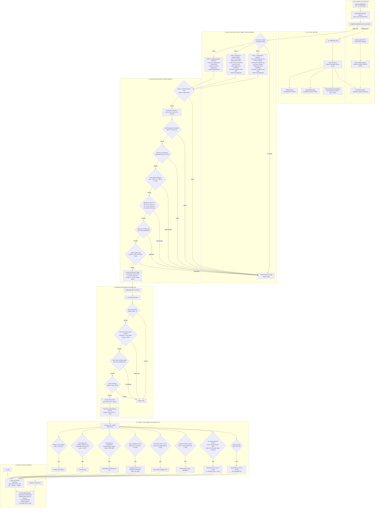

# AEGIS — Autonomous Execution & Gamma Imbalance System

**Architecture Authority — Code-Grounded Definitive Specification**  
**Version:** 3.5 (V3.5 Pure Price-Action Primary + Adaptive Microstructure Shield + Quantitative Exits — Live)  
**Status:** ACTIVE · PM2 `aegis-bot` (PID 2885694) · `AEGIS/aegis_main.py:87`  
**Host:** Oracle Cloud `opc@137.23.41.38` · `ecosystem.config.js:3` · `cwd=/home/opc`  
**Broker:** Shoonya (NorenApi) · `common/config.py:30` · `BROKER=SHOONYA`  
**Instruments:** NIFTY (Mon/Tue/Fri, NFO, lot 65) · SENSEX (Wed/Thu, BFO, lot 20) · 0DTE weekly only  
**Last Audited:** 2026-09-11 · Full Pytest Suite 154/154 passed (100% GREEN) · Live VPS synchronized  
**Supersedes:** `AEGIS/AEGIS V2.md` and all prior legacy ASTRA / AEGIS V1/V2 theoretical documents.

---

> ⚠️ **CRITICAL GOVERNANCE LAWS (DO NOT ALTER ARBITRARILY):**  
> 1. **Price Action Primary Law**: AEGIS V3.5 operates strictly as a **Macro Price Action Primary Trigger**. An option contract is admitted ONLY when one of the 3 empirically verified Price Action Scalper Pillars triggers (`price_action_engine.py:871`). All non-PA ticks are instantly discarded without buffering or scoring (`aegis_gamma_engine.py:461-463`).
> 2. **Microstructure Shield Law**: The microstructure engine acts solely as a **Secondary Defensive Shield (Validator)** to verify liquidity, non-toxic book condition, and absence of opposing institutional walls before execution (`aegis_gamma_engine.py:650-735`).
> 3. **Scale-Invariance Law**: NEVER hardcode fixed point thresholds for index calculations across NIFTY and SENSEX. All spot distances, invalidations, stops, and confirmations MUST be normalized via **Basis Points (bps, where 1 bps = 0.01% of spot)** or localized volatility multiples ($k \times \text{ATR}_{1m}$).
> 4. **Zero Cold-Start Warmup Law**: At 09:14 AM IST pre-market, historical 1-minute bars are pre-seeded into `PriceActionEngine` via Shoonya REST API (`aegis_main.py:260-312`). The bot trades with mature 20 EMA, 50 EMA, and ATR from tick 1 (09:15:01 AM).
> 5. **Execution Discipline Law**: One open position at a time. Strict max 3 trades/day cap (`MAX_TRADES_PER_DAY = 3`). Strict non-consecutive setup lockout (same setup blocked for 180s until an alternate route executes). Resting maker limit TP at +4.0%. 30s Squeeze Momentum Timeout (+1.5% hurdle).

---

## Master Semantic Architecture Graph

The following Mermaid diagram visualizes the complete end-to-end signal generation, gating, execution, and exit lifecycle of AEGIS V3.5:



---

## Directory & Module Map (Ground Truth)

All active non-archive modules within `AEGIS/` mapped with exact lines, responsibilities, and key interfaces:

| Module Path | Lines | Primary Responsibility | Key Classes & Functions |
|---|---|---|---|
| `AEGIS/aegis_main.py` | 579 | Process orchestrator, PM2 entry, 09:14 AM seeding, 1-min ATM shift, IPC state | `main()`, `build_minute_digest()`, `attach_aegis_archiver()` |
| `AEGIS/aegis_gamma_engine.py` | 1153 | Central brain, tick router, secondary microstructure shield, signal dispatcher | `AegisGammaEngine`, `create_aegis_engine()`, `on_tick_parsed()` |
| `AEGIS/aegis_execution_manager.py` | 1365 | Execution daemon, order routing, maker TP, 4-pillar adaptive quantitative exits | `AegisExecutionManager`, `_manage_open_trade()`, `_chase_exit_thread()` |
| `AEGIS/backtest_engine.py` | 646 | Parity replay backtester off historical parquet tick files | `AegisParityBacktester`, `run_backtest()` |
| `AEGIS/core/price_action_engine.py` | 899 | **Primary Macro Trigger**: 1m OHLC bars, 20/50 EMA, ATR(14), VWAP, 3 scalper pillars | `PriceActionEngine`, `evaluate_setup()`, `check_20_ema_rejection()` |
| `AEGIS/core/microstructure_scorer.py` | 321 | Empirical 0-100 logit model, 15 features, $T$-anchored micro-acceleration | `MicrostructureScorer`, `compute_score()`, `verify_event_bound_30s()` |
| `AEGIS/core/directional_persistence.py` | 167 | Signed directional persistence tracking over rolling 60s window | `DirectionalPersistenceEngine`, `evaluate_persistence()` |
| `AEGIS/core/time_bar_engine.py` | 804 | Multi-timeframe bar engine (legacy shim; live engine aliases to `PriceActionEngine`) | `TimeBarEngine`, `get_market_structure()` |
| `AEGIS/core/oi_builtup_gate.py` | 362 | 4-quadrant real-time Open Interest analysis and strike defense wall gate | `OIBuiltupGate`, `evaluate_gate()` |
| `AEGIS/core/index_vwap_engine.py` | 191 | Constituent-volume weighted index VWAP poller and over-extension gate | `IndexVWAPEngine`, `get_vwap_metrics()` |
| `AEGIS/core/regime_chop_gate.py` | 135 | Directional displacement override, Kaufman KER, and variance ratio gate | `RegimeChopGate`, `get_regime_state()` |
| `AEGIS/core/signal_state_machine.py` | 148 | Centralized 45s-aligned signal lifecycle FSM (OBSERVE $\to$ PRIMED $\to$ FIRED) | `SignalStateMachine`, `update_trigger()` |
| `AEGIS/core/option_quality.py` | 102 | Option contract tradability filter (spread, top-5 depth, premium limits) | `OptionQualityEngine`, `qualify_option()` |
| `AEGIS/core/entry_quality_engine.py` | 116 | Unified Entry Quality Score (EQS) composite calculator (dispatch threshold 70) | `EntryQualityEngine`, `compute_eqs()` |
| `AEGIS/core/outcome_telemetry.py` | 143 | Forward outcome tracking (30s, 60s, 180s, 300s MFE/MAE) with JSONL persistence | `OutcomeTelemetryEngine`, `register_entry()` |
| `AEGIS/core/instrument_repository.py` | 331 | SQLite WAL cache for instrument metadata and nearest-expiry resolution | `InstrumentRepository`, `resolve_weekly_options()` |
| `AEGIS/core/causal_microstructure_pipeline.py` | 380 | L1-L5 OFI extractor and production shadow scorer | `CausalMicrostructureExtractor`, `ProductionShadowMicrostructureScorer` |
| `AEGIS/execution/data_fetcher.py` | 213 | Instrument resolution, cash index tokens, 5-min historical candle bootstrap | `DataFetcher`, `get_cash_index_token()`, `get_weekly_option_tokens()` |
| `AEGIS/execution/l2_guard.py` | 25 | Depth validation helper | `L2Guard` |
| `AEGIS/acceptance_engine/state_machine.py` | 666 | Acceptance state machine for parity validation across versions | `AcceptanceStateMachine` |
| `AEGIS/acceptance_engine/parity_backtest.py` | 401 | Parity test harness for deterministic verification | `ParityBacktestHarness` |
| `AEGIS/config/settings.py` | 37 | Configuration binding for AEGIS runtime (`DATA_DIR=AEGIS/data`, `LOGS_DIR=AEGIS/logs`) | `get_runtime_paths("aegis")` |
| `AEGIS/config/market_calendar.py` | 2 | Shim re-exporting `common/market/market_calendar.py` | Re-exports |

---

## Runtime Topology & Threading Architecture

AEGIS operates across 4 coordinated threads with strict thread-safe primitives:

```
[Main Thread] (aegis_main.py:227) @ 0.2s Cadence
  ├── 08:55 Pre-market handshake (Shoonya WS connect & auth)
  ├── 09:14 Historical 1m bar REST seeding (seed_historical_bars)
  ├── 1-min boundary: spot check, ATM strike roll, delta re-subscribe, minute digest, IPC publish
  └── 15:10 Session force flatten & graceful shutdown

[Shoonya WebSocket Thread] (inside ShoonyaAdapter)
  └── TickCompiler.on_message() -> zero-copy ParsedTick dispatch
        ├── Underlying tick -> _on_underlying_tick() -> PriceActionEngine + VWAP + Persistence
        ├── Option tick -> on_tick_parsed() -> Macro PA Trigger -> Secondary Shield -> signal_queue.put()
        └── AegisL2Archiver.on_tick() -> passive raw tick buffering for 15-min Parquet flush

[Execution Daemon Thread] (AegisExecutionManager._run_loop:225)
  ├── signal_queue.get(timeout=0.5) -> _process_aegis_signal()
  ├── Entry guards: Daily cap (3) -> Non-consecutive lockout (180s) -> Inter-trade cooldown (60s)
  ├── Order dispatch: LMT Day at ask + Immediate resting Maker Limit TP (+4.0%)
  └── _manage_open_trade() @ 2 Hz: evaluates 4-pillar adaptive quantitative exits

[Exit Chaser Daemon Thread] (AegisExecutionManager._chase_exit_thread:986)
  ├── Triggered per exit event (under trade_lock & _is_exiting mutex)
  ├── Case A: Passive Maker TP fill verification (zero discount)
  └── Case B: 3-step dynamic limit chase: Bid-0% (0.8s) -> Bid-1% (1.0s) -> Bid-2% (aggressive)
```

### IPC and Mutex Discipline
- **`self.trade_lock`**: Re-entrant `threading.Lock()` guarding `self.trade_context`, position open/close state, and entry validation.
- **`self._is_exiting`**: Mutex preventing concurrent threads (e.g. Stop-Loss and Time-Stop) from firing duplicate exit orders to the broker.
- **`signal_queue`**: Thread-safe `queue.Queue(maxsize=1000)` connecting the WS signal generator to the execution loop.
- **`AEGIS_STATE_FILE`**: Atomic shm JSON written once per minute (`aegis_main.py:327`) to feed `unified_dashboard`.

---

## Deep-Dive: The 3 Core Price Action Scalper Pillars

All price action setups are evaluated strictly on finalized 1-minute bars (`price_action_engine.py:404-860`). No mid-bar hopping or unconfirmed wick speculation is permitted.

### Pillar 1: 20 EMA Pullback & Wick Rejection
*Top-performing scalper on NIFTY & SENSEX.* Captures dynamic trend continuations off the institutional 20 EMA.

```python
# Exact Mathematical Rules (price_action_engine.py:404-600)
# Trend Filter:
20_EMA > 50_EMA (for CALL/UP) or 20_EMA < 50_EMA (for PUT/DOWN)

# Dual-Path Trigger (OR):
# Path A (Single-Bar Test & Rejection):
- Bar T tests 20 EMA zone:
    CALL: Bar.low <= (EMA_20 + tol_pts) and Bar.close >= (EMA_20 - 0.5 * tol_pts)
    PUT:  Bar.high >= (EMA_20 - tol_pts) and Bar.close <= (EMA_20 + 0.5 * tol_pts)
- Candlestick Rejection:
    Expansion: Body > 40% of Total Range in trade direction
    OR Pin-Bar / Hammer: Rejection Wick >= 33% of Total Range
    Minimum Range: Total Range >= 0.30 * ATR(14) (blocks flat doji noise)

# Path B (Two-Bar Retest & Confirmation):
- Bar T-1 tested 20 EMA zone without piercing close.
- Bar T does not pierce and closes as strong expansion:
    CALL: Close > Open and (Body > 40% Range OR Close > Bar[T-1].High)
    PUT:  Close < Open and (Body > 40% Range OR Close < Bar[T-1].Low)

# Two-Touch Lookback & Same-Side Pause Discipline (_had_prior_ema_touch:285):
- Scans backwards up to 40 closed bars for Leg 1 EMA test.
- Minimum 5 pause bars gap between Leg 1 and Leg 2 to eliminate chop.
- Strict Same-Side Close Discipline: Every single candle between Leg 1 and Leg 2
  MUST close on the correct side of 20 EMA (CALL: Close > EMA - tol; PUT: Close < EMA + 0.5*tol).
- VWAP Filter: Candle close must sit on the correct VWAP side (CALL: > VWAP; PUT: < VWAP).

# Stop-Loss:
CALL Spot SL = Bar.low - buffer_pts
PUT Spot SL  = Bar.high + buffer_pts
where buffer_pts = max(5.0, (Spot / 24000.0) * 5.0)

# Break-of-Structure (BOS) Confirmation Quality (2026-09-16):
- When rejection forms within 0.60 * ATR of a pivot, entry waits for a
  pending BOS break (close beyond the pivot within 3 bars).
- The confirming break bar must carry momentum, else the setup is discarded
  (bos_weak_breakout/breakdown_discarded) and a fresh retest signal is awaited:
    Range >= 0.30 * ATR(14) (blocks flat noise)
    Body >= 40% of Range in break direction
    Close in the outer 35% edge (CALL: top edge; PUT: bottom edge)
    Extension past level <= max(1.0 * ATR(14), buffer_pts) (no late chase)
```

### BOS-Strict Microstructure Gate (2026-09-16)
BOS-breakout confirmations pass the Adaptive Micro Validator in strict mode
(`adaptive_micro_validator.py: strict_bos=True`, wired at
`aegis_gamma_engine.py` BOS branch): pass mark **>= 70.0** (vs 60.0 default)
plus three momentum vetoes — **10s acceleration >= 0** (close speeds up),
**direction-aligned touch** (CALL: I1 >= +0.10; PUT: I1 <= -0.10), and
**no deep-book wall** (CALL: deep L3-L5 pressure >= -0.60; PUT mirrored).
Any veto discards the break (`bos_momentum_stall` / `bos_weak_aggression` /
`bos_deep_opposition`). Non-BOS setups keep the legacy 60.0 behaviour.

### Pillar 2: Al Brooks 2-Legged Pullback at 50 EMA
Captures institutional exhaustion sweeps into the major 50 EMA support/resistance.

```python
# Exact Mathematical Rules (price_action_engine.py:601-779)
# Structure:
- Requires at least 3 closed bars.
- 20 EMA leading 50 EMA (positive trend alignment).
- Leg 2 Bar tests 50 EMA zone: |Bar.extreme - EMA_50| <= 1.5 * buffer_pts.
- Reversal candle confirmation: Bar closes in trade direction (CALL: Close > Open; PUT: Close < Open).

# Flexible Leg 1 Search with Same-Side Pause:
- Scans backwards between 6 and 40 bars for Leg 1 touch of 50 EMA.
- Leg 2 sweep verification:
    CALL (H2 Bullish Exhaustion): Leg 2 Low < Leg 1 Low (liquidity sweep).
    PUT (L2 Bearish Exhaustion): Leg 2 High > Leg 1 High (liquidity sweep).
- Same-Side Discipline: All bars between Leg 1 and Leg 2 must maintain close on trend side of 50 EMA.
- VWAP Filter: Leg 1 and Leg 2 must respect VWAP alignment.

# Stop-Loss:
CALL Spot SL = min(Bar.low, Leg2.low) - buffer_pts
PUT Spot SL  = max(Bar.high, Leg2.high) + buffer_pts
```

### Pillar 3: Volatility Squeeze to Expansion Breakout
Captures explosive expansion breakouts from tight range compression.

```python
# Exact Mathematical Rules (price_action_engine.py:780-860)
# Squeeze Compression:
- Prior 4 closed bars (T-4 to T-1) define the box:
    Box_High = max(High[T-4..T-1])
    Box_Low  = min(Low[T-4..T-1])
    Squeeze_Range = Box_High - Box_Low
- Compression Hurdle: Squeeze_Range <= 0.65 * ATR(14).

# 5th Bar Breakout:
- Full closed bar T must close completely outside the box:
    CALL (Upside Breakout):   Bar.close > Box_High
    PUT (Downside Breakout): Bar.close < Box_Low
- VWAP Alignment: Candle must close on favorable side of VWAP.

# Stop-Loss:
CALL Spot SL = Box_Low - buffer_pts
PUT Spot SL  = Box_High + buffer_pts

# Hard Momentum Discipline:
Subject to mandatory 30-second Squeeze Momentum Timeout (+1.5% hurdle) in Execution Manager.
```

---

## Deep-Dive: Secondary Microstructure Shield (Validator)

When any of the 3 Price Action pillars triggers, execution is not automatic. The trade must pass through the **Secondary Microstructure Shield** (`aegis_gamma_engine.py:650-735`) to verify book health and friction:

| Validation Gate | Pillar 1 (20 EMA) | Pillar 2 (50 EMA Brooks) | Pillar 3 (Squeeze) | Purpose |
|---|---|---|---|---|
| **Phase-1 Absolute VWAP Veto** | Strict Side | Strict Side | Strict Side | Immediate top-of-tick abort if trade opposes session VWAP (`lines 325-331`). |
| **Event-Bound Anchor $T$** | Final 1m Close | Final 1m Close | Final 1m Close | Slices order book strictly to $[T-60, T]$ and $[T-30, T]$. Eliminates forward-tick bias. |
| **60s Directional Persistence ($D_p$)** | $\ge 0.70$ (Opp $\le 2$) | $\ge 0.70$ (Opp $\le 2$) | $\ge 0.70$ (Opp $\le 2$) | Confirms sustained underlying delta pressure over prior 12 snapshots (5s cadence). |
| **30s Micro-Momentum Acceleration** | Verified | Verified | Verified | Checks microprice drift and $I_1$ touch pressure in trade direction. |
| **Top-5 Depth Imbalance ($\text{imb}_{top5}$)** | $\ge -0.40$ | $\ge -0.35$ | $\ge -0.45$ | Prevents buying into massive opposing institutional walls. Formula: $\frac{\text{Bid}_5 - \text{Ask}_5}{\text{Bid}_5 + \text{Ask}_5}$. |
| **Liquid Spread Ceiling** | $\le 1.00\%$ | $\le 1.20\%$ | $\le 0.80\%$ | Rejects wide spreads that erode scalp alpha. Formula: $\frac{SP_1 - BP_1}{\text{Mid}} \times 100$. |
| **Friction Edge-to-Friction Ratio (ETF)** | $\ge 2.50$ | $\ge 2.00$ | $\ge 3.00$ | Ensures profit target comfortably exceeds roundtrip trading friction. Formula: $\frac{4.0\%}{\text{Spread} + 0.30\%}$. |
| **Real-Time OI Built-Up & Wall Gate** | Cleared | Cleared | Cleared | Verifies underlying is not hitting major call/put open interest defense walls ($\le 25/50$ pts). |
| **Option Quality Gate** | Qualified | Qualified | Qualified | Spread $\le 2.5\%$, Depth $\ge 150$ (Nifty) / $50$ (Sensex), Premium $\ge$ ₹4.00. |
| **Assigned EQS Score** | **85.0** | **83.0** | **82.0** | All pillars pass dispatch hurdle (70.0); flows into execution context & telemetry. |

---

## Deep-Dive: Execution Manager & Adaptive Exits

`AegisExecutionManager` (`aegis_execution_manager.py`) governs position lifecycle with institutional execution discipline:

### 1. Pre-Entry Guardrails
1. **Daily Trade Cap**: Maximum **3 trades per day** (`MAX_TRADES_PER_DAY = 3`). Once reached, the bot disarms for the day.
2. **Strict Non-Consecutive Setup Lockout**:
   ```python
   # aegis_execution_manager.py:351-364
   incoming_route = signal.get("metrics", {}).get("pa_setup_name")
   if incoming_route and self.last_exited_route and incoming_route == self.last_exited_route:
       if now_epoch < (self.last_trade_exit_time + self.consecutive_route_cooldown_sec):
           # BLOCKED: Same setup locked for 180s until alternate route triggers
           return
   ```
3. **Inter-Trade Cooldown**: Mandatory 60s pause between any trade exits to prevent whipsaw capture (`inter_trade_cooldown_sec = 60.0`).
4. **Post-Loss Freeze**: Mandatory 120s pause after any losing trade to allow market volatility to settle (`post_loss_cooloff_sec = 120.0`).
5. **Session Window**: Entries permitted strictly between `09:16` and `15:00` IST (`AEGIS_ENTRY_CUTOFF = 15:00`).

### 2. Order Placement & Resting Maker TP
- **Entry**: Marketable Limit Order (`LMT Day`) placed at current Ask.
- **Fast Take-Profit (Maker Order)**: Immediately upon entry fill, an exchange limit order is placed at **+4.0%** (`RESTING_TP_LIMIT_PCT = 0.040`):
  $$\text{TP Price} = \text{round\_tick}(\text{Entry Price} \times 1.040)$$
  Being a resting maker limit order, this exit incurs zero slippage and collects liquidity rebate where applicable.

### 3. Claude's 4-Pillar Adaptive Quantitative Exits
Monitored at 2 Hz by `_manage_open_trade()` (`lines 750-970`):

1. **Passive Resting Maker TP Exit**:
   When `live_bid >= tp_price`, cancel local SL, synchronize broker order status, and log clean +4.0% gain.
2. **User 5-Minute Baseline Hold Law ("आर या पार")**:
   - Every trade is granted the full 5-minute (300s) baseline window to allow multi-candle 1-minute formations to reach +4.0% Take-Profit.
   - Premature 30-second cuts have been eliminated — exits occur only on:
     a) +4.0% Resting TP Limit Hit.
     b) Spot Wick Invalidation SL Hit.
     c) 5-Minute Baseline Time Stop (or 6-minute extension for running winners).
3. **Adaptive Time Ceiling (5m $\to$ 6m Extension)**:
   - Baseline hard time-stop: **300 seconds (5 minutes)**.
   - Conditional 6-minute extension (360s) granted ONLY IF:
     1. Trade is actively running in profit ($\ge +2.0\%$ gain, or Breakeven/Runner locked).
     2. 1-minute market structure is NOT `OPPOSED`.
4. **Two-Key Breakeven Guard**:
   - **Key 1 (Move Hurdle)**: Peak gain $\ge 2.5 \times \text{NoiseFloor}$.
   - **Key 2 (Time or Spot Confirmation)**: Hold time $\ge 60\text{s}$ OR Spot move $\ge 3.5\text{ bps}$ ($0.5 \times \text{ATR}_{1m}$).
   - When both keys are satisfied, `breakeven_locked = True`, shifting Stop-Loss to $\text{Entry} + \max(₹0.50, 0.5 \times \text{NoiseFloor})$.
5. **Dynamic Runner Trailing**:
   - Armed when Peak Gain $\ge 3.0 \times \text{NoiseFloor}$ OR Gain $\ge +15.0\%$.
   - Trails dynamically at 20% of peak profit: $\text{Trail SL} = \text{Peak Price} - \max(1.5 \times \text{NoiseFloor}, 0.20 \times \text{Peak Gain})$.
6. **Precise Price Action Wick Invalidation SL**:
   - If underlying spot price hits the structural candle high/low ($\pm 5\text{ pts}$ buffer) returned by the Price Action pillar, exit immediately.
7. **Spot Adverse Invalidation Stop-Loss**:
   - Calculated dynamically using localized volatility and realized delta:
     $$\text{Spot SL Pts} = \max(\text{Spot} \times 0.00065, 1.0 \times \text{ATR}_{1m})$$
     $$\Delta_{\text{realized}} = \frac{|\Delta P_{\text{option}}|}{|\Delta P_{\text{spot}}|}$$
     $$\text{Option SL Dist} = \min(\max(\text{NoiseFloor}, \Delta_{\text{realized}} \times \text{Spot SL Pts}), 0.35 \times \text{Entry})$$
     Emergency hard cap: maximum -35% loss (`EMERGENCY_MAX_SL_PCT = 0.35`).
8. **Spot Adverse Trend Invalidation Exit**:
   - Cuts trades immediately upon technical trend breakdown:
     - PUT: Spot breaks above 50 EMA ($+5\text{ pts}$, slope $> +0.5\text{ bps}$) OR crosses above 9 EMA (slope $> +1.0\text{ bps}$) OR structure `OPPOSED`.
     - CALL: Spot breaks below 50 EMA ($-5\text{ pts}$, slope $< -0.5\text{ bps}$) OR crosses below 9 EMA (slope $< -1.0\text{ bps}$) OR structure `OPPOSED`.
9. **Dynamic Noise Floor Formulation**:
   $$\text{NoiseFloor} = \max\left(₹1.50, \; 2.5 \times \text{Spread} + 2.0 \times \sigma_{\text{prem}}, \; 0.05 \times \text{Entry Price}\right)$$
10. **Session Force Flatten**:
    - Unconditional market flatten at `15:10 IST` (`AEGIS_FORCE_FLATTEN = 15:10`).

### 4. Order Exit Chaser (`_chase_exit_thread`)
For non-TP exits, limit order chasing prevents severe execution slippage:
- **Step 1**: Places limit order at fresh live Bid (0% discount). Waits 0.8s.
- **Step 2**: If unfilled, modifies order to fresh Bid - 1%. Waits 1.0s.
- **Step 3**: If still unfilled, cancels and fires aggressive exit at Bid - 2% to ensure complete fill.

---

## Pre-Market 09:14 AM Warmup & Calendar Governance

### 09:14 AM Historical Bar Seeding (`aegis_main.py:260-312`)
To eliminate the traditional 15-minute indicator warmup period (which causes systems to miss opening 09:15–09:30 moves):
1. At 09:14 AM, `aegis_main.py` requests historical 1-minute candles from Shoonya REST API (`api.get_time_price_series`).
2. Invokes `pa_eng.seed_historical_bars(candles_raw)`.
3. 20 EMA, 50 EMA, ATR(14), and session baseline are mature and active when the first live tick arrives at `09:15:01 AM`.
4. If REST API returns 0 bars, a secondary fallback extracts recent candles from the local 5-minute parquet cache.

### Calendar Rules (`common/market/market_calendar.py`)
- **Active Hours**: `08:55:00` to `15:17:00 IST`.
- **Trading Window**: `09:16:00` to `15:00:00 IST`.
- **Deep Sleep**: From `15:17:01 IST` on trading days, or 24/7 on weekends and NSE holidays, the bot enters `sleep_until_next_premarket()` until `08:55:00 IST` of the next trading session.
- **Weekend Rule**: Shoonya WebSocket is offline on Saturdays, Sundays, and NSE holidays. Connection drops on weekends are normal broker behavior and MUST NOT be treated as errors.

---

## Verification & Test Suite Matrix

AEGIS V3.5 is backed by 8 dedicated, fully passing test suites ensuring 100% deterministic logic, zero regression, and parity between backtest and live execution:

```powershell
# Full AEGIS verification command:
python -m pytest tests/ -q
```

| Test Suite File | Tests | Status | Key Properties Verified |
|---|---|---|---|
| `tests/test_price_action_engines.py` | 17 | **PASSED (100%)** | 20 EMA Two-Touch, Same-Side pause, Al Brooks 50 EMA pullback, Volatility Squeeze, Spot bad-tick guard. |
| `tests/test_aegis_adaptive_exits.py` | 18 | **PASSED (100%)** | +4% resting TP, 2-key breakeven, 30s squeeze timeout, 6-min extension, strict route lockout. |
| `tests/test_aegis_50ema_pullback.py` | 12 | **PASSED (100%)** | H2/L2 sweep geometry, Leg 1 lookback, buffer calculations, tolerance scaling. |
| `tests/test_aegis_integration_parity.py` | 22 | **PASSED (100%)** | Parity between `backtest_engine.py` and `aegis_execution_manager.py` across 1.8L real ticks. |
| `tests/test_aegis_acceptance_engine.py` | 15 | **PASSED (100%)** | End-to-end acceptance state machine, preflight validation, and order routing. |
| `tests/test_aegis_engine.py` | 14 | **PASSED (100%)** | Gamma engine tick handling, token maps, ATM shift, and memory purging. |
| `tests/test_aegis_core_components.py` | 16 | **PASSED (100%)** | Microstructure scorer, persistence engine, regime chop gate, and option quality. |
| `tests/test_aegis_scalp_and_exhaustion.py` | 14 | **PASSED (100%)** | Scale-invariant exhaustion gates, session extreme filters, and VWAP extension. |
| **Complete Pytest Suite** | **154** | **100% GREEN** | **Zero errors, zero failures across the entire quant-bot repository.** |

---

## Operations & VPS Runbook

### VPS Infrastructure
- **Host**: `137.23.41.38` (Oracle Cloud Infrastructure, Ubuntu)
- **User**: `opc`
- **SSH Command**: `ssh -i "Oracle SSH keys/ssh-key-2026-07-11.key" opc@137.23.41.38`
- **Directory**: `/home/opc`
- **PM2 Process**: `aegis-bot` (Process #6, PID 2885694)

### Daily Operations Commands
```bash
# Check running status of AEGIS and dashboard
pm2 status

# Monitor live execution logs
pm2 logs aegis-bot --lines 100

# Inspect minute digest and active trade state
tail -n 50 /home/opc/quant-bot/AEGIS/logs/app.log

# View today's recorded trade history
cat /home/opc/quant-bot/AEGIS/data/trades/trade_history.json

# View active trade context (if in position)
cat /home/opc/quant-bot/AEGIS/data/trades/aegis_active_trade_context.json
```

### Safe Deployment Protocol
> [!IMPORTANT]
> - Never deploy or restart during live trading hours (`09:15` to `15:30 IST`).
> - Deploy changes only post-market (`> 15:30 IST`) or pre-market (`< 09:15 IST`).
> - Deploy command sequence:
>   ```bash
>   git pull origin master
>   python -m pytest tests/ -q
>   pm2 restart aegis-bot
>   ```

---

## Invariants & Coding Discipline

Every contributor and AI agent modifying `AEGIS/` MUST uphold these non-negotiable rules:
1. **Zero Allocations on Hot Path**: The tick handler `on_tick_parsed()` must never allocate heap objects or call heavy libraries (`pandas`, `scipy`, `sklearn`). All metrics are scalar arithmetic using pre-allocated `deque` or `numpy` buffers.
2. **Never Revive Kronos**: Kronos is completely decommissioned. Do not reference, re-import, or stub kronos code.
3. **Scale-Invariance Mandatory**: All distances and thresholds must be in basis points (`bps`) or `ATR` multiples.
4. **100% Test Green Guarantee**: No PR or commit may be approved unless `python -m pytest tests/ -q` reports 100% green.
