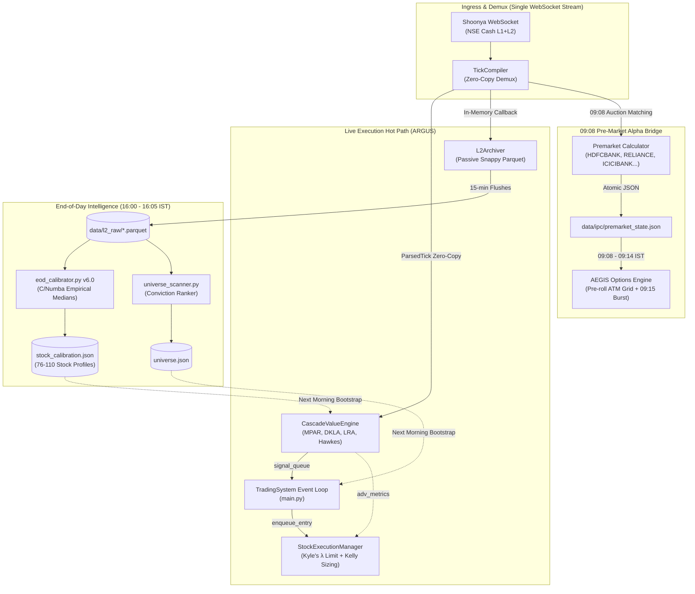

# 🏗️ ARGUS SYSTEM ARCHITECTURE & QUANTITATIVE BLUEPRINT (v3.7)  
**ARGUS — Algorithmic Real-Time Granular Ultra-Microstructure Scalper**  
*Target Audience: AI Agentic Coder (Antigravity, Cursor, Devin) & Quantitative System Engineers*  
*Version: 3.7 "Unified Microstructure Core + 09:08 Pre-Market Alpha Bridge + Reverse-Engineered Empirical EOD Calibrator + Single-Stream WebSocket"*  
*Classification: **Internal — System Architecture Authority***  
*Last Comprehensive Audit & Revision: 2026-08-19*  

---

## 1. SYSTEM OVERVIEW & INFRASTRUCTURE CONSTRAINTS

### 1.1 Infrastructure Profile (Non-Negotiable Production Environment)
| Resource | Specification | Engineering Implication |
| :--- | :--- | :--- |
| **Compute** | Oracle Cloud Free Tier: **1 OCPU (Arm Neoverse N1)**, **1 GB RAM** | **Zero-Allocation Hot Paths Mandatory.** No `list.append()` in tick loops. No heavy DataFrames in live memory. Pre-allocated arrays, object pools, and C/Numba kernels only. |
| **Storage** | ~50 GB NVMe Boot Volume | Partitioned Parquet (Snappy) for raw L2 data. Daily aggregates < 100 KB. Aggressive retention policies (Raw L2: 3-5 days, Agg: 30 days). |
| **Network** | Low-latency VCN, WebSocket (Noren/Shoonya) | Tick-to-Trade execution latency target **< 5 ms**. Historical API batches strictly off-hot-path. |
| **OS** | Ubuntu 22.04 Minimal / Python 3.11+ | Single-process event loops, strict memory caps enforced via PM2. |

### 1.2 Engine Identity & Full Nomenclature
- **Full Form**: **ARGUS** (**A**lgorithmic **R**eal-time **G**ranular **U**ltra-microstructure **S**calper)
- **Core Mission**: Sub-second high-frequency directional equity scalping on Indian Equities (NSE Cash Market), driven by order book level-2 depth dynamics, Hawkes self-excitation processes, Kyle's lambda liquidity pricing, adverse selection probability shields, and automated end-of-day empirical calibration.
- **Companion Engine**: **AEGIS** (**A**utonomous **E**xecution & **G**amma **I**mbalance **S**ystem) — Weekly Index Options Gamma Engine.

### 1.3 Broker Seam Constraints (Shoonya / NorenAPI)
| Constraint | Production Rule |
| :--- | :--- |
| **Weekday-Only Operation** | Shoonya WebSocket drops on Saturdays, Sundays, and NSE holidays. The engine is active Mon-Fri 08:55-15:35 IST. Sat/Sun disconnects are expected and ignored. |
| **Static IP Mandatory** | API credentials are bound to a whitelisted VPS static egress IP (`137.23.41.38`). |
| **Cooperative Session Sharing** | Single credential set across all components. Exactly ONE OAuth login per day (`data/shoonya_session.json` + `shoonya_session.lock`). Peer processes adopt the token without kickbacks. |
| **Single WebSocket Stream per Engine** | ARGUS connects **strictly 1 WebSocket connection** to Shoonya. `TickCompiler` demultiplexes ticks in-memory to both the live `CascadeValueEngine` and the passive `L2Archiver`. No duplicate connections. |
| **5-Level L2 Depth Boundary** | Shoonya provides Touchline (L1) + 5-Level Depth (L2). All microstructure primitives (MPAR, DKLA, LRA, Vacuum) are optimized for manual O(1) 5-level unrolling. |

---

## 2. END-TO-END SYSTEM COMPONENT ARCHITECTURE



---

## 3. THE 09:08 PRE-MARKET IPC ALPHA BRIDGE (ARGUS → AEGIS)

### 3.1 Quantitative Premise
In Indian markets:
- **Cash Market (Equities)**: Pre-open auction session runs from **09:00:00 to 09:08:00 IST**. Order matching and equilibrium price discovery complete between **09:08:00 and 09:12:00 IST**.
- **Derivatives Market (Options)**: Continuous trading begins strictly at **09:15:00 IST** with no pre-open auction.

Top 10 constituent stocks (Reliance, HDFC Bank, ICICI Bank, Infosys, TCS, ITC, L&T, Axis Bank, Kotak Bank, SBI) make up $>65\%$ of NIFTY and SENSEX weight. By capturing the cash auction equilibrium at 09:08 AM, ARGUS extracts the exact directional gap bias and indicative opening index spot 7 minutes before options trading commences.

### 3.2 IPC Bridge Protocol (`common/ipc/premarket_bridge.py`)
1. **Publishing (ARGUS side, 09:08:00–09:14:50 IST)**:
   $$	ext{Weighted Gap \%} = rac{\sum_{i=1}^{N} w_i \cdot 	ext{Gap}_i \%}{\sum_{i=1}^{N} w_i}, \quad 	ext{Gap}_i \% = rac{P_{i,	ext{auction}} - P_{i,	ext{prev\_close}}}{P_{i,	ext{prev\_close}}} 	imes 100$$
   $$	ext{Indicative Spot} = S_{	ext{base}} 	imes \left(1 + rac{	ext{Weighted Gap \%}}{100}
ight)$$
   Published atomically to `data/ipc/premarket_state.json`.

2. **Consumption (AEGIS side, 09:08:00–09:14:55 IST)**:
   - Reads `premarket_state.json`.
   - Realings the 21-strike tensor grid: $	ext{Target ATM} = 	ext{round}(S_{	ext{indicative}} / 	ext{step}) 	imes 	ext{step}$.
   - Calls `_roll_atm_state(shift)` to pre-center all IV, Hawkes, and depth arrays.
   - At **09:15:01 IST**, on the first confirming option tick, triggers the opening momentum trade immediately in paper mode!

---

## 4. REVERSE-ENGINEERED EMPIRICAL EOD CALIBRATOR v6.0 (`ARGUS/eod_calibrator.py`)

### 4.1 From Rigid Grid Search to Pure Empirical Physics
Previous calibration approaches utilized discrete grid search over artificial buckets (`[0.08, 0.12]`, `[0.80, 1.20]`), leading to severe recall collapse ($>95\%$ missed trades on high-beta names like BEL and Canara Bank).

The v6.0 Calibrator applies **C-accelerated reverse engineering**:
1. Ingests all 3-day rolling raw L2 Parquet partitions ($>3,000,000$ ticks).
2. Computes forward 10-minute maximum favorable excursion ($\Delta S_{	ext{up}}$) and adverse excursion ($\Delta S_{	ext{down}}$) using Numba `@njit` kernels:
   $$	ext{Long Breakout Condition}: \Delta S_{	ext{up}} \ge +0.45\% \quad 	ext{and} \quad \Delta S_{	ext{down}} \le 0.20\%$$
   $$	ext{Short Breakout Condition}: \Delta S_{	ext{down}} \ge +0.45\% \quad 	ext{and} \quad \Delta S_{	ext{up}} \le 0.20\%$$
3. Identifies the exact tick of breakout inception and extracts the true continuous **P50 (Median)** and **P75** distributions of:
   - **Hawkes Branching Ratio ($B$)**
   - **Whale Z-Score ($	ext{Whale}_Z$)**
   - **5-Minute Directional Momentum ($	ext{Mom}_{5m}$)**
   - **Order Book Spread & Kyle's Lambda ($\lambda$)**
4. Assigns stock-specific regime classifications (`TRENDING_UP_SURGE`, `TRENDING_DOWN_LIQUIDATION`, `BALANCED_TREND_GRINDER`, `CHOPPY_NOISE_REJECT`).
5. Persists profiles to `ARGUS/stock_calibration.json` in $<12$ seconds.

---

## 5. MICROSTRUCTURE PHYSICS DICTIONARY (THE 11 CORE PRIMITIVES)

| Primitive | Mathematical Formula | Alpha Rationale |
| :--- | :--- | :--- |
| **Microprice (MP)** | $MP = rac{P_{	ext{bid}} \cdot Q_{	ext{ask}} + P_{	ext{ask}} \cdot Q_{	ext{bid}}}{Q_{	ext{bid}} + Q_{	ext{ask}}}$ | True fair value removing bid-ask bounce. |
| **MPAR** | $	ext{Accel} = 	ext{EMA}_{lpha=0.2}\left(rac{d}{dt}	ext{EMA}_{lpha=0.3}\left(rac{d MP}{dt}
ight)
ight)$ | **Highest Alpha**. Detects latent momentum acceleration before visible price change. |
| **DKLA ($\lambda_{	ext{kyle}}$)** | $\lambda = rac{\Delta P}{\Delta 	ext{Vol}} 	imes 	ext{TPIN}, \quad 	ext{Asym} = rac{\lambda_B - \lambda_S}{\lambda_B + \lambda_S}$ | Dynamic Kyle's Lambda measuring price impact per crore notional. |
| **LRA** | $	ext{EMA}_{lpha=0.05}(\Delta Q_{	ext{bid, top2}}) - 	ext{EMA}_{lpha=0.05}(\Delta Q_{	ext{ask, top2}})$ | Liquidity Replenishment Asymmetry. MM intent to support or dump. |
| **Net Vacuum (VAC)** | $	ext{NetVac} = rac{\sum (	ext{Cancelled}_{	ext{ask}} \cdot P) - \sum (	ext{Cancelled}_{	ext{bid}} \cdot P)}{	ext{Depth}_{	ext{avg}}} 	imes 10^4$ | Cancellation pressure (bps). Asks pulled = upward vacuum. |
| **Whale Z-Score** | $Z = rac{\Delta 	ext{Vol} - \mu_{100}}{\sigma_{100}}$ | Detects aggressive institutional block sweeps ($>1.2\sigma$). |
| **Hawkes Branching ($B$)** | $B = 1 - \sqrt{rac{\mu_{	ext{bin}}}{\sigma^2_{	ext{bin}}}}$ (10s bins, 10m window) | Self-excitation ratio. $B > 0.35$ indicates clustered institutional cascades. |
| **MLOFI (L1-L5)** | $	ext{OBI}_{	ext{L5, weighted}} - 	ext{FlowImb}_{	ext{bucket}}$ | Multi-Level Order Flow Imbalance divergence. |
| **Queue Decay** | $rac{d(	ext{QueuePos})}{dt} 	imes rac{	ext{Spread}}{	ext{Mid}} 	imes 10^4$ | Rate of passive queue consumption (bps/sec). |
| **Adverse Selection ($P_{	ext{toxic}}$)**| $\sigma\left(\sum w_i x_i
ight)$ over VPIN, OIB, Spread, DKLA, Whale, Hawkes | Toxic fill probability. $P > 0.60$ vetoes entry. |
| **Kelly Fraction ($f^*$)** | $f^* = rac{p \cdot b - q}{b} 	imes 	ext{RegimeScale}$ | Optimal capital allocation fraction based on ML probability $p$ and win ratio $b$. |

---

## 6. LIVE EXECUTION, GATING & 4-PILLAR EXITS

### 6.1 Entry Sequence (`CascadeValueEngine` → `StockExecutionManager`)
1. **Phase 1: Hard Statistical Gates (Boolean AND)**:
   - $	ext{Tick Count} \ge 	ext{min\_ticks}$ (2 to 4 based on calibration).
   - $	ext{Hawkes Branching} \ge 	ext{opt\_branching}$ (calibrated P50).
   - $	ext{Whale Z-Score} \ge 	ext{opt\_whale\_z}$ (calibrated P50).
   - $	ext{Toxicity} \ge 	ext{P75}$ of rolling toxicity history.
2. **Phase 2: Conviction Scoring (Max 10.5)**:
   - $	ext{Score} = w_{	ext{mpar}} 	ext{MPAR} + w_{	ext{mlofi}} 	ext{MLOFI} + w_{	ext{vac}} 	ext{VAC} + w_{	ext{lra}} 	ext{LRA} + w_{	ext{dkla}} 	ext{DKLA} + w_{	ext{dev}} 	ext{MicroDev}$.
   - Must exceed calibrated threshold (e.g. 5.2 for Balanced, 4.8 for Surge).
3. **Phase 3: Adverse Selection Shield**:
   - Computes $P(	ext{toxic\_fill})$. If $P > 0.60$, signal is vetoed immediately.
4. **Phase 4: Kyle's $\lambda$ Limit Order Generation**:
   $$	ext{Limit Price} = 	ext{Mid} \pm rac{1}{2} \cdot \lambda_{	ext{side}} \cdot 	ext{Notional} \cdot 	ext{ConvictionScaling}$$
   High conviction ($>0.7$) = Maker price inside book. Low conviction ($<0.5$) = Marketable limit.

### 6.2 4-Pillar Dynamic Exit Architecture
The exit brain continuously monitors 4 physical decay pillars:
1. **Pillar 1 (MPAR Momentum Exhaustion)**: Microprice acceleration reverses against trade direction.
2. **Pillar 2 (DKLA Liquidity Wall Formation)**: Opposite side lambda spikes $>2.5	imes$, indicating massive resistance wall.
3. **Pillar 3 (Vacuum Collapse)**: Order cancellations flip to the opposing side.
4. **Pillar 4 (LRA MM Retreat)**: Market maker replenishment velocity drops $>70\%$.
- **Confirmation Layer**: Triggered when 2 or more pillars decay simultaneously OR upon Hawkes branching collapse ($B < 0.10$).
- **Hard Guardrails**: Hard SL ($0.25\%$), Trailing Breakeven Lock ($+0.35\%$ triggers SL to $+0.05\%$), Max Hold Time (12 min), Hard EOD Flatten (15:15 IST).

---

## 7. SINGLE-STREAM WEBSOCKET & ZERO-COPY ENGINEERING

### 7.1 Unified In-Memory Ingestion
To eliminate server resource contention on 1GB RAM instances:
- **WebSocket Ingress**: Exactly 1 WebSocket stream per engine (`ShoonyaAdapter`).
- **Demux & Object Pool**: `TickCompiler` pre-allocates 1,000 `ParsedTick` objects per symbol.
- **In-Memory Callback**: `L2Archiver` registers via `attach_archiver(broker, token_map)`.
- **Zero Duplication**: Engine and Archiver read the same memory buffers. Standalone archiver process eliminated from PM2 `ecosystem.config.js`.

---

## 8. SUMMARY DIRECTORY & FILE MAPPING

```
quant-bot/
├── ARGUS/
│   ├── ARGUS_SYSTEM_ARCHITECTURE.md   # This master architecture authority (v3.7)
│   ├── main.py                        # Orchestrator & TradingSystem event loop
│   ├── tick_compiler.py               # Zero-copy demuxer & object pool
│   ├── execution_manager.py           # Kyle's lambda limit pricing & Kelly sizing
│   ├── l2_archiver.py                 # In-memory passive partitioned Parquet logger
│   ├── eod_calibrator.py              # C/Numba reverse-engineered empirical calibrator v6.0
│   ├── stock_calibration.json         # Stock-by-stock calibrated P50 medians
│   └── cascade/
│       └── value_engine.py            # Microstructure cascade & adverse selection shield
├── AEGIS/                             # Companion Options Engine
│   ├── aegis_main.py                  # AEGIS main orchestrator
│   ├── aegis_gamma_engine.py          # 21-strike dynamic ATM roll & gamma burst detector
│   └── aegis_execution_manager.py     # 09:08 premarket bridge consumer & paper executor
├── common/
│   ├── broker/shoonya_adapter.py      # Cooperative single-session broker seam
│   ├── ipc/premarket_bridge.py        # ARGUS -> AEGIS 09:08 alpha IPC bridge
│   └── symbols.py                     # SUBSCRIPTION_UNIVERSE (110 stocks) & NIFTY100
├── ecosystem.config.js                # PM2 process manager configuration
└── AGENTS.md                          # Repository instructions & rules
```
