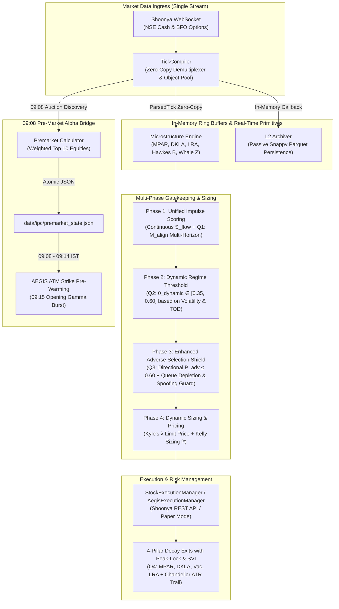

# 🏛️ SYSTEM CONTEXT SPECIFICATION (Single Source of Truth)

**System Name**: Quant-Bot Multi-Engine Microstructure Execution Platform  
**Active Production Engines**: **ARGUS** (HFT Equities) × **AEGIS** (Index Options)  
**Architecture Classification**: Context Engine Architecture (Zero-Allocation Hot Path / In-Memory State)  
**Last Synchronized**: 2026-08-20  

---

## 1. SYSTEM TOPOLOGY & EXECUTION PIPELINE

---

## 2. DIRECTORY & MODULE CONTRACT

| Directory / File | Subsystem | Strict Architectural Responsibilities |
| :--- | :--- | :--- |
| **`ARGUS/`** | Equities Microstructure | High-frequency equity scalper on NSE Cash. Zero-copy `tick_compiler.py`, `cascade/value_engine.py`, `execution_manager.py`, `l2_archiver.py`, and `eod_calibrator.py`. |
| **`AEGIS/`** | Options Gamma Engine | Weekly index options execution engine (NIFTY & SENSEX). Dynamic 21-strike ATM roll (`aegis_gamma_engine.py`), `aegis_execution_manager.py`, and `l2_options_archiver.py`. |
| **`common/`** | Shared Core Library | Single source of truth for broker adapter (`common/broker/`), IPC bridges (`common/ipc/`), market calendar rules (`common/market/`), and symbol universes (`common/symbols.py`). |
| **`unified_dashboard/`** | Monitoring & Telemetry | Live monitoring web console (FastAPI / HTML5) displaying dual-engine telemetry, live PnL, risk state, and microstructure snapshots. |
| **`data/`** | Persistent State & Data | Ephemeral and persistent storage: `data/ipc/` (premarket bridge), `data/l2_raw/` (partitioned Parquet files), `data/shoonya_session.json` (OAuth session). |
| **`tests/`** | Verification Suite | Pytest unit and integration test suite. Required to remain 100% green before any deployment. |

---

## 3. MATHEMATICAL & METRIC INVARIANTS

### 3.1 Zero-Allocation Hot-Path Rules
1. **O(1) Tick Ingestion**: All hot-path tick handlers (`on_tick_parsed`) must execute in **< 50 microseconds** in pure Python.
2. **Zero Object Allocation**: No `dict`, `list`, or `DataFrame` instantiations inside tick loops. State is updated using pre-allocated `numpy` arrays, `__slots__` object pools, or `collections.deque(maxlen=N)`.
3. **No Heavy Imports on Hot Path**: `pandas`, `scipy`, and `sklearn` are strictly prohibited in `value_engine.py`, `tick_compiler.py`, and `aegis_gamma_engine.py` tick handlers. Vectorized libraries are used exclusively in batch EOD calibration.

### 3.2 Microstructure Metric Definitions
- **Microprice ($MP$)**: Volume-weighted fair value removing bid-ask bounce:
  $$MP = \frac{P_{\text{bid}} \cdot Q_{\text{ask}} + P_{\text{ask}} \cdot Q_{\text{bid}}}{Q_{\text{bid}} + Q_{\text{ask}}}$$
- **Microprice Acceleration (MPAR)**: Smoothed second derivative of fair value:
  $$\text{Accel} = \text{EMA}_{\alpha=0.2}\left(\frac{d}{dt}\text{EMA}_{\alpha=0.3}\left(\frac{d MP}{dt}\right)\right)$$
- **Dynamic Kyle's Lambda (DKLA)**: Price impact per unit of order flow:
  $$\lambda = \frac{\Delta P}{\Delta \text{Volume}} \times \text{TPIN}$$
- **Hawkes Self-Excitation Branching Ratio ($B$)**: Quantifies trade arrival clustering:
  $$B = 1 - \sqrt{\frac{\mu_{\text{bin}}}{\sigma^2_{\text{bin}}}}$$
- **Whale Volume Z-Score**: Standardized block volume anomaly detection:
  $$Z = \frac{\Delta \text{Vol} - \mu_{100}}{\sigma_{100}}$$
- **Directional Adverse Selection Shield with Queue Depletion ($P_{\text{adv}}$)**:
  $$P_{\text{adv}} = 0.30 \cdot \text{FlowOpp} + 0.20 \cdot \text{WhaleOpp} + 0.15 \cdot \text{SpreadRisk} + 0.10 \cdot \text{QueueRisk} + 0.10 \cdot \text{BranchRisk} + 0.15 \cdot \text{SpoofRisk}$$
  If $P_{\text{adv}} > 0.60$, signal is immediately vetoed to protect against institutional traps and spoofed liquidity walls.
- **Continuous Multi-Horizon Momentum ($M_{\text{align}}$)**:
  $$M_{\text{align}} = \sigma\left(\sum_{h \in \{10s, 1m, 5m, 15m\}} w_h \cdot \tanh(k_h \cdot \text{Mom}_h \cdot \text{sign})\right)$$
- **Kyle's $\lambda$ Dynamic Limit Price Engine**:
  $$\text{Limit Price} = \text{Mid} \pm \frac{1}{2} \cdot \lambda_{\text{side}} \cdot \text{Notional} \cdot \text{ConvictionScaling}$$

### 3.3 4-Pillar Dynamic Decay Exit System (with SVI & Peak-Lock)
Exits are governed by real-time structural decay across 4 pillars with adaptive thresholds:
1. **Pillar 1 (`MPAR_DECEL`)**: Acceleration drops below adaptive collapse percentage of locked peak magnitude.
2. **Pillar 2 (`DKLA_FLIP`)**: Opposing side impact resistance spikes $>2.5\times$ with adaptive confirmation.
3. **Pillar 3 (`VAC_REVERSAL`)**: Depth cancellation pressure flips against position from locked peak vacuum.
4. **Pillar 4 (`LRA_VEL_FLIP`)**: Replenishment rate drops $>70\%$.
- **Hard Guardrails**: Initial SL at $1.0 \times \text{ATR}$, Trailing Chandelier Stop at $1.2 \times \text{ATR}$, Breakeven Lock at $+0.6 \times \text{ATR}$, Max Hold Time of 15 minutes, and Hard EOD Flatten at 15:15 IST.

---

## 4. BROKER & INFRASTRUCTURE OPERATIONAL BOUNDARIES

1. **Shoonya API Single Session Rule**: Exactly ONE OAuth login per day (`data/shoonya_session.json` + `shoonya_session.lock`). Peer processes adopt the token without server kicks.
2. **Single-Stream Ingress**: Strictly ONE WebSocket connection per engine (`ARGUS` and `AEGIS`). In-memory demuxing distributes ticks to both execution engines and passive L2 archivers.
3. **Trading Calendar Enforcement**:
   - `08:55 IST`: System wakes up and verifies broker credentials.
   - `09:00 - 09:08 IST`: Cash market pre-open auction monitoring.
   - `09:08 - 09:14 IST`: Pre-market alpha bridge broadcasts indicative spot and gap bias.
   - `09:15 - 15:15 IST`: Continuous live trading and microstructure execution.
   - `15:15 IST`: Hard position flatten.
   - `16:00 IST`: EOD reverse-engineered empirical calibration and universe scanning.

---

## 5. AGENT GOVERNANCE & INVARIANT RULES

1. **Decommissioned Component Invariant**: `kronos_bot` is fully decommissioned. Never recreate, import, or reference kronos code in active engines.
2. **Verification Invariant**: All code changes must pass the full pytest suite (`python -m pytest tests\ -q`) with 100% green status prior to deployment.
3. **No Mock / Placeholder Code**: All modules must be completely implemented, strongly typed, and resilient to disk and network faults.
4. **Atomic State Mutation**: Modifying runtime state files (`STATE.json`, `premarket_state.json`) must always use temporary staging files and atomic `os.replace` operations.
