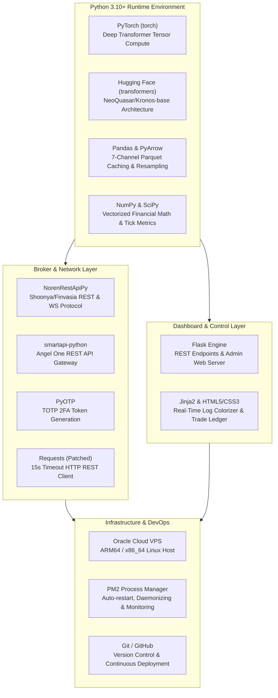
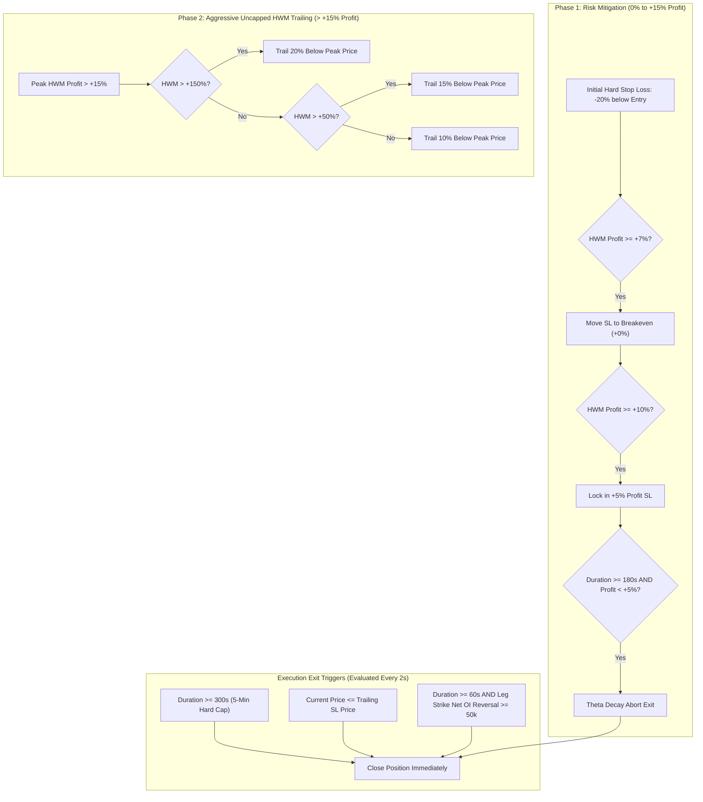

# Comprehensive Systems Architecture Specification
## Kronos Options Trading Bot: Event-Driven Quantitative Options Engine

---

## 1. System Philosophy & Technical Requirements

### 1.1 Mission & Architectural Principles
The **Kronos Options Trading Bot** is an event-driven, low-latency, quantitative options trading system designed to trade Indian index options (NIFTY 50 and BSE SENSEX) on a 5-minute candle resolution. 

The core predictive engine leverages the **Kronos Foundation Model** (`NeoQuasar/Kronos-base`), a deep transformer neural network tailored for financial time-series forecasting. The bot converts multi-channel market data into discrete token sequences, forecasts the immediate next 5-minute candle closing price, and executes directional option buying strategies (CALL / PUT) based on predictive delta thresholds.

The architecture is built around six non-negotiable principles:
1. **Zero-Latency Execution**: Synthetic volume compilation and signal generation execute within sub-millisecond windows upon candle boundary closure.
2. **Low-Resource Efficiency**: Optimized to run continuously within constrained cloud environments (**1 GB RAM**, **4.5 GB Swap** on Oracle Cloud ARM64/x86_64 VPS instances).
3. **Reboot & Fault Resilience**: Full state recovery via disk-backed 7-channel Parquet caches, local SQLite instrument databases, and REST fallback backfilling.
4. **Broker Agnosticism**: Strict decoupled layer boundaries via abstract interfaces (`IBrokerGateway`), allowing seamless switching between brokers (Shoonya / Angel One).
5. **Exact Market Calibration**: Precise adherence to Indian market microstructures (NSE/BSE schedules, lot sizes: NIFTY **65**, SENSEX **20**, tick steps, dynamic constituent volume aggregation, and weekly options expiries).
6. **Regulatory Order Placement Compliance**: Strict adherence to exchange API rules (Marketable Limit Orders with dynamic hybrid buffers for options entry, 2-stage exit routines).

---

## 2. Technology Stack & Component Dependencies

The system relies on a clean, modular Python 3.10+ stack. All direct external dependencies and their functional responsibilities within the architecture are detailed below:



### 2.1 Complete Dependency Matrix

| Library / Module | Primary Architectural Responsibility | Import Usage in Codebase |
| :--- | :--- | :--- |
| **`torch` (PyTorch)** | Tensor compute engine for running forward passes on `Kronos-base` transformer. | `kronos_predictor.py` |
| **`transformers`** | Model architecture definition, weight loading (`AutoModelForCausalLM`), and tokenizer loading. | `kronos_predictor.py` |
| **`pandas`** | 7-channel candle DataFrame manipulation, resample logic, and rolling window slicing. | `data_fetcher.py`, `signals.py`, `strike_selector.py` |
| **`pyarrow`** | High-performance Apache Parquet I/O for `underlying_candles_[INDEX].parquet` storage. | `data_fetcher.py`, `bootstrap_sensex.py` |
| **`numpy`** | Array transformations, logarithmic return calculations, and sliding window arrays. | `kronos_predictor.py`, `data_fetcher.py` |
| **`NorenRestApiPy`** | Native Shoonya (Finvasia) REST API & WebSocket client wrapper (`NorenApi`). | `shoonya_adapter.py`, `shoonya_auth.py` |
| **`smartapi-python`** | Native Angel One API client (`SmartConnect`). | `angel_one_adapter.py` |
| **`pyotp`** | Time-based One-Time Password (TOTP) generation for headless broker authentication. | `shoonya_auth.py`, `angel_one_adapter.py` |
| **`requests`** | HTTP REST transport layer (monkey-patched with mandatory 15s timeout guard). | `shoonya_adapter.py`, `update_constituents.py` |
| **`Flask`** | Lightweight Web Dashboard server running on port `5000`. | `dashboard.py` |
| **`lxml` / `beautifulsoup4`** | HTML scraping of NIFTY 50 and BSE SENSEX constituent stock tables. | `update_constituents.py` |
| **`nsepython`** | Utility queries for NSE index composition metadata. | `update_constituents.py` |

---

## 3. Global Architecture & Layered System Design

The system is organized into four clean, decoupled operational layers plus an isolated Web Dashboard layer:

```mermaid
flowchart TD
    subgraph Layer1["1. Broker Gateway Layer (ShoonyaAdapter / AngelOneAdapter)"]
        GW_OAuth["Session & OAuth Provider<br/>(Session JSON Persistence)"]
        GW_WS["WebSocket Connection Manager<br/>(Auto-reconnect & Tick Stream)"]
        GW_Limiter["TokenBucket Rate Limiters<br/>(15s HTTP Guard & Retries)"]
    end

    subgraph Layer2["2. Data & Feature Engine (DataFetcher)"]
        DF_Const["Constituent Discovery & Scraping<br/>(30 SENSEX / 50 NIFTY Stocks)"]
        DF_Synth["Synthetic Volume Accumulator<br/>(Live Tick LTQ Aggregation)"]
        DF_OI["Option Delta OI Accumulator<br/>(CE & PE Top 15 OTM Strikes)"]
        DF_Parquet["8-Channel Parquet Storage<br/>(underlying_candles_[INDEX].parquet)"]
        DF_EOD["EOD REST Backfill Engine<br/>(15:30 IST Auto-repair)"]
    end

    subgraph Layer3["3. Strategy & Kronos AI Layer (signals.py & KronosPredictor)"]
        K_Model["Kronos Transformer Base<br/>(NeoQuasar/Kronos-base)"]
        K_Token["Kronos Tokenizer<br/>(Discrete Quantization BSQ)"]
        K_Slice["6-Channel Strict Slicer<br/>df[['open','high','low','close','vol','amt']]"]
        S_Gate["False Breakout Gate<br/>(Dynamic 0DTE/1DTE Thresholds & Net Delta OI)"]
    end

    subgraph Layer4["4. Execution & Risk Manager (ExecutionManager)"]
        E_Capital["CapitalEngine<br/>(Live Funds: cash - marginused)"]
        E_Strike["StrikeSelector<br/>(15 OTM Strikes Ladder & Affordability)"]
        E_State["Position Lifecycle State Machine<br/>(300s Hard Cap, Trailing SL/TP, Theta Abort)"]
        E_Order["ShoonyaOrderLifecycle<br/>(Marketable LMT Entry & Order Book Fill Sync)"]
    end

    subgraph Layer5["5. Web Dashboard & Remote Monitoring (dashboard.py)"]
        Dash_Flask["Flask Web Engine<br/>(Port 5000)"]
        Dash_Color["Log Colorizer Engine<br/>(HTML Span Color Rendering)"]
        Dash_Ledger["Trade Performance Ledger<br/>(Real Fill Prices, Realized PnL, Win Rate)"]
    end

    GW_WS -->|Live Stock Ticks| DF_Synth
    GW_WS -->|Live Option Ticks| DF_OI
    GW_OAuth <-->|REST OHLCV & Orders| Layer1
    
    DF_Synth --> DF_Parquet
    DF_OI --> DF_Parquet
    DF_EOD --> DF_Parquet
    
    DF_Parquet -->|Sliding Window 512x8| K_Slice
    K_Slice --> K_Token --> K_Model --> S_Gate
    DF_OI -->|Live Net Delta OI| S_Gate
    
    S_Gate -->|CALL / PUT Signal| E_Strike
    E_Strike --> E_Capital --> E_State -->|Execute Entry (Marketable LMT)| E_Order
    E_Order -->|Order Book Fill Sync| E_State
    
    Layer4 -->|Trade Records| Dash_Ledger
    Layer1 & Layer2 & Layer3 & Layer4 -->|Logs| Dash_Color --> Dash_Flask
```

### 3.1 Layer Responsibilities

| Layer | Primary Responsibilities | Key Components |
| :--- | :--- | :--- |
| **1. Broker Gateway** | Session management, OAuth token renewal, live WebSocket tick ingestion, HTTP request safety monkey-patching, quote caching, live account limits querying (`cash - marginused`). | `ShoonyaAdapter`, `AngelOneAdapter`, `IBrokerGateway` |
| **2. Data & Features** | Constituent tracking, live synthetic volume aggregation, 8-channel parquet sliding window management, pre-market handshake, EOD backfilling, Net Option Delta OI tracking. | `DataFetcher`, `update_constituents.py`, `bootstrap_sensex.py` |
| **3. Prediction & Signals** | Hierarchical time-series tokenization, PyTorch autoregressive transformer inference, percentage change computation, Net Delta OI false breakout filtering. | `KronosPredictor`, `KronosTokenizer`, `signals.py` |
| **4. Execution & Risk** | OTM strike selection (up to 15 OTM strikes), capital allocation, Marketable Limit Order entry execution, order book fill price confirmation, trailing SL, 300s hard-cap exit, theta decay abort. | `ExecutionManager`, `CapitalEngine`, `StrikeSelector`, `ShoonyaOrderLifecycle` |
| **5. Web Dashboard** | Admin web interface (port 5000), real-time log colorizing, live account balance display, historical trade ledger rendering. | `dashboard.py`, Flask server |

---

## 4. Broker Gateway Layer & Broker API Integration

### 4.1 Shoonya (Finvasia / Noren API) Integration & Workarounds

The production broker adapter (`ShoonyaAdapter`) interfaces with Shoonya's REST and WebSocket APIs (`NorenRestApiOAuth`). Due to known SDK limitations and exchange regulatory requirements, the gateway enforces five mandatory features:

#### A. Dual-Session Authentication Sequence
The Shoonya SDK contains a critical authentication segregation bug:
- `set_session()` initializes the WebSocket token (`__access_token`) but leaves REST HTTP headers unpopulated.
- `injectOAuthHeader()` populates HTTP headers for REST requests (`__OAuthHeaders`) but leaves the WebSocket connection unauthenticated.

**Solution**: Both methods are called sequentially in `_restore_or_login()`:
```python
self._api.set_session(self.userid, self.password, self.susertoken, self.susertoken)
self._api.injectOAuthHeader(self.susertoken, self.userid, actid)
```
Session tokens are persisted to `data/shoonya_session.json` to prevent re-triggering headless browser logins upon bot restart.

#### B. 15-Second HTTP Connection Timeout Guard
Shoonya's historical data endpoint (`api.shoonya.com`) can hang indefinitely during off-market hours or high network load. The adapter constructor dynamically monkey-patches `requests.get` and `requests.post`:
```python
def patched_post(*args, **kwargs):
    if 'timeout' not in kwargs:
        kwargs['timeout'] = 15
    return original_post(*args, **kwargs)
```
This guarantees that API requests fail fast and trigger built-in retry mechanisms rather than locking the main event loop thread.

#### C. In-Memory WebSocket Quote Caching (`_live_quotes`)
To avoid exceeding REST rate limits during live trading, `ShoonyaAdapter` implements an in-memory WebSocket quote cache:
1. When `get_quote(exchange, token)` is invoked, it checks if the token is subscribed.
2. If unsubscribed, it registers the token on the WebSocket feed (`subscribe([token], exchange, feed_type='d')`).
3. Touchline updates (`tk`) and depth ticks (`tf`) write the latest trade price (`lp`) into `self._live_quotes[token]`.
4. Subsequent calls return instantly from `self._live_quotes`, delivering **0ms latency** and zero REST API calls.

#### D. Marketable Limit Entry Orders (`price_type="LMT"`)
Indian exchanges (NSE/BSE) have banned raw Market Orders (`price_type="MKT"`) via client APIs for index options trading. `ShoonyaOrderLifecycle.execute_entry()` calculates a **Dynamic Marketable Limit Price** above the Best Ask (`ap1`):

$$\text{Buffer} = \max(\text{Best Ask} \times 0.025, 3.00)$$

$$\text{Raw Limit Price} = \text{Best Ask} + \text{Buffer}$$

$$\text{Marketable Limit Price} = \text{round}\left(\frac{\text{Raw Limit Price}}{0.05}\right) \times 0.05$$

* Entry payload: `buy_or_sell="B"`, `price_type="LMT"`, `price=limit_price`, `product_type="M"` (Margin/NRML on Shoonya), `retention="DAY"`.
* Telemetry log: `INFO - [ENTRY MARKETABLE LIMIT] Best Ask: 27.20 | Buffer: 3.00 | Calculated Entry Limit: 30.20`.

#### E. Order Book Fill Price Confirmation (`avgprc`)
Upon entry or exit order completion (`resp.get("stat") == "Ok"`), `ShoonyaOrderLifecycle` pauses briefly (500ms) and queries Shoonya's order book (`get_order_book()`) to retrieve the exact execution fill price (`avgprc`):
- Entry fill price updates `leg.entry_price` (e.g. **₹27.30**).
- Exit fill price updates `leg.exit_price` (e.g. **₹26.70**).
- `ExecutionManager` computes exact net PnL: `leg.pnl = (exit_price - entry_price) * quantity * lot_size` (e.g. `-₹39.00`).

#### F. Live Account Balance Sync (`cash - marginused`)
Shoonya's `get_limits()` API returns static opening day cash under `cash` (`₹2,092.10`) and tracks intraday realized MTM losses + brokerage under `marginused` (`₹55.18`). 
`ShoonyaPortfolioProvider.get_available_funds()` calculates net available funds as:

$$\text{Available Funds} = \max(0.0, \text{cash} - \text{marginused})$$

This guarantees that `CapitalEngine` and the Web Dashboard display your exact live tradable margin (e.g. **₹2,036.92**) in real time.

---

### 4.2 Dynamic Exchange Routing

The active underlying index alternates depending on the day of the week:

| Day of Week | Active Index | Cash Token | Derivative Segment | Exchange Segment | Constituent Count | Lot Size | Strike Step |
| :--- | :--- | :--- | :--- | :--- | :--- | :---: | :---: |
| **Monday, Tuesday, Friday** | **NIFTY 50** | `26000` | NFO | **NSE** | 50 Stocks | **65** | 50 |
| **Wednesday, Thursday** | **BSE SENSEX** | `1` | BFO | **BSE** | 30 Stocks | **20** | 100 |

---

## 5. Synthetic Volume Engine & Data Pipeline

### 5.1 Replicating TradingView Constituent Volume Aggregation
Cash market indices (NIFTY 50 and BSE SENSEX) do not trade directly on exchange order books, so raw API queries return `volume = 0`. The system implements a **Synthetic Volume Engine** that replicates TradingView's volume aggregation methodology:

$$\text{Synthetic Volume}_{t} = \sum_{i=1}^{N} \Delta v_{i, t}$$

Where $N$ is the number of constituent stocks (50 for NIFTY, 30 for SENSEX), and $\Delta v_{i, t}$ is the tick volume delta for constituent $i$ within 5-minute time bucket $t$.

### 5.2 Strict Candle Boundary Execution Sequence
To guarantee zero latency and prevent race conditions when a 5-minute candle closes (e.g. at `09:25:00`):

1. **STEP A (Compile Volume FIRST)**: Extract and reset the accumulated tick volume delta sum from RAM.
2. **STEP B (Fetch Price SECOND)**: Query broker REST API for the closed 5-minute index price candle (`open, high, low, close`). If `get_index_ltp()` returns `0.0`, automatically fall back to `candle_window[-1]['close']`.
3. **STEP C (Combine & Persist THIRD)**: Compute candle turnover (**Amount**):

$$\text{Typical Price} = \frac{\text{Open} + \text{High} + \text{Low} + \text{Close}}{4}$$

$$\text{Amount (in ₹)} = \text{Typical Price} \times \text{Synthetic Volume}$$

Append `[timestamp, open, high, low, close, volume, amount, delta_oi]` to the active `deque(maxlen=512)` and flush to disk.

---

## 6. Kronos Foundation Model & Prediction Engine

### 6.1 Tokenization & Inference Pipeline
1. **Input Matrix Construction**: Past 512 candles are extracted as a 6-feature matrix: `[open, high, low, close, volume, amount]`.
2. **Discrete Quantization**: `KronosTokenizer` (`NeoQuasar/Kronos-Tokenizer-base`) maps numerical values into discrete token embeddings.
3. **Model Inference**: `KronosPredictor` (`NeoQuasar/Kronos-base`) runs autoregressive forward passes to predict the `close` price of the upcoming 5-minute candle.

### 6.2 Signal Generation & Net Option Delta OI Filter (`signals.py`)

$$\Delta\% = \frac{\text{predicted\_close} - \text{current\_close}}{\text{current\_close}} \times 100$$

1. **Dynamic Expiry Thresholding**:
   - **0DTE Expiry Days (Wed SENSEX / Tue NIFTY)**: Threshold = **$\pm 0.20\%$** ($0.0020$).
   - **1DTE & Normal Days (Mon, Thu, Fri)**: Threshold = **$\pm 0.25\%$** ($0.0025$).
2. **False Breakout Filtering Engine**:
   - **CALL Protection**: If Kronos predicts CALL ($\ge \text{threshold}$) but $\text{Net Option } \Delta OI < 0$ (Call writing dominant), signal is overridden to `NEUTRAL`.
   - **PUT Protection**: If Kronos predicts PUT ($\le -\text{threshold}$) but $\text{Net Option } \Delta OI > 0$ (Put writing dominant), signal is overridden to `NEUTRAL`.
   - **Opening Pass-Through (`Net Option Delta OI == 0`)**: At 09:15 AM opening or when Net Delta OI is 0, signals pass through unblocked to capture opening momentum breakouts.

---

## 7. Execution Manager & Risk Engine

### 7.1 Strike Selection & Expanded OTM Ladder (`StrikeSelector`)

`StrikeSelector` selects option strikes based on available funds and affordability:

1. **Calculate ATM Strike**:
   $$\text{ATM}_{\text{NIFTY}} = \text{round}\left(\frac{\text{Index Price}}{50}\right) \times 50 \quad | \quad \text{ATM}_{\text{SENSEX}} = \text{round}\left(\frac{\text{Index Price}}{100}\right) \times 100$$
2. **Expanded OTM Strike Array**: Generates up to **15 OTM strikes** (`range(-5, 16)`, `max_depth = 25`).
3. **Premium Range Limits**:
   - NIFTY: `NIFTY_PREMIUM_MIN = 15`, `NIFTY_PREMIUM_MAX = 120`
   - SENSEX: `SENSEX_PREMIUM_MIN = 20`, `SENSEX_PREMIUM_MAX = 200`
4. **Low Capital Affordability**: Enables accounts with ~₹2,000 capital to select OTM options priced around ₹20–₹30 (costing ₹1,300–₹1,950 for 1 lot of 65 NIFTY).

### 7.2 2-Phase Dynamic Risk & Trailing Exit Engine



---

## 8. Web Dashboard & Remote Monitoring Layer (`dashboard.py`)

The Web Dashboard operates as an independent Flask administrative server running on port `5000`:

1. **Live Capital Synchronization**: Queries `ShoonyaAdapter.get_available_funds()` (`cash - marginused`) dynamically on every page render and API poll, displaying true tradable margin (e.g. **₹2,036.92**).
2. **Log Colorizer Palette**: Sanitizes log text and applies dynamic CSS highlight spans for `CALL` (green), `PUT` (red), `NEUTRAL` (yellow), `EXECUTED` (bold green), and `ERROR` (bold red).
3. **Trade Performance Ledger**: Persists executed trades in `data/trades/trade_history.json` and renders a live historical table with Entry Time, Exit Time, Option Symbol, Capital Used, Exit Reason, Net PnL, Return %, and Result Badges (`WIN`, `LOSS`, `MIN LOSS`).

---

## 9. Component Interdependency & Blast Radius Matrix

| Modifying Target | Direct System Effect | Cascading Downstream Risks (Blast Radius) | Required Co-Edits / Safeguards |
| :--- | :--- | :--- | :--- |
| **`ShoonyaOrderLifecycle.execute_entry`** | Changes option entry order execution protocol. | Changing `price_type` to `"MKT"` causes exchange rejection (`ALGO_CHK`). Omitting 0.05 tick rounding causes broker validation errors. | Must use Marketable Limit (`price_type="LMT"`), `buy_or_sell="B"`, `product_type="M"`, and 0.05 tick rounding. |
| **`ShoonyaPortfolioProvider.get_available_funds`** | Changes live capital calculation logic. | Returning raw `cash` ignores intraday MTM losses $\rightarrow$ dashboard & `CapitalEngine` over-report available funds. | Must calculate `max(0.0, cash - marginused)`. |
| **`DataFetcher.get_weekly_option_tokens` Strike Range** | Changes number of registered option strikes. | Reducing range below 15 OTM strikes prevents low-capital accounts from finding affordable strikes $\rightarrow$ `Sniper Aborted`. | Keep strike list range `range(-5, 16)` and `max_depth = 25`. |
| **Option Lot Sizes (`settings.py` / `execution_manager.py`)** | Alters contract quantity multiplier. | Setting NIFTY lot size to 25 instead of 65 causes invalid quantity calculation on Shoonya API. | NIFTY lot size must strictly be **65**, SENSEX lot size must strictly be **20**. |

---

## 10. Verification & System Health Checklist

To verify system health after code modifications or server reboots:

1. **PM2 Process Status**:
   ```bash
   pm2 status
   ```
   *Expected*: `astra-bot` and `astra-dashboard` online.

2. **Run Unit & Order Mechanics Test Suite**:
   ```bash
   python astra_bot/scratch/test_oi_reversal_and_order_mechanics.py
   ```
   *Expected*: All unit & regression tests pass 100%.

3. **Verify Dashboard Live State API**:
   ```bash
   python3 -c "import requests; print(requests.get('http://127.0.0.1:5000/api/state').json())"
   ```
   *Expected*: `available_funds` reflects live Shoonya cash minus marginused.


---

## 11. File Structure & Entry Points (CRITICAL FOR AI AGENTS)

> [!WARNING]
> This section is mandatory reading before making any code changes. The project contains multiple files with similar names. Editing the wrong file will have zero effect on the running system.

### PM2 Entry Points (What Actually Runs)
```
ecosystem.config.js specifies:
  astra-bot       → script: "astra_bot/main.py"       ← THE REAL TRADING LOOP
  astra-dashboard → script: "astra_bot/dashboard.py"  ← THE REAL DASHBOARD
```

### Dead / Legacy Files (Do NOT Edit)
| File | Status | Reason |
|---|---|---|
| `astra_bot/core/main.py` | ⚠️ LEGACY | Older Kronos Foundation Model loop. NOT run by PM2. |
| `dashboard.py` (root) | ⚠️ LEGACY | Older simple Flask dashboard. NOT run by PM2. |
| `astra_bot/execution/data_fetcher.py` | ⚠️ VERIFY | May be duplicate of core version. Check imports before editing. |

### Dashboard IPC Architecture
The bot and dashboard are separate OS processes. They communicate via `/dev/shm/live_kdo_state.json` (RAM disk):

```
astra-bot process                       astra-dashboard process
─────────────────────────                ──────────────────────────
main.py every 0.1s tick:                 Flask /api/live_state:
  update_kdo_live_state({                  → reads /dev/shm/live_kdo_state.json
    spot_price, gex_net,                   → returns JSON to browser
    signal_status, chain...
  })
    ↓ writes atomically
  /dev/shm/live_kdo_state.json
```

**Why `main.py` imports from `dashboard`**: `from astra_bot.dashboard import update_kdo_live_state` imports only the helper function, not the Flask app. This creates a module-level dependency that is architecturally backwards but functionally correct.

**Stale dashboard during bot restart**: When the bot is stopped and restarted, `/dev/shm/live_kdo_state.json` retains the last-written values. The dashboard will show stale `spot_price` and `option_chain` for the duration of the restart gap. This is expected behavior. On resume, the first WebSocket tick from token 26000 triggers a write and the dashboard updates immediately.

---

## 12. Known Issues & Technical Debt (Updated 2026-07-28)

| ID | Issue | File | Severity |
|---|---|---|---|
| ISSUE-001 | Hardcoded `DTE=4` in dashboard option chain BSM | `astra_bot/main.py` | 🟠 Medium |
| ISSUE-002 | `_option_oi_start` not initialized in `__init__` | `shoonya_adapter.py` | 🟡 Low-Med |
| ISSUE-003 | Lot sizes hardcoded via symbol string match | `order_lifecycle.py` | 🟡 Low |
| ISSUE-004 | Dashboard has no authentication | `astra_bot/dashboard.py` | 🟡 Low |
| ISSUE-005 | No Telegram/alert notification system | All | 🔵 Design Gap |