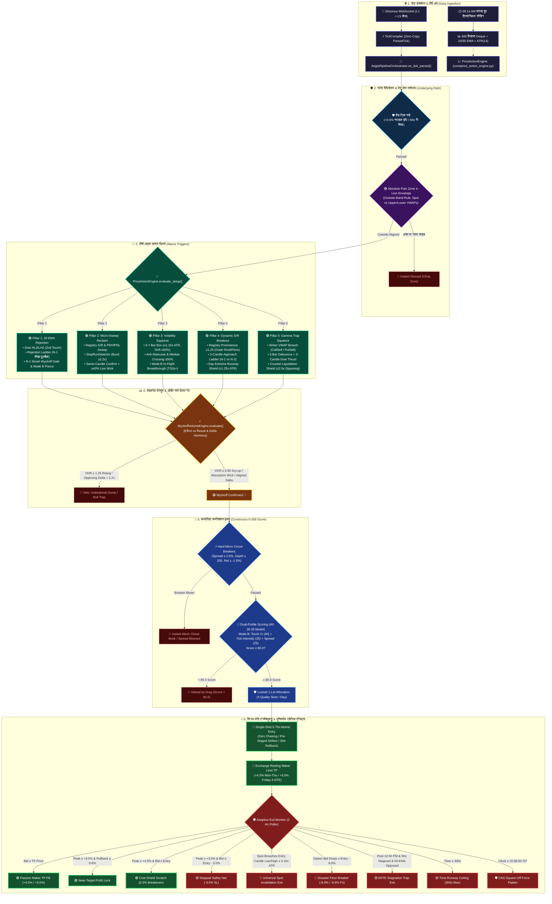

# AEGIS Production v1.0 — 5-Pillars Master Blueprint & Microstructure Specification

> **दस्तावेज़ का उद्देश्य (Document Purpose)**:
> यह मास्टर ब्लूप्रिंट AEGIS Production Version 1.0 (v1.0 Locked) के सभी **5 मैक्रो प्राइस एक्शन पिलर्स (5 Macro Price Action Pillars)**, डेटा इंजेक्शन, वाइकोफ़ वॉल्यूम इंजन, कम्पोज़िट कनविक्शन इंजन (40-35-25 मॉडल) और यूनिवर्सल एडेप्टिव एग्जिट्स का कोड-ग्राउंडेड, संपूर्ण और आधिकारिक संदर्भ (Canonical Single Source of Truth) है।

---

## 🎨 संपूर्ण सिस्टम आर्किटेक्चर फ़्लोचार्ट (Vibrant Multi-Color Mermaid)

---

## 1. 🌐 कॉमन फाउंडेशन (Data Ingestion & Base Filters)

1. **Shoonya WebSocket L1 + L5 Depth**:
   - रीयल-टाइम टिक्स और 5-लेवल ऑर्डर बुक सीधे इन-मेमोरी टिक कंपाइलर (`common/market/tick_compiler.py`) में आते हैं।
   - सुबह **09:14 AM IST** पर 400 बार्स की हिस्टोरिकल सीडिंग से 20 EMA, 50 EMA, ATR(14) और वॉल्यूम SMA पहले से वॉर्म रहते हैं।
2. **बैड-टिक गार्ड (Bad-Tick Guard)**:
   - यदि स्पॉट प्राइस में अचानक $> 0.5\%$ का असंभव स्पाइक आता है, तो टिक ड्रॉप करके 60s के लिए सेफ री-सिंक मोड लागू होता है।
3. **देक्यू सैचुरेशन सेफ्टी (Monotonic Indexing)**:
   - `self.bars_1m` में `maxlen=400` फिक्स्ड है। कभी भी `len(bars_1m)` से कैंडल एज नहीं नापी जाती; हमेशा मोनोटोनिक **`self._total_bars_seen` (`seq_idx`)** या यूनिक्स टाइमस्टैम्प का उपयोग होता है।
4. **Absolute Pain Zone 4-Line Envelope Law (`_pain_zone_vwap_aligned`)**:
   - 4 मुख्य इंस्टीट्यूशनल लाइन्स: `vwap_call_buy`, `vwap_call_sell`, `vwap_put_buy`, `vwap_put_sell`।
   - $\text{Upper Band} = \max(\text{active\_vwaps})$, $\text{Lower Band} = \min(\text{active\_vwaps})$।
   - **आर-पार का कड़ा नियम**:
     - **CALL** $\implies$ $\text{Spot} > \text{Upper Band}$ (पूरी तरह ऊपर)।
     - **PUT** $\implies$ $\text{Spot} < \text{Lower Band}$ (पूरी तरह नीचे)।
     - बैंड के अंदर का ज़ोन न्यूट्रल चॉप ज़ोन माना जाता है और सिग्नल तुरंत डिस्कार्ड होता है।

---

## 2. 🚀 5-Pillars Master Comparison Table

| पिलर & स्ट्रेटेजी | प्राइस एक्शन कोर नियम (PA Rules) | वाइकोफ़ वॉल्यूम & ऑर्डर फ्लो नियम | कनविक्शन & एग्जीक्यूशन मोड |
| :--- | :--- | :--- | :--- |
| **Pillar 1** `20_ema_rejection` *(Dow HL2 / LH2 Reversal)* | 1. **Dow 2nd-Touch Sequence**: $HL_1$ स्किप, $HH_2 > HH_1 + 0.15\text{ATR}$, 4-12 बार पुलबैक। 2. **Rejection Ladder ($N-1$ vs $N-2$)**: • CALL: $High_{N-1} < High_{N-2} \land Low_{N-1} < Low_{N-2}$ • PUT: $High_{N-1} > High_{N-2} \land Low_{N-1} > Low_{N-2}$ 3. **Open-Side Anti-Breakout Veto**: बैंड के पार ओपनिंग ब्लॉक। 4. **Piercing Guard**: लाइव स्पॉट बैंड के पार पियर्स न करे। 5. **Wick Geometry**: विक $\ge 33\%$, क्लोज एज $\ge 0.60$, ऑपोजिट विक $\le 15\%$। | 1. **Swing VDR**: $VDR \le 0.85$ (ड्राई-अप); $VDR \ge 1.25 \implies$ `INSTITUTIONAL_DUMP` वीटो। 2. **Counter-Flow Cap**: $Flow_{counter} \le 1.25\times Flow_{impulse}$। 3. **Opposing Delta Surge**: $PB \le 2.2\times CB$ (CALL पर)। 4. **Delta Flip**: $\Delta_{N-1} \le 0 \to \Delta_N \ge 0$ (CALL)। 5. **N-1 Smart Safe Gate**: $N-1$ पर वॉल्यूम स्पाइक पर स्टॉपिंग एब्जॉर्प्शन विक अनिवार्य। | • **Mode B In-Flight**: $Spot \ge High_{N-1}$ (CALL) या $Spot \le Low_{N-1}$ (PUT) पर $T:02s+$ ट्रिगर। • **Mode A**: $T:50s/T:00s$ बार क्लोज। • **Conviction**: Score $\ge 80.0$ (Mode A/B)। |
| **Pillar 2** `micro_sweep_reclaim` *(Stop-Hunt Liquidity Grab)* | 1. **Registry & Day Extreme Sweep**: केवल रजिस्टर्ड S/R (रूफ/फ्लोर) व PDH/PDL। 2. **Min Sweep Depth**: $\max(1.5, \frac{Spot}{24000}\times 1.5, 0.08\text{ATR})$। 3. **Lunch Chop Veto**: 11:15 से 13:00 IST एंट्री पूर्णतः ब्लॉक। 4. **Reclaim Geometry**: क्लोज लेवल के अंदर, विक $\ge 35\%$, ऑपोजिट विक $\le 15\%$, क्लोज एज $\ge 0.55$, लोअर विक $\ge 1.25\times$ अपर विक। 5. **$\ge 40\%$ Live Wick**: फॉर्मिंग कैंडल पर $\ge 40\%$ विक अनिवार्य। | 1. **Confirmed Sweep Gate**: Burst Ratio $\ge 2.20\times$ + Reclaim Flow $\ge 0.0$। 2. **Same-Candle Sweep Flow**: स्वीप ब्रीच उसी चालू कैंडल के अंदर शुरू होना अनिवार्य। 3. **Opposing Delta Veto**: विरोधी डेल्टा $> 1.5\times$ (वॉल्यूम $\ge 500$) या $> 2.2\times$ होने पर वीटो। 4. **Delta Flip Velocity**: $\Delta_{N-1} \le 0 \to \Delta_N \ge 0$ सपोर्टिव कन्फर्मेशन। | • **Mode B In-Flight**: स्वीप लेवल रिक्लेम और $N-1$ हाई/लो पियर्स पर $T:02s+$ ट्रिगर। • **Mode A**: बार क्लोज रिक्लेम। • **Conviction**: Score $\ge 80.0$। |
| **Pillar 3** `volatility_squeeze_breakout` *(Tight Box Compression)* | 1. **5-7 Bar Box Compression**: बॉक्स रेंज $\le 1.15\times \text{ATR}$, प्रति बार $\le 0.85\times \text{ATR}$। 2. **Directional Drift Cap**: $|Close_{last} - Open_{first}| \le 0.50\times BoxRange$। 3. **Anti-Staircase / Waterfall**: बाउंड्री पहले से टेस्टेड हो; लगातार 3 गिरती/चढ़ती कैंडल्स ब्लॉक। 4. **Median Oscillation**: $\ge 50\%$ बार्स सेंटरलाइन क्रॉस करें। 5. **Anti-Climax Cap**: लाइव ब्रेकआउट बार $\le 1.35\times \text{ATR}$। | 1. **Expansion Velocity**: $Rate_{curr} \ge 1.50\times \overline{Rate}_{box}$ (सर्ज)। 2. **Hard Floor Veto**: $VDR < 0.40 \implies$ `PHANTOM_DRIFT` वीटो। 3. **Delta Imbalance**: $Vol_{dir} \ge 2.0\times Vol_{opposing}$। 4. **Opposing Delta Swamp**: $> 2.2\times$ विरोधी फ्लो पर बुल/बेयर ट्रैप वीटो। 5. **Synthetic Net Delta**: CALL पर $SynthDelta < 0$ वीटो। | • **Priority Mode B**: बॉक्स के अंदर ओपन होकर $T:02s+$ पर $High_{box}$ या $Low_{box}$ पियर्स। • 3-बार डीबाउंस लॉकआउट। • **Conviction**: Mode B Profile Score $\ge 80.0$। |
| **Pillar 4** `sr_breakout` *(Dynamic S/R Breakout)* | 1. **Dynamic S/R Registry**: $Prominence \ge 1.25$, बार एज $\ge 3$ या टाइम एज $\ge 180s$। 2. **Outermost Level Policy**: केवल आउटरमोस्ट रूफ/फ्लोर; इंटीरियर क्लस्टर स्किप। 3. **2-Candle Approach Ladder ($N-1$ vs $N-2$)**: • CALL: $High_{N-1} > High_{N-2} \land Low_{N-1} > Low_{N-2} \land Close_{N-1} > Open_{N-1}$ • PUT: $Low_{N-1} < Low_{N-2} \land High_{N-1} < High_{N-2} \land Close_{N-1} < Open_{N-1}$ 4. **5m Trend Gate**: $Close_{5m} \ge Open_{5m}$ (CALL) / $Close_{5m} \le Open_{5m}$ (PUT)। 5. **Day Extreme Runway**: $\text{Runway} \ge \max(1.25\text{ATR}, 0.0008\text{Spot})$। | 1. **Demand Ignition (VER)**: $VER_{N-1} = \frac{Vol_{N-1}}{\overline{Vol}_{5m}} \ge 1.10\times$ डायरेक्शनल कैंडल के साथ। 2. **Delta Harmony**: विरोधी डेल्टा $> 2.2\times$ होने पर ट्रैप वीटो। 3. **OFI Delta Harmony**: लाइव इन-फ्लाइट डेल्टा दिशा के साथ संरेखित। | • **Priority Mode B**: रजिस्टर्ड रेजिस्टेंस/सपोर्ट को $T:02s+$ पर पियर्स करते ही सिंगल-शॉट एंट्री। • 3-बार डीबाउंस लॉकआउट। • **Conviction**: Mode B Profile Score $\ge 80.0$। |
| **Pillar 5** `gamma_trap_squeeze` *(Trapped Writer Squeeze)* | 1. **Decoupled Writer VWAP Breach**: • CALL: कैंडल $vwap\_call\_sell$ के नीचे खुली और लाइव स्पॉट $> vwap\_call\_sell$ (शॉर्ट कवरिंग पैनिक)। • PUT: कैंडल $vwap\_put\_sell$ के ऊपर खुली और लाइव स्पॉट $< vwap\_put\_sell$ (लॉन्ग लिक्विडेशन पैनिक)। 2. **3-Candle Dow Thrust Ladder**: हायर हाईज व हायर क्लोजेज (CALL) / लोअर लोज व लोअर क्लोजेज (PUT)। 3. **3-Bar Debounce**: $(bar\_idx - last\_trig) \ge 3$। | 1. **Counter-Liquidation Shield**: यदि वॉल्यूम $> 15\times LotSize$, तो $Vol_{PE} \le 2.5\times Vol_{CE}$ (CALL) / $Vol_{CE} \le 2.5\times Vol_{PE}$ (PUT)। अनवाइंडिंग डंप पर वीटो। 2. **OFI Flow Alignment**: लाइव डेल्टा ट्रेड की दिशा में होना अनिवार्य। | • **Priority Mode B**: $T:02s+$ पर राइटर VWAP टूटते ही इंस्टेंट ट्रिगर। • **SL Anchor**: $\min(Low_{N-1}, Low_N) - 0.10\text{ATR}$। • **Conviction**: Mode B Profile Score $\ge 80.0$। |

---

## 3. 🔍 पाँचों पिलर्स का विस्तृत कोड-लेवल विश्लेषण

### 🟢 Pillar 1: Dow HL2 / LH2 Retracement & Reversal (`20_ema_rejection`)
- **कैंडल टाइमिंग & प्रोग्रेशन**:
  - $N-2$ और $N-1$ कैंडल्स 20 EMA की ओर एक तीखी और व्यवस्थित गिरावट (CALL के लिए) बनाती हैं (`_check_rejection_approach_ladder`)।
  - $N-1$ कैंडल 20 EMA हाई-लो बैंड को टेस्ट करती है और इस पर एक रिजेक्शन विक ($\ge 33\%$) बनता है।
  - लाइव कैंडल $N$ में $T:02s+$ पर जैसे ही स्पॉट $N-1$ के हाई ($Spot \ge High_{N-1}$) को क्रॉस करता है, **Priority Mode B In-Flight Reversal Pierce** ट्रिगर होता है।
- **हार्ड गेट्स (Hard Gates)**:
  - `breakout_from_below_open_veto`: 20 EMA बैंड के दूसरी तरफ से ओपन होने वाली कैंडल पर एंट्री ब्लॉक।
  - `live_price_piercing_below_20_ema`: लाइव स्पॉट अगर बैंड के लो से $0.5\times tol\_pts$ ज्यादा नीचे जाता है, तो इनवैलिडेट।
  - `stale_bar_entry_window_expired`: कैंडल क्लोज के $12.0\text{s}$ बाद एंट्री ब्लॉक।
  - `wyckoff_dump_counter_volume_expansion`: $VDR \ge 1.25$ और वॉल्यूम स्लोप पॉजिटिव होने पर इंस्टीट्यूशनल डंप वीटो।
  - `wyckoff_n1_unabsorbed_volume_dump`: $N-1$ पर वॉल्यूम स्पाइक ($\ge 1.25\times$) बिना स्टॉपिंग एब्जॉर्प्शन के होने पर वीटो।

### 🟢 Pillar 2: Stop-Hunt Liquidity Grab (`micro_sweep_reclaim`)
- **कैंडल टाइमिंग & प्रोग्रेशन**:
  - स्वीप कैंडल $N-1$ किसी रजिस्टर्ड सपोर्ट/रेजिस्टेंस या PDH/PDL को कम से कम $min\_sweep\_depth$ गहराई तक तोड़ती है, जिससे रिटेल स्टॉप-लॉस पैनिक में ट्रिगर होते हैं।
  - कैंडल $N-1$ या चालू कैंडल $N$ तुरंत लेवल के वापस अंदर क्लोज/रिक्लेम होती है, जिस पर लंबा एब्जॉर्प्शन विक ($\ge 35\%$) बनता है।
- **हार्ड गेट्स (Hard Gates)**:
  - `lunch_chop_sweep_veto`: 11:15 से 13:00 IST के बीच का स्वीप 100% ब्लॉक।
  - `same_candle_sweep_gate`: `SweepStopRunDetector` का ब्रीच टाइमस्टैम्प चालू कैंडल के स्टार्ट के बाद होना अनिवार्य।
  - `mode_b_p2_wick_gate`: लाइव कैंडल पर कम से कम $40\%$ विक बन चुका होना अनिवार्य (`MODE_B_P2_WICK_MIN_PCT = 0.40`)।
  - `wyckoff_p2_opposing_put_dominance`: विरोधी ऑप्शन डेल्टा $> 1.5\times$ होने पर वीटो।

### 🟢 Pillar 3: Tight Box Compression Breakout (`volatility_squeeze_breakout`)
- **कैंडल टाइमिंग & प्रोग्रेशन**:
  - पिछले 5 से 7 बार्स एक शांत, संकीर्ण बॉक्स ($\le 1.15\times \text{ATR}$) में संकुचित होते हैं।
  - बॉक्स के अंदर का कोई भी बार $0.85\times \text{ATR}$ से बड़ा नहीं हो सकता और कुल नेट ड्रिफ्ट $\le 50\%$ होनी चाहिए।
  - लाइव कैंडल $N$ बॉक्स के अंदर ओपन होकर $T:02s+$ पर $High_{box}$ (CALL) या $Low_{box}$ (PUT) को ब्रेक करती है।
- **हार्ड गेट्स (Hard Gates)**:
  - `consecutive_upward_staircase` / `consecutive_downward_waterfall`: लगातार 3 चढ़ती/गिरती कैंडल्स पर वीटो।
  - `anti_climax_cap`: कैंडल रेंज $> 1.35\times \text{ATR}$ होने पर एग्जॉशन कैप वीटो।
  - `wyckoff_phantom_breakout_no_participation`: $VDR < 0.40$ होने पर बिना वॉल्यूम का झूठा ब्रेकआउट ब्लॉक।
  - `wyckoff_breakout_insufficient_delta_imbalance`: दिशा का वॉल्यूम विरोधी वॉल्यूम के $2.0\times$ से कम होने पर वीटो।

### 🟢 Pillar 4: Dynamic S/R Outermost Breakout (`sr_breakout`)
- **कैंडल टाइमिंग & प्रोग्रेशन**:
  - $N-2$ और $N-1$ कैंडल्स एक साफ 2-कैंडल अप्रोच सीढ़ी (`_check_p4_approach_ladder`) बनाकर रेजिस्टेंस/सपोर्ट के पास पहुँचती हैं।
  - लाइव कैंडल $N$ $T:02s+$ पर लेवल को तोड़ती है और 5-मिनट की चालू कैंडल ट्रेंड के फेवर में होती है।
- **हार्ड गेट्स (Hard Gates)**:
  - `interior_cluster_skip`: क्लस्टर के अंदर फंसे लेवल्स पर ट्रेड नहीं होता; केवल `OUTERMOST_ROOF` और `OUTERMOST_FLOOR` ट्रेड होते हैं।
  - `day_extreme_runway_shield`: यदि लेवल और Day High/PDH के बीच की दूरी $\max(1.25\text{ATR}, 0.0008\text{Spot})$ से कम है, तो वीटो।
  - `wyckoff_breakout_delta_divergence_bear_swamp`: ब्रेकआउट पर विरोधी डेल्टा $> 2.2\times$ होने पर बुल/बेयर ट्रैप वीटो।

### 🟢 Pillar 5: Trapped Option Writer Short-Squeeze (`gamma_trap_squeeze`)
- **कैंडल टाइमिंग & प्रोग्रेशन**:
  - कैंडल राइटर VWAP (`vwap_call_sell` CALL के लिए, `vwap_put_sell` PUT के लिए) के सुरक्षित साइड ओपन होती है और $T:02s+$ पर इसे पियर्स करती है।
  - 3 लगातार कैंडल्स डाउ थ्रस्ट (Higher Highs / Lower Lows) बनाती हैं।
- **हार्ड गेट्स (Hard Gates)**:
  - `p5_debounce_active`: पिछले ट्रिगर से 3 बार्स पूरे होने से पहले दोबारा ट्रिगर ब्लॉक।
  - `p5_counter_liquidation_veto`: यदि एक्टिव ऑप्शन फ्लो $> 15\times LotSize$ है, और विरोधी अनवाइंडिंग फ्लो सपोर्टिंग फ्लो के $2.5\times$ से ज्यादा है, तो वीटो।

---

## 4. 🧠 कम्पोज़िट कनविक्शन इंजन (Continuous 0–100 Microstructure Scoring)

कम्पोज़िट कनविक्शन इंजन (`AEGIS/core/option_order_flow.py`) **40-35-25 मॉडल** पर काम करता है:

1. **Domain 1 (Spot Structure) Retired (0.0 pts)**: स्पॉट स्ट्रक्चर अपस्ट्रीम 100% वेरिफाइड रहता है।
2. **हार्ड सैनिटी सर्किट ब्रेकर्स (तत्काल रिजेक्शन)**:
   - $Spread > 2.5\% \implies$ `circuit_breaker_spread_blowout`
   - $TotalDepth < 200 \implies$ `circuit_breaker_ghost_book`
   - $micro\_ret < -1.5\% \implies$ `circuit_breaker_severe_dump`
   - $Ask \le Bid \implies$ क्रॉस्ड कोट्स तत्काल अबॉर्ट।
3. **Dual-Profile स्कोरिंग**:
   - **Mode B Profile (इन-फ्लाइट $T:02s+$ ब्रेकथ्रू)**:
     - **Touch Aggression $I_1$ (40 pts)**: $I_1 \ge +0.20 \to 40$ pts; $\ge +0.08 \to 34$ pts; $\ge -0.05 \to 28$ pts; $\ge -0.20 \to 16$ pts; $< -0.20 \to 0$ pts (`aggression_drag`)।
     - **Live Tick Intensity (35 pts)**: $Rate \ge 1.5$ ticks/s $\to 35$ pts; $\ge 0.8 \to 28$ pts; $\ge 0.4 \to 22$ pts; $< 0.4 \to 12$ pts (`tick_rate_drag`)।
     - **Spread Tradability (25 pts)**: Spread $\le 0.50\% \to 25$ pts; $\le 1.0\% \to 20$ pts; $\le 1.5\% \to 12$ pts; $\le 2.5\% \to 5$ pts।
   - **Mode A Profile (क्लोज्ड बार $T:50s/T:00s$)**:
     - **Order Book Support & Deep Pressure (40 pts)**: $I_1 \ge 0.15 \land Deep \ge -0.10 \to 40$ pts।
     - **Option Return Velocity `micro_ret` (35 pts)**: $\ge +0.8\% \to 35$ pts; $\ge +0.3\% \to 30$ pts; $\ge -0.1\% \to 25$ pts; $< -0.5\% \to 0$ pts (`momentum_drag`)।
     - **Contract Tradability & Depth (25 pts)**: Spread $\le 1.0\% \to 25$ pts; $\le 1.5\% \to 15$ pts।
4. **हर्डल & लॉट साइज़**:
   - **कुल स्कोर $\ge 80.0$** होने पर ही ट्रेड एडमिट होता है। एडमिटेड ट्रेड्स स्ट्रिक्टली **1 लॉट** से ट्रेड होते हैं।

---

## 5. 🛡️ यूनिवर्सल एग्जिट मैकेनिज्म (Universal Adaptive Exit Discipline)

सभी 5 पिलर्स का एग्जिट मैकेनिज्म `AEGIS/execution/aegis_execution_manager.py` द्वारा 2 Hz पर संचालित होता है:

1. **सिंगल-शॉट 0.75s क्लीन एंट्री**: 0.75s एटॉमिक विंडो, 0 ऑर्डर चेसिंग। रिजेक्शन पर `_rollback_slot()` द्वारा स्लॉट की तत्काल बहाली।
2. **पैसिव रेस्टिंग मेकर टेक-प्रॉफिट**:
   - सोम-गुरु: एंट्री से **`+4.0%`** ऊपर एक्सचेंज रेस्टिंग लिमिट TP (ज़ीरो स्लिपेज मेकर फिल)।
   - शुक्रवार (4 DTE): **`+3.0%`** रेस्टिंग मेकर TP (लो इलास्टिसिटी के अनुकूलित)।
3. **नियर-टारगेट प्रॉफिट लॉक**:
   - पीक गेन $\ge +3.5\%$ (+2.5% शुक्रवार) पर आर्म होता है।
   - पीक से $\ge 0.8\%$ (0.5% शुक्रवार) का पुलबैक आते ही मार्केट एग्जिट से प्रॉफिट लॉक।
4. **स्टेप्ड रिस्क कम्प्रेशन & कॉस्ट-शील्ड स्क्रैच**:
   - **Step 1**: पीक गेन $\ge +3.0\%$ (+2.0% शुक्र) $\implies$ SL टाइट होकर **-3.0%**।
   - **Step 2 (Cost Shield)**: पीक गेन $\ge +3.5\%$ (+2.2% शुक्र) $\implies$ SL परमानेंटली **0.0% (ब्रेकईवन / स्क्रैच)** पर लॉक।
5. **यूनिवर्सल प्योर प्राइस एक्शन स्पॉट इनवैलिडेशन (Universal Spot SL)**:
   $$\text{CALL SL} = \text{Entry Candle Low} - (0.10 \times \text{ATR}_{1m})$$
   $$\text{PUT SL} = \text{Entry Candle High} + (0.10 \times \text{ATR}_{1m})$$
   स्पॉट लेवल टूटने पर तत्काल एग्जिट; जब तक कैंडल इंटैक्ट है, ऑप्शन को सांस लेने का पूरा मौका मिलता है।
6. **डिजास्टर सर्किट ब्रेकर**: ऑप्शन बिड $\le Entry - 8.0\%$ (-6.5% शुक्रवार) पर इमरजेंसी मार्केट स्क्वायर-ऑफ।
7. **0DTE स्टेग्नेशन ट्रैप**: एक्सपायरी के दिन दोपहर 12:30 PM के बाद, 90s होल्ड पर यदि गेन $< +0.5\%$ और 50 EMA ऑपोज्ड हो, तो एग्जिट।
8. **टाइम सीलिंग**: 300 सेकंड्स (5 मिनट्स) मैक्सिमम होल्डिंग रनवे।
9. **15:08:00 IST CAS फोर्स-फ्लैटन**: दोपहर 15:08 IST पर सभी ओपन पोजीशंस को बिना शर्त स्क्वायर-ऑफ किया जाता है ताकि क्लोजिंग ऑक्शन की अनिश्चितता और पेनल्टी से बचा जा सके।
