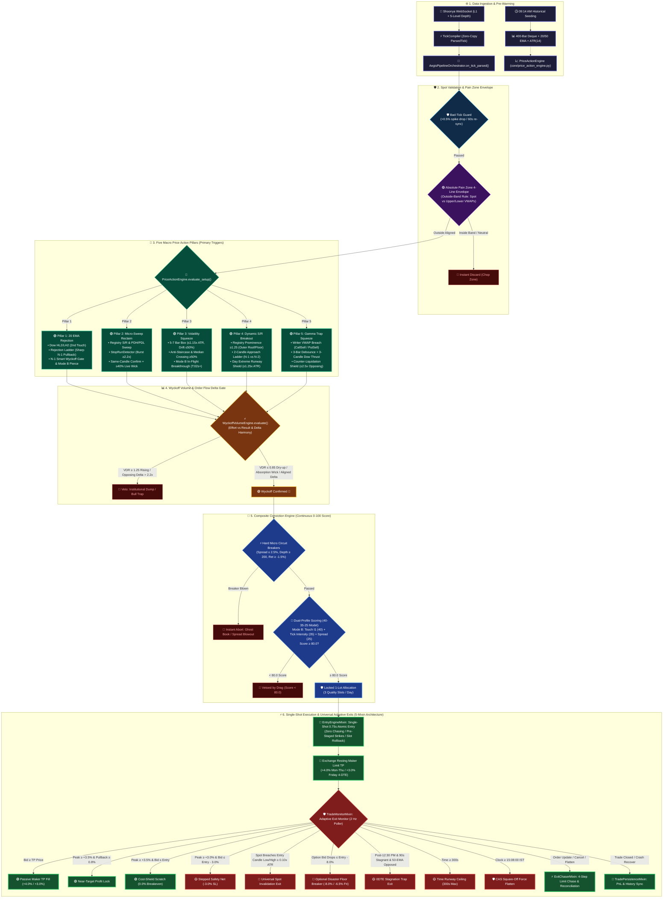

# AEGIS — Autonomous Execution & Gamma Imbalance System (Version 1.0 Production Locked)

**Architecture Authority — Code-Grounded Definitive Specification**  
**Version:** Production 1.0 (v1.0 Production Locked — Priority Mode B In-Flight Mid-Bar Breakthrough Surge [T:02s onwards / No Upper Cap] + 5 Macro Price Action Pillars + Absolute Pain Zone 4-Line VWAP Envelope + Wyckoff Volume & OFI Delta Gate + Single-Shot Clean Entry Mandate [0.75s / No Chasing] + Universal Entry Candle Low/High Invalidation + Friday 4-DTE +3.0% TP Calibration + Zero-Regression 5-Mixin Execution Architecture — Live)  
**Status:** ACTIVE · PM2 `aegis-bot` · `main.py`  
**Host:** Oracle Cloud `opc@137.23.41.38` · `ecosystem.config.js` · `cwd=/home/opc/aegis`  
**Instruments:** NIFTY (Mon [1 DTE], Tue [0 DTE], Fri [4 DTE], NFO, strike step 50, lot 65) · SENSEX (Wed [1 DTE], Thu [0 DTE], BFO, strike step 100, lot 20)  
**Supersedes:** All prior V3.x specifications, draft architecture proposals, and legacy experimental code.

---

## ⚠️ Critical Governance Laws (Core Trading Invariants)

1. **Price Action Primary & Mode B Golden Middle Path Law**:
   - AEGIS operates strictly on a **Macro Price Action Primary Trigger** across 5 canonical pillars governed by **Priority Mode B In-Flight Breakthrough**:
     - **Priority Mode B (In-Flight Breakthrough Surge)**: Mid-bar entry evaluated from **T:02s onwards (no upper cap)** when forming candle pierces pre-mapped boundary (P3 Squeeze Box, P4 Dynamic S/R Registry, P1 20 EMA Reversal Pierce, P2 Micro-Sweep Reclaim Pierce, P5 Trapped Writer VWAP Breach) with single-shot clean execution entering ahead of retail, filling resting +4.0% Maker TP before or as candle closes.
     - **Pillar 1 (`20_ema_rejection`)**: Classical Dow Theory 20 EMA Retracement Engine ($HH_1 \to HL_1 \to HH_2 \to HL_2$). Rejection Approach Ladder (sharp 2-bar pullback into 20 EMA), Candle N-1 Smart Wyckoff Gate, and Mode B in-flight reversal pierce.
     - **Pillar 2 (`micro_sweep_reclaim`)**: Liquidity Sweep & Reclaim across Dynamic S/R Registry & Day Extremes (PDH/PDL). Stop-run detection ($\ge 2.2\times$ burst ratio), Same-or-Prior-Candle Sweep-Flow confirmation, and $\ge 40\%$ live wick requirement.
     - **Pillar 3 (`volatility_squeeze_breakout`)**: 5-7 bar box compression ($\le 1.15\times \text{ATR}_{1m}$, drift $\le 50\%$, anti-staircase/waterfall, median oscillation $\ge 50\%$), anti-climax cap ($\le 1.35\times \text{ATR}_{1m}$), and expansion breakout.
     - **Pillar 4 (`sr_breakout` / `topological_prominence_breakout`)**: Outermost Roof/Floor Dynamic S/R Registry Breakout ($Prominence \ge 1.25$, age $\ge 3$ bars / $180\text{s}$), Strict 2-Candle Approach Ladder ($N-1$ vs $N-2$), 5m trend alignment, and Day Extreme Runway Shield.
     - **Pillar 5 (`gamma_trap_squeeze`)**: Trapped Option Writer Short-Squeeze Engine. Decoupled Corridors: CALL breaks above `vwap_call_sell` (Call writers trapped $\to$ short covering); PUT breaks below `vwap_put_sell` (Put writers trapped $\to$ liquidation). 3-bar debounce and 3-candle Dow Thrust progression.
2. **Absolute Pain Zone 4-Line Envelope Law (`_pain_zone_vwap_aligned`)**:
   - Evaluates the 4 core option-flow VWAP lines: `vwap_call_buy`, `vwap_call_sell`, `vwap_put_buy`, `vwap_put_sell`.
   - $\text{Upper Band} = \max(\text{active\_vwaps})$, $\text{Lower Band} = \min(\text{active\_vwaps})$.
   - **Strict Outside-Band Rule (आर-पार का नियम)**:
     - Spot **ABOVE** Upper Band $\implies$ **ONLY CALL** trades allowed.
     - Spot **BELOW** Lower Band $\implies$ **ONLY PUT** trades allowed.
     - Spot **INSIDE** Band $\implies$ Neutral chop zone (strictly discarded, no trade).
3. **Wyckoff Volume & Order Flow Delta Parallel Law**:
   - Immediately following a Price Action setup trigger, the trade MUST pass `WyckoffVolumeEngine` (`core/wyckoff_volume_engine.py`):
     - **Effort vs Result**: High volume spent with zero price displacement at S/R confirms institutional absorption.
     - **Volume Dry-Up Ratio (VDR)**: For Pillar 1 pullbacks, approach candles must show supply drying up ($VDR \le 0.85$, decaying slope). Counter-trend expanding volume ($VDR \ge 1.25$ rising) is classified as an **Institutional Liquidation Dump** and vetoed immediately.
     - **Delta Harmony**: On breakouts (P3/P4/P5/Mode B), directional option aggressors must dominate. Opposing delta swamping ($> 2.2\times$ opposing flow, $> 500$ vol) is classified as a **Bull/Bear Trap** and vetoed.
     - **In-Flight Option Delta Fast-Path**: Mode B intra-bar setups evaluate live in-flight option delta (`_opt_flow_1m`) directly, ensuring real institutional aggression without stale bar-close delay.
4. **Fixed Sizing & Maker TP Discipline Law**:
   - Position sizing is strictly locked to **1 Lot** (no dynamic multi-lot scaling).
   - Take-Profit is strictly locked to **+4.0% Resting Maker Limit** for Monday–Thursday.
   - **Friday (4 DTE) Calibrated TP**: Due to $5\times$ Option Elasticity ($\Omega$) drop on 4 DTE, Friday resting limit TP is calibrated to **`+3.0%`**, with Near-Target Profit Lock at **`+2.5%`** and Breakeven shift at **`+2.2%`**.
5. **Single-Shot Clean Entry & Zero Chasing Mandate**:
   - Limit orders receive an atomic **0.75-second fill window**. If unconfirmed or rejected, the order is cancelled immediately.
   - Never modify or chase orders (100% win-rate on clean first-attempt fills vs 0.0% on chased orders).
   - Immediate queue draining (`_drain_signal_queue`) purges pending signals upon any failure.
   - Pre-Trade Abort Slot Rollback: If an order aborts prior to fill, `_rollback_slot()` immediately restores the daily trade slot.
6. **Universal Structural Invalidation Law**:
   - Universal Spot Invalidation across ALL 5 Pillars and Mode B:
     $$\text{CALL SL} = \text{Entry Candle Low} - (0.10 \times \text{ATR}_{1m})$$
     $$\text{PUT SL} = \text{Entry Candle High} + (0.10 \times \text{ATR}_{1m})$$
   - Evaluated strictly against cash index spot price, fully immunizing trades from option spread flutter, IV crush, and spoofing.
7. **Composite Conviction Continuous Scoring Law ($\ge 75.0$ in-flight / $\ge 80.0$ bar-close)**:
   - Continuous 0–100 dual-profile microstructure scoring (`core/option_order_flow.py`).
   - Zero-Entropy domain model (upstream spot structure retired to 0.0 pts as it is 100% verified by PriceActionEngine).
   - **Mode B Profile** — pillar-aware: Pillars 1/3/4/5 (Touch Aggression $I_1$ 40, Live Tick Arrival 35, Spread Tradability 25, impulse $\ge +0.20\%$); Pillar 2 Reclaim (Touch Aggression $I_1$ 45, Live Tick Arrival 30, Spread Tradability 25, impulse $\ge -0.10\%$).
   - **Wyckoff contributes 0 pts in Mode B** (telemetry only) — it already reads the same option-flow ledger, so scoring it again would double-count one data source.
   - Hard Circuit Breakers: Spread $> 2.5\%$, Total Depth $< 200$, 30s Dump $< -1.5\%$. Score below the profile floor is vetoed with an itemized drag audit.
8. **Option Corridor & Book Quality Law**:
   - Option flow is aggregated strictly inside **ATM ± 5 strikes** ($5.0 \times$ `strike_step`, 11-strike core) so OTM 4-5 institutional positioning still feeds the Pain Zone VWAPs.
   - L2 depth is only accepted if it is at most **2.0s** older than the latest tick — a stale book is never paired with a fresh LTP.
   - `OptionQualityEngine` enforces a **two-sided** depth floor: total top-5 depth $\ge \max(\text{configured}, 5 \times \text{lot})$ **and** $\min(\text{bid side}, \text{ask side}) \ge \max(2 \times \text{lot}, 25)$, closing the one-sided book slippage trap.
9. **Pure Mode B Enforcement & Complete Mode A Decommission Law**:
   - Live trading fires 100% from **Priority Mode B Live Breakout**. Legacy Mode A has been permanently decommissioned (Nov 14, 2026 audit), removing ~1,500 lines of dead ladders and dual-state cruft.
   - Option-flow delta uses the **4-leg** convention $(call\_buy + put\_sell) - (put\_buy + call\_sell)$ everywhere.
10. **Scale-Invariance Law**:
   - NEVER hardcode fixed point thresholds across NIFTY (24k) and SENSEX (80k). All spot distances, invalidations, stops, and confirmations MUST be normalized via **Basis Points (bps, where 1 bps = 0.01% of spot)** or localized volatility multiples ($k \times \text{ATR}_{1m}$).
11. **Session Force-Flatten Law**:
   - All open positions unconditionally liquidated at **15:08:00 IST** (`AEGIS_FORCE_FLATTEN = 15:08`) to eliminate NSE Closing Auction (CAS) volatility and broker auto-square-off penalization.
12. **Zero-Regression Mixin Execution Architecture Law**:
   - `execution/execution_manager.py` is decomposed into 5 cohesive modules using the **Mixin pattern** (`EntryEngineMixin`, `TradeMonitorMixin`, `ExitChaserMixin`, `TradePersistenceMixin`, `QualitySlotPolicy` / risk constants).
   - The central orchestrator retains exact class identity, lock semantics, monkeypatch compliance, and 100% backward compatibility.

---

## Master Architecture Flowchart (Vibrant Multi-Color Mermaid)

---

## Directory & Subsystem Inventory (Audited 14 November 2026)

| Module Path | LOC | Semantic Responsibility |
|---|:---:|---|
| `core/price_action_engine.py` | **1,972** | **Primary Macro Trigger**: 1m/5m/15m OHLC bar aggregation, 5 active pillars (P1 20 EMA, P2 Micro-Sweep Reclaim, P3 Vol Squeeze, P4 S/R Breakout, P5 Gamma Trap Writer Squeeze), and Priority Mode B In-Flight Breakthrough (`check_mode_b_breakthrough`). |
| `core/pipeline_orchestrator.py` | **1,888** | **Central Pipeline Brain**: Master L2 tick router, 6-gate synchronization, 3-strike budget cluster pre-staging, and signal queue dispatch. |
| `core/structural_registry.py` | **1,042** | **Dynamic S/R Level Registry**: Monotonic `seq_idx` tracking, 5m candle clustering, role classification (`OUTERMOST_ROOF`, `OUTERMOST_FLOOR`, `INTERIOR_CLUSTER`), and multi-touch prominence boost. |
| `core/option_order_flow.py` | **1,010** | **Option Microstructure & Conviction Gatekeeper**: ATM $\pm 5$ strikes tape reading, OFI delta flow, Absolute Pain Zone VWAP envelope, and continuous 0–100 dual-profile conviction scoring (`CompositeConvictionEngine`, 40-35-25 model, $\ge 80.0$). |
| `core/shadow_boundary_observer.py` | **927** | **Shadow Telemetry**: Zero-capital empirical paper-trader tracking Pain Zone and 200 EMA breakout/rejection analytics. |
| `core/sweep_stop_run_detector.py` | **697** | **Sweep & Stop-Run Detector**: Live microstructure stop-loss burst ($\ge 2.2\times$) and absorption formula. |
| `core/outcome_telemetry.py` | **691** | **Trade Telemetry**: Signal logging, slippage, latency, and JSONL outcome recording. |
| `core/dow_macro_shields.py` | **633** | **Dow Theory & Macro Obstacle Shields**: 4-point HL2/LH2 sequence, 20 EMA High/Low bands, and scale-invariant Day Extreme Runway Shield (`min_runway_pts = max(1.25 * ATR_1m, 0.0008 * Spot)`). |
| `core/gex_engine.py` | **593** | **Gamma Exposure Engine**: Net market maker gamma positioning, zero gamma levels, and proximity. |
| `core/wyckoff_volume_engine.py` | **442** | **Wyckoff Volume & Delta Gate**: Effort vs Result, Volume Dry-Up Ratio (VDR), Absorption pin wick, Delta Harmony (Call Buy vs Put Buy), and Candle N-1 smart protection. |
| `execution/entry_engine.py` | **959** | **Signal Intake & Entry Execution (`EntryEngineMixin`)**: `_process_aegis_signal`, strike budget targets refresh, admission gates, maker TP placement, and slot rollback. |
| `execution/exit_chaser.py` | **923** | **Exit Chaser & Reconciliation (`ExitChaserMixin`)**: 4-step limit exit chasing, order updates, fill polling, TP cancellation, broker net position reconciliation, and emergency flatten. |
| `execution/trade_monitor.py` | **817** | **Trade Lifecycle Monitor (`TradeMonitorMixin`)**: Live tick management, dynamic noise floor, realized delta, 0DTE time stop, and Universal Spot Invalidation SL. |
| `execution/trade_persistence.py` | **567** | **State & Context Persistence (`TradePersistenceMixin`)**: Daily state, PnL tallying, NSE charges, trade history JSON, and crash-recovery active context saving/loading. |
| `execution/execution_manager.py` | **409** | **Slim Orchestrator (`AegisExecutionManager`)**: Composes the 4 Mixins, manages `__init__`, main loop thread (`_run_loop`), L1 book query (`_latest_option_book`), and re-exports risk constants. |
| `execution/slot_and_risk_constants.py` | **239** | **Slot Policy & Quantitative Risk Constants**: `QualitySlotPolicy`, `PostTriggerStabilityTracker`, and scale-invariant normalized risk parameters. |
| `broker/shoonya_adapter.py` | **1,106** | **Broker Seam**: Shoonya API adapter, WebSocket tick stream, order execution, and account sync. |
| `market/tick_compiler.py` | **382** | **Tick Compiler**: Zero-copy tick parsing into 1m/5m OHLC bars. |
| `main.py` | **822** | **Process Orchestrator**: PM2 entry point, 09:14 AM seeding, ATM shift, and WebSocket reconnect management. |
| `backtest.py` | **882** | **Backtest Simulator**: Replays recorded tick and OHLC bars against the full 5-pillar pipeline. |

---

## Universal Execution & Adaptive Exit Discipline (`execution/execution_manager.py`)

Monitored at 2 Hz by `_manage_open_trade()` in `execution/trade_monitor.py`:

1. **Strict 1-Lot Fixed Allocation**: Every admitted trade executes strictly with **1 Lot**.
2. **Passive Resting Maker TP Exit**:
   - **+4.0%** Limit Order on exchange order book for Monday–Thursday.
   - **+3.0%** Limit Order for Friday (4 DTE). Zero slippage maker fill.
3. **Near-Target Profit Lock**:
   - Arms when peak bid reaches $\ge +3.5\%$ (Friday: $+2.5\%$).
   - If price pulls back $\ge 0.8\%$ (Friday: $0.5\%$) from peak, instant market exit locks profit.
4. **Stepped Risk Compression & Cost-Shield Scratch Engine**:
   - **Step 1 (Stepped Safety Net)**: When peak gain reaches $\ge +3.0\%$ (Friday: $+2.0\%$), SL is compressed to **-3.0%**.
   - **Step 2 (Cost-Shield Scratch)**: When peak gain reaches $\ge +3.5\%$ (Friday: $+2.2\%$), SL is locked to **0.0% (Entry Price / Breakeven)**.
5. **Universal Pure Price Action Spot Invalidation**:
   - Evaluated strictly against cash index spot price:
     $$\text{CALL SL} = \text{Entry Candle Low} - (0.10 \times \text{ATR}_{1m})$$
     $$\text{PUT SL} = \text{Entry Candle High} + (0.10 \times \text{ATR}_{1m})$$
6. **Tick-Cadence Option Premium Disaster Circuit Breaker (DECOMMISSIONED, Nov 12 2026)**:
   - Permanently OFF by default (`AEGIS_ENABLE_PREMIUM_DISASTER_FLOOR = "0"`). 0-DTE option bid wiggles/spreads caused fake shakeouts while spot was 100% safe.
   - Retained only as an optional env-flag-gated emergency breaker (Entry - 8.0%, -6.5% Friday) for explicit operator override.
7. **0DTE Stagnation Trap**:
   - After 12:30 PM on expiry days: If held $\ge 90\text{s}$, gain $< +0.5\%$, and 50 EMA is opposed $\implies$ instant stagnation exit.
8. **Time Ceiling**:
   - 300 seconds (5 minutes) maximum holding runway.
9. **15:08:00 IST CAS Force Flatten**:
   - Unconditional square-off at **15:08:00 IST** to avoid NSE Closing Auction volatility and broker penalty fees.
