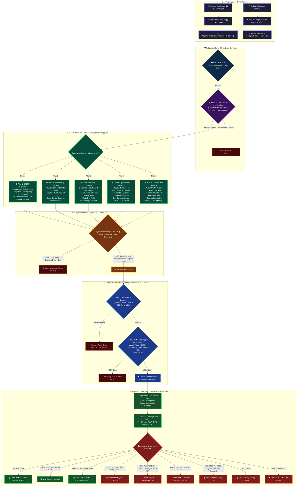

# AEGIS — Autonomous Execution & Gamma Imbalance System (Version 1.0 Production Locked)

**Architecture Authority — Code-Grounded Definitive Specification**  
**Version:** Production 1.0 (v1.0 Production Locked — Priority Mode B In-Flight Mid-Bar Breakthrough Surge [T:02s onwards / No Upper Cap] + 5 Macro Price Action Pillars + Absolute Pain Zone 4-Line VWAP Envelope + Wyckoff Volume & OFI Delta Gate + Single-Shot Clean Entry Mandate [0.75s / No Chasing] + Universal Entry Candle Low/High Invalidation + Friday 4-DTE +3.0% TP Calibration — Live)  
**Status:** ACTIVE · PM2 `aegis-bot` · `AEGIS/aegis_main.py:87`  
**Host:** Oracle Cloud `opc@137.23.41.38` · `ecosystem.config.js:3` · `cwd=/home/opc`  
**Instruments:** NIFTY (Mon [1 DTE], Tue [0 DTE], Fri [4 DTE], NFO, strike step 50, lot 65) · SENSEX (Wed [1 DTE], Thu [0 DTE], BFO, strike step 100, lot 20)  
**Supersedes:** All prior V3.x specifications, draft architecture proposals, and legacy experimental code.

---

## ⚠️ Critical Governance Laws (Core Trading Invariants)

1. **Price Action Primary & Mode B Golden Middle Path Law**:
   - AEGIS operates strictly on a **Macro Price Action Primary Trigger** across 5 canonical pillars governed by **Priority Mode B In-Flight Breakthrough**:
     - **Priority Mode B (In-Flight Breakthrough Surge)**: Mid-bar entry evaluated from **T:02s onwards (no upper cap)** when forming candle pierces pre-mapped boundary (P3 Squeeze Box, P4 Dynamic S/R Registry, P1 20 EMA Reversal Pierce, P2 Micro-Sweep Reclaim Pierce, P5 Trapped Writer VWAP Breach) with single-shot clean execution entering ahead of retail, filling resting +4.0% Maker TP before or as candle closes.
     - **Pillar 1 (`20_ema_rejection`)**: Classical Dow Theory 20 EMA Retracement Engine ($HH_1 \to HL_1 \to HH_2 \to HL_2$). Rejection Approach Ladder (sharp 2-bar pullback into 20 EMA), Candle N-1 Smart Wyckoff Gate, and Mode B in-flight reversal pierce.
     - **Pillar 2 (`micro_sweep_reclaim`)**: Liquidity Sweep & Reclaim across Dynamic S/R Registry & Day Extremes (PDH/PDL). Stop-run detection ($\ge 2.2\times$ burst ratio), Same-or-Prior-Candle Sweep-Flow confirmation, and $\ge 40\%$ live wick requirement.
     - **Pillar 3 (`volatility_squeeze_breakout`)**: 5-7 bar box compression ($\le 1.15\times \text{ATR}_{1m}$, drift $\le 50\%$, anti-staircase/waterfall, median oscillation $\ge 50\%$), anti-climax cap ($\le 1.35\times \text{ATR}_{1m}$), and expansion breakout.
     - **Pillar 4 (`sr_breakout` / `topological_prominence_breakout`)**: Outermost Roof/Floor Dynamic S/R Registry Breakout ($Prominence \ge 1.25$, age $\ge 3$ bars / $180\text{s}$), Strict 2-Candle Approach Ladder ($N-1$ vs $N-2$), 5m trend alignment, and Day Extreme Runway Shield.
     - **Pillar 5 (`gamma_trap_squeeze`)**: Trapped Option Writer Short-Squeeze Engine. Decoupled Corridors: CALL breaks above `vwap_call_sell` (Call writers trapped $\to$ short covering); PUT breaks below `vwap_put_sell` (Put writers trapped $\to$ liquidation). 3-bar debounce and 3-candle Dow Thrust progression.
2. **Absolute Pain Zone 4-Line Envelope Law (`_pain_zone_vwap_aligned`)**:
   - Evaluates the 4 core option-flow VWAP lines: `vwap_call_buy`, `vwap_call_sell`, `vwap_put_buy`, `vwap_put_sell`.
   - $\text{Upper Band} = \max(\text{active\_vwaps})$, $\text{Lower Band} = \min(\text{active\_vwaps})$.
   - **Strict Outside-Band Rule (आर-पार का नियम)**:
     - Spot **ABOVE** Upper Band $\implies$ **ONLY CALL** trades allowed.
     - Spot **BELOW** Lower Band $\implies$ **ONLY PUT** trades allowed.
     - Spot **INSIDE** Band $\implies$ Neutral chop zone (strictly discarded, no trade).
3. **Wyckoff Volume & Order Flow Delta Parallel Law**:
   - Immediately following a Price Action setup trigger, the trade MUST pass `WyckoffVolumeEngine` (`AEGIS/core/wyckoff_volume_engine.py`):
     - **Effort vs Result**: High volume spent with zero price displacement at S/R confirms institutional absorption.
     - **Volume Dry-Up Ratio (VDR)**: For Pillar 1 pullbacks, approach candles must show supply drying up ($VDR \le 0.85$, decaying slope). Counter-trend expanding volume ($VDR \ge 1.25$ rising) is classified as an **Institutional Liquidation Dump** and vetoed immediately.
     - **Delta Harmony**: On breakouts (P3/P4/P5/Mode B), directional option aggressors must dominate. Opposing delta swamping ($> 2.2\times$ opposing flow, $> 500$ vol) is classified as a **Bull/Bear Trap** and vetoed.
     - **In-Flight Option Delta Fast-Path**: Mode B intra-bar setups evaluate live in-flight option delta (`_opt_flow_1m`) directly, ensuring real institutional aggression without stale bar-close delay.
4. **Fixed Sizing & Maker TP Discipline Law**:
   - Position sizing is strictly locked to **1 Lot** (no dynamic multi-lot scaling).
   - Take-Profit is strictly locked to **+4.0% Resting Maker Limit** for Monday–Thursday.
   - **Friday (4 DTE) Calibrated TP**: Due to $5\times$ Option Elasticity ($\Omega$) drop on 4 DTE, Friday resting limit TP is calibrated to **`+3.0%`**, with Near-Target Profit Lock at **`+2.5%`** and Breakeven shift at **`+2.2%`**.
5. **Single-Shot Clean Entry & Zero Chasing Mandate**:
   - Limit orders receive an atomic **0.75-second fill window**. If unconfirmed or rejected, the order is cancelled immediately.
   - Never modify or chase orders (100% win-rate on clean first-attempt fills vs 0.0% on chased orders).
   - Immediate queue draining (`_drain_signal_queue`) purges pending signals upon any failure.
   - Pre-Trade Abort Slot Rollback: If an order aborts prior to fill, `_rollback_slot()` immediately restores the daily trade slot.
6. **Universal Structural Invalidation Law**:
   - Universal Spot Invalidation across ALL 5 Pillars and Mode B:
     $$\text{CALL SL} = \text{Entry Candle Low} - (0.10 \times \text{ATR}_{1m})$$
     $$\text{PUT SL} = \text{Entry Candle High} + (0.10 \times \text{ATR}_{1m})$$
   - Evaluated strictly against cash index spot price, fully immunizing trades from option spread flutter, IV crush, and spoofing.
7. **Composite Conviction Continuous Scoring Law ($\ge 80.0$)**:
   - Continuous 0–100 dual-profile microstructure scoring (`AEGIS/core/option_order_flow.py`).
   - Zero-Entropy 40-35-25 model (upstream spot structure retired to 0.0 pts as it is 100% verified by PriceActionEngine).
   - **Mode B Profile** (Touch Aggression $I_1$ 40 pts, Live Tick Arrival Intensity 35 pts, Spread Tradability 25 pts).
   - **Mode A Profile** (Order Book Support & Deep Pressure 40 pts, 30s Option Return Velocity 35 pts, Contract Tradability & Depth 25 pts).
   - Hard Circuit Breakers: Spread $> 2.5\%$, Total Depth $< 200$, 30s Dump $< -1.5\%$. Score $< 80.0$ is vetoed with itemized drag audit.
8. **Scale-Invariance Law**:
   - NEVER hardcode fixed point thresholds across NIFTY (24k) and SENSEX (80k). All spot distances, invalidations, stops, and confirmations MUST be normalized via **Basis Points (bps, where 1 bps = 0.01% of spot)** or localized volatility multiples ($k \times \text{ATR}_{1m}$).
9. **Session Force-Flatten Law**:
   - All open positions unconditionally liquidated at **15:08:00 IST** (`AEGIS_FORCE_FLATTEN = 15:08`) to eliminate NSE Closing Auction (CAS) volatility and broker auto-square-off penalization.

---

## Master Architecture Flowchart (Vibrant Multi-Color Mermaid)

---

## Directory & Subsystem Inventory (Audited)

| Module Path | LOC | Semantic Responsibility |
|---|:---:|---|
| `AEGIS/core/price_action_engine.py` | **2,749** | **Primary Macro Trigger**: 1m/5m/15m OHLC bar aggregation, 5 active pillars (P1 20 EMA, P2 Micro-Sweep Reclaim, P3 Vol Squeeze, P4 S/R Breakout, P5 Gamma Trap Trapped Writer Squeeze), and Priority Mode B In-Flight Breakthrough (`check_mode_b_breakthrough`). |
| `AEGIS/core/aegis_pipeline_orchestrator.py` | **1,926** | **Central Pipeline Brain**: Master L2 tick router, 6-gate synchronization, 3-strike budget cluster pre-staging, and signal queue dispatch. |
| `AEGIS/core/option_order_flow.py` | **1,300** | **Option Microstructure & Conviction Gatekeeper**: ATM $\pm 25$ strikes tape reading, OFI delta flow, Absolute Pain Zone VWAP envelope, and continuous 0–100 dual-profile conviction scoring (`CompositeConvictionEngine`, 40-35-25 model, $\ge 80.0$). |
| `AEGIS/core/structural_registry.py` | **982** | **Dynamic S/R Level Registry**: Monotonic `seq_idx` tracking, 5m candle clustering, role classification (`OUTERMOST_ROOF`, `OUTERMOST_FLOOR`, `INTERIOR_CLUSTER`), and multi-touch prominence boost. Prominence is a PURE birth/touch attribute — dynamic post-excursion inflation is decommissioned (Task 4). |
| `AEGIS/core/shadow_boundary_observer.py` | **897** | **Shadow Telemetry**: Zero-capital empirical paper-trader tracking Pain Zone and 200 EMA breakout/rejection analytics. |
| `AEGIS/core/wyckoff_volume_engine.py` | **730** | **Wyckoff Volume & Delta Gate**: Effort vs Result, Volume Dry-Up Ratio (VDR), Absorption pin wick, Delta Harmony (Call Buy vs Put Buy), and Candle N-1 smart protection. |
| `AEGIS/core/dow_macro_shields.py` | **583** | **Dow Theory & Macro Obstacle Shields**: 4-point HL2/LH2 sequence, 20 EMA High/Low bands, and scale-invariant Day Extreme Runway Shield (`min_runway_pts = max(1.25 * ATR_1m, 0.0008 * Spot)`). |
| `AEGIS/execution/aegis_execution_manager.py` | **2,896** | **Live Execution Lifecycle**: Single-shot 0.75s clean entry, +4.0% Maker TP (+3.0% Friday), Universal Spot Invalidation, Cost-Shield Scratch, and 15:08:00 CAS force flatten. |
| `AEGIS/aegis_main.py` | **911** | **Process Orchestrator**: PM2 entry point, 09:14 AM seeding, ATM shift, and WebSocket reconnect management. |

---

## Deep-Dive: The 5 Macro Price Action Scalper Pillars

### 1. Pillar 1: Classical Dow Theory 20 EMA Retracement Engine (`20_ema_rejection`)
- **Dow Theory Sequence ($HH_1 \to HL_1 \to HH_2 \to HL_2$)**:
  - $HL_1$ (1st Touch): Strictly skipped (`first_touch_hl1_not_found_no_entry_on_hl1`).
  - $HH_2$ (BOS): Confirmed higher high ($HH_2 > HH_1 + \min(1.5, 0.15 \times \text{ATR})$).
  - Orderly Retracement: 3 to 10 candles orderly cooling off ($Descent \ge 60\%$) down to 20 EMA Band with volume dry-up ($VDR \le 1.15$).
  - $HL_2$ (2nd Touch): Retests 20 EMA High-Low Band with $HL_2 > HL_1$.
- **Rejection Approach Ladder (Closed Bars $N-1$ & $N-2$)**:
  - **CALL**: $High_{N-1} < High_{N-2} \land Low_{N-1} < Low_{N-2}$ (sharp fall into 20 EMA).
  - **PUT**: $High_{N-1} > High_{N-2} \land Low_{N-1} > Low_{N-2}$ (sharp rise into 20 EMA).
- **Open-Side Anti-Breakout Veto**:
  - Candle must open at/above lower band edge for CALL (`breakout_from_below_open_veto`) or at/below upper band edge for PUT (`breakdown_from_above_open_veto`).
- **Candlestick Geometry & Trap Shields**:
  - Rejection wick $\ge 33\%$ ($min\_wick\_ratio = 0.33$), close edge $\ge 0.60$, opposite wick $\le 15\%$, lower wick $\ge 1.5\times$ upper wick; or bullish expansion body $\ge 40\%$.
  - Inside-bar trap protection: If lower wick $< 45\%$, must clear prior pullback bar's open, body, and high.
- **Wyckoff N-1 Smart Safe Gate (`check_n1_wyckoff_gate`)**:
  - Spiking volume ($\ge 1.25\times$ baseline) on $N-1$ MUST be stopping volume (absorption wick $\ge 40\%$); unabsorbed spikes trigger immediate dump veto.
  - Opposing synthetic delta swamp veto ($Bears > 1.5\times Bulls$ on CALL) armed only once the N-1 footprint crosses the lot-scaled floor $\max(150, 5 \times \text{lot size})$ shares (NIFTY 65 → 325, SENSEX 20 → 150) — never a hardcoded 500.
- **Priority Mode B In-Flight Reversal Pierce**:
  - Active mid-bar at $T:02s+$: Triggers immediately when forming bar bounces from 20 EMA Band and pierces prior pullback bar extreme ($Spot \ge High_{N-1}$ for CALL, $Spot \le Low_{N-1}$ for PUT).
  - The same `check_n1_wyckoff_gate` (unabsorbed volume dump + delta swamp) is enforced inside Mode B, so an in-flight pierce can never bypass the N-1 absorption mandate.

### 2. Pillar 2: Liquidity Sweep & Reclaim (`micro_sweep_reclaim`)
- **Dynamic S/R Registry & Day Extreme Mapping**:
  - Sweeps active registered `StructuralLevel` (Support/PDL for CALL, Resistance/PDH for PUT). Eliminates random 5-bar wiggles in no-man's land.
  - **Qualification (Task 5, Nov 2026)**: only `OUTERMOST_FLOOR`, `OUTERMOST_ROOF`, `PDH`, `PDL`, and high-prominence `MAJOR_SWING` ($Prominence \ge 1.50$) qualify. `INTERIOR_CLUSTER` (interior chop) and `C_UNQUALIFIED` are strictly vetoed — raiding an interior cluster is not an institutional liquidity sweep.
- **Scale-Invariant Minimum Sweep Depth**:
  $$\text{min\_sweep\_depth} = \max\left(1.5, \frac{\text{Spot}}{24000} \times 1.5, 0.08 \times \text{ATR}_{1m}\right)$$
- **Lunch Chop Shield**:
  - 11:15 AM to 13:00 PM IST sweep entries are strictly blocked (`lunch_chop_sweep_veto`).
- **Reclaim Absorption Geometry**:
  - Candle sweeps below level but closes firmly back inside with lower wick $\ge 35\%$, upper wick $\le 15\%$, close edge $\ge 0.55$, and lower wick $\ge 1.25\times$ upper wick.
- **Confirmed Sweep Gate & Live Wick Controls (User-Locked 2026-11-05)**:
  - `SweepStopRunDetector`: Tick burst ratio $\ge 2.20\times$ (panic retail stops hit) + Reclaim Flow $\ge 0.0$ (institutional absorption).
  - **Same-or-Prior Candle Sweep-Flow Confirm**: Breach start timestamp must fall inside the active forming candle or the immediately prior candle ($N-1$) with $\le 90\text{s}$ freshness — a valid $N-1$ sweep that reclaims on $N$ is tradeable instead of being killed by a forming-candle-only window.
  - **$\ge 40\%$ Live Wick Gate**: Forming candle must have established at least $40\%$ live wick (`MODE_B_P2_WICK_MIN_PCT = 0.40`, range $\ge 0.30\times \text{ATR}$).

### 3. Pillar 3: Volatility Squeeze Breakout (`volatility_squeeze_breakout`)
- **5 to 7 Bar Box Compression (`_is_valid_squeeze_box`)**:
  - Gross Box Range $\le 1.15 \times \text{ATR}_{1m}$.
  - Per-bar compression: Every individual bar range $\le 0.85 \times \text{ATR}_{1m}$.
  - Net directional drift cap: $|Close_{last} - Open_{first}| \le 0.50 \times \text{BoxRange}$.
- **Pre-Established Boundary & Anti-Staircase Shield**:
  - CALL: Highest high must be pre-established (not created by last bar); no 3 consecutive higher highs and higher closes at the tail.
  - PUT: Lowest low must be pre-established; no 3 consecutive lower lows and lower closes (waterfall veto).
- **Median Oscillation / Core Overlap**:
  - At least $50\%$ of bars must cross or touch the center-line $((High_{box} + Low_{box})/2)$.
- **Anti-Climax Cap**:
  - Breakout candle range must NOT exceed $1.35 \times \text{ATR}_{1m}$ to prevent entering at exhaustion peaks.
- **Mode B In-Flight Breakthrough**:
  - Candle opens inside/at box, spot pierces $High_{box}$ (CALL) or $Low_{box}$ (PUT) at $T:02s+$ with a direction-scoped same-candle lockout (`DIR_UP` / `DIR_DOWN`).
  - **Opposing Sweep Veto**: an opposing-side sweep verdict at the box boundary blocks the breakout (`p3_sweep_veto_*`).
  - **Option-Flow Harmony Veto**: once in-flight option flow $\ge 3 \times$ lot size, bull flow must dominate bear flow for CALL (mirror for PUT) and counter-side aggression must not exceed $2\times$ the aligned side, else `p3_option_flow_divergence_veto`.

### 4. Pillar 4: Dynamic S/R Breakout (`sr_breakout` / `topological_prominence_breakout`)
- **Dynamic S/R Registry & Role Classification**:
  - Level prominence $Prominence \ge 1.25$, age $\ge 3$ bars or $180\text{s}$.
  - Outermost classification: Trades only outermost structural boundaries (`OUTERMOST_ROOF`, `OUTERMOST_FLOOR`); interior cluster levels are skipped.
- **Strict 2-Candle Approach Ladder (`_check_p4_approach_ladder`)**:
  - **CALL**: $High_{N-1} > High_{N-2} \land Low_{N-1} > Low_{N-2} \land Close_{N-1} > Open_{N-1}$ (green ladder into resistance).
  - **PUT**: $Low_{N-1} < Low_{N-2} \land High_{N-1} < High_{N-2} \land Close_{N-1} < Open_{N-1}$ (red ladder into support).
- **5-Minute Trend Alignment**:
  - Active 5m candle must be aligned with direction ($Close_{5m} \ge Open_{5m}$ for CALL, $Close_{5m} \le Open_{5m}$ for PUT).
- **Day Extreme Runway Shield**:
  $$\text{min\_runway\_pts} = \max(1.25 \times \text{ATR}_{1m}, 0.0008 \times \text{Spot})$$
  Blocks breakouts firing within `min_runway_pts` of Day High / PDH (CALL) or Day Low / PDL (PUT).

### 5. Pillar 5: Trapped Option Writer Short-Squeeze Engine (`gamma_trap_squeeze`)
- **Decoupled Writer VWAP Breach**:
  - **CALL Squeeze**: Spot crosses above Call Sell VWAP ($Spot > VWAP_{CallSell}$), trapping option writers in short-covering panic.
  - **PUT Squeeze**: Spot crosses below Put Sell VWAP ($Spot < VWAP_{PutSell}$), trapping put writers in long-liquidation panic.
- **3-Bar Debounce Lockout**: $(bar\_idx - last\_trig) \ge 3$.
- **3-Candle Dow Thrust Ladder**:
  - Consecutive Higher Highs and Higher Closes (CALL) or Lower Lows and Lower Closes (PUT) to ensure real institutional impulse.
- **Counter-Liquidation Shield**:
  - Active flow floor $15 \times LotSize$. Opposing liquidation volume must not swamp trade direction ($Vol_{PE} \le 2.5\times Vol_{CE}$ for CALL, $Vol_{CE} \le 2.5\times Vol_{PE}$ for PUT).
- **Stop-Loss Anchor**:
  $$\text{CALL SL} = \min(Low_{N-1}, Low_N) - (0.10 \times \text{ATR}_{1m})$$
  $$\text{PUT SL} = \max(High_{N-1}, High_N) + (0.10 \times \text{ATR}_{1m})$$

---

## Deep-Dive: Wyckoff Volume & Order Flow Delta Engine (`wyckoff_volume_engine.py`)

1. **Effort vs Result (Absorption Index)**:
   $$\text{Absorption Index} = \frac{\text{Volume}_T}{\text{Spread}_T / \text{ATR}_{14}}$$
2. **Pillar 1 Retracement Laws**:
   - Supply Dry-Up ($VDR \le 0.85$ or $VR \le 0.70$) confirms lack of selling into 20 EMA.
   - Counter-trend volume expansion ($VDR \ge 1.25$ rising) $\implies$ `INSTITUTIONAL_DUMP` veto.
   - Counter-flow dominance ($Flow_{counter} > 1.25 \times Flow_{impulse}$) $\implies$ veto.
   - Opposing delta surge ($PB > 2.2\times CB$ on CALL touch) $\implies$ veto.
   - Delta Flip Velocity ($\Delta_{N-1} \le 0 \to \Delta_N \ge 0$) confirms institutional reversal.
3. **Pillars 3, 4, 5 Breakout Laws**:
   - Volume expansion ratio on squeeze breakout: $Rate_{curr} \ge 1.50\times \overline{Rate}_{box}$.
   - Demand ignition on S/R breakout: $VER_{N-1} \ge 1.10\times$ with directional close.
   - Hard participation floor: $VDR < 0.40 \implies$ `PHANTOM_DRIFT` veto.
   - Delta imbalance: Directional volume $\ge 2.0\times$ opposing volume on active bars.
   - Opposing delta divergence ($> 2.2\times$ opposing flow, $> 500$ volume) $\implies$ Bull/Bear Trap veto.
   - Synthetic net delta trap veto: $(CB + PS) - (PB + CS) < 0$ on CALL $\implies$ veto.

---

## Deep-Dive: Composite Conviction Engine (`option_order_flow.py`)

A pure-Python 0–100 continuous microstructure engine executing a **40-35-25 Model**:

1. **Domain 1 (Spot Structure) Retired to 0.0 pts**:
   - Upstream price action verification is 100% complete in `PriceActionEngine`. Zero redundant scoring loops.
2. **Hard Micro Circuit Breakers**:
   - Bid-Ask Spread $> 2.5\% \implies$ `circuit_breaker_spread_blowout` (instant drop).
   - Total Book Depth $< 200 \implies$ `circuit_breaker_ghost_book` (instant drop).
   - 30s Option Return $micro\_ret < -1.5\% \implies$ `circuit_breaker_severe_dump` (instant drop).
   - Crossed Quotes ($Ask \le Bid$) $\implies$ instant drop.
3. **Dual-Profile Scoring Framework**:
   - **Mode B Profile (In-Flight Breakthrough Surge, $T:02s+$ onwards)**:
     - **Touch Aggression & Ask Sweep $I_1$ (40 pts)**: $I_1 = (b_1 - a_1)/(b_1 + a_1 + 10^{-4})$. $I_1 \ge +0.20 \implies 40\text{ pts}$; $\ge +0.08 \implies 34\text{ pts}$; $\ge -0.05 \implies 28\text{ pts}$; $\ge -0.20 \implies 16\text{ pts}$; $< -0.20 \implies 0\text{ pts}$ (`aggression_drag`). Wyckoff floor guarantees $\ge 34\text{ pts}$ only if $I_1 \ge -0.20$.
     - **Live Tick Arrival Intensity (35 pts)**: $Rate \ge 1.5\text{ ticks/s} \implies 35\text{ pts}$; $\ge 0.8 \implies 28\text{ pts}$; $\ge 0.4 \implies 22\text{ pts}$; $< 0.4 \implies 12\text{ pts}$ (`tick_rate_drag`).
     - **Contract Tradability & Spread (25 pts)**: Spread $\le 0.50\% \implies 25\text{ pts}$; $\le 1.00\% \implies 20\text{ pts}$; $\le 1.50\% \implies 12\text{ pts}$; $\le 2.50\% \implies 5\text{ pts}$.
   - **Mode A Profile (Structural Rejection & Close)**:
     - **Order Book Support & Deep Pressure (40 pts)**: $I_1 \ge 0.15$ and Deep Pressure $\ge -0.10 \implies 40\text{ pts}$.
     - **Option Premium Return Velocity `micro_ret` (35 pts)**: $micro\_ret \ge +0.8\% \implies 35\text{ pts}$; $\ge +0.3\% \implies 30\text{ pts}$; $\ge -0.1\% \implies 25\text{ pts}$; $\ge -0.5\% \implies 14\text{ pts}$; $< -0.5\% \implies 0\text{ pts}$ (`momentum_drag`).
     - **Contract Tradability & Book Depth (25 pts)**: Spread $\le 1.00\% \implies 25\text{ pts}$; $\le 1.50\% \implies 15\text{ pts}$; $> 1.50\% \implies 5\text{ pts}$.
4. **Conviction Hurdle**:
   - Total score **$\ge 80.0$** $\implies$ `ADMITTED` (Strict 1 Lot).
   - Score **$< 80.0$** $\implies$ `BLOCKED` with itemized audit drags.

---

## Universal Execution & Adaptive Exit Discipline (`aegis_execution_manager.py`)

Monitored at 2 Hz by `_manage_open_trade()`:

1. **Strict 1-Lot Fixed Allocation**: Every admitted trade executes strictly with **1 Lot**.
2. **Passive Resting Maker TP Exit**:
   - **+4.0%** Limit Order on exchange order book for Monday–Thursday.
   - **+3.0%** Limit Order for Friday (4 DTE). Zero slippage maker fill.
3. **Near-Target Profit Lock**:
   - Arms when peak bid reaches $\ge +3.5\%$ (Friday: $+2.5\%$).
   - If price pulls back $\ge 0.8\%$ (Friday: $0.5\%$) from peak, instant market exit locks profit.
4. **Stepped Risk Compression & Cost-Shield Scratch Engine**:
   - **Step 1 (Stepped Safety Net)**: When peak gain reaches $\ge +3.0\%$ (Friday: $+2.0\%$), SL is compressed to **-3.0%**.
   - **Step 2 (Cost-Shield Scratch)**: When peak gain reaches $\ge +3.5\%$ (Friday: $+2.2\%$), SL is locked to **0.0% (Entry Price / Breakeven)**.
5. **Universal Pure Price Action Spot Invalidation**:
   - Evaluated strictly against cash index spot price:
     $$\text{CALL SL} = \text{Entry Candle Low} - (0.10 \times \text{ATR}_{1m})$$
     $$\text{PUT SL} = \text{Entry Candle High} + (0.10 \times \text{ATR}_{1m})$$
6. **Tick-Cadence Option Premium Disaster Circuit Breaker (DECOMMISSIONED, Nov 12 2026)**:
   - Permanently OFF by default (`AEGIS_ENABLE_PREMIUM_DISASTER_FLOOR = "0"`). 0-DTE option bid wiggles/spreads caused fake shakeouts while spot was 100% safe.
   - Retained only as an optional env-flag-gated emergency breaker (Entry - 8.0%, -6.5% Friday) for explicit operator override.
7. **0DTE Stagnation Trap**:
   - After 12:30 PM on expiry days: If held $\ge 90\text{s}$, gain $< +0.5\%$, and 50 EMA is opposed $\implies$ instant stagnation exit.
8. **Time Ceiling**:
   - 300 seconds (5 minutes) maximum holding runway.
9. **15:08:00 IST CAS Force Flatten**:
   - Unconditional square-off at **15:08:00 IST** to avoid NSE Closing Auction volatility and broker penalty fees.
