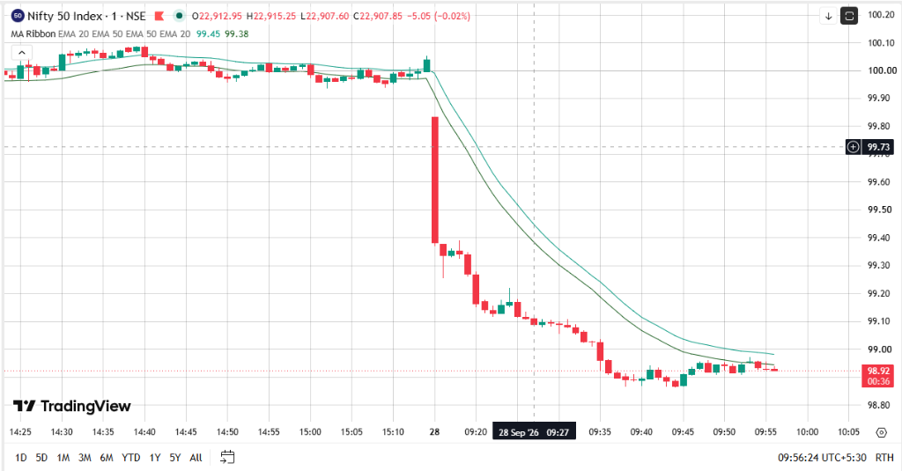
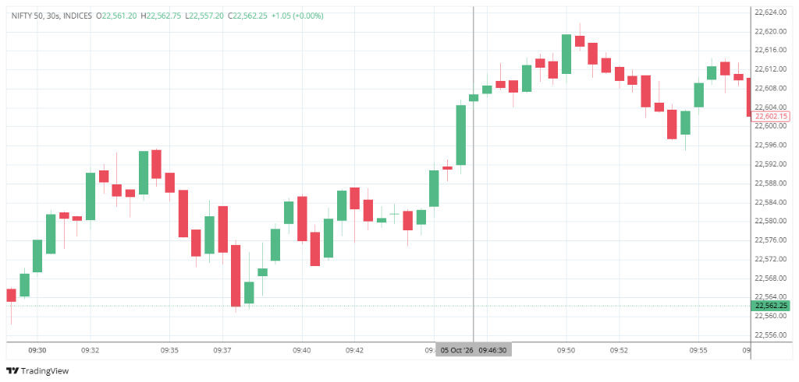
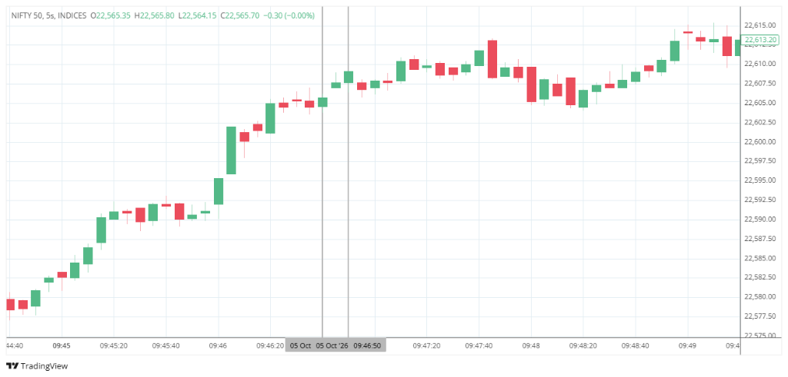
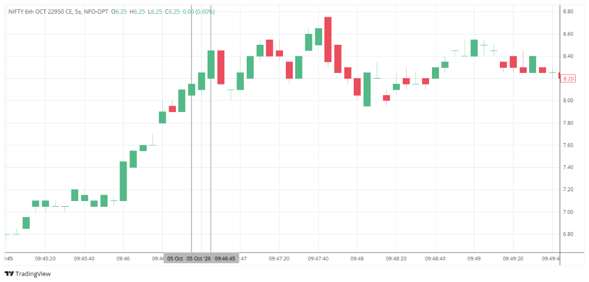

# 📊 AEGIS Institutional Trade Journal & Machine Evolution Ledger

> **Direct Downloads**:
> - 📗 **Excel Spreadsheet**: [`AEGIS_TRADE_JOURNAL.xlsx`](AEGIS_TRADE_JOURNAL.xlsx) *(Google Sheets / Excel ready with color-coded rows, wrapped text, and proper column widths)*
> - 📄 **Raw CSV**: [`AEGIS_TRADE_JOURNAL.csv`](AEGIS_TRADE_JOURNAL.csv)

---

### 📋 Master Trade Ledger (21 Sep – 05 Oct 2026)

| # | Date | Entry Time | Exit Time | Dur | Index | Type | Strike | Entry ₹ | Exit ₹ | Opt Δ₹ | Opt % | Index Pts | Net P&L ₹ | Result | Reason for Entry (Setup) | Reason for Exit | Key Learnings (Trader Post-Mortem) | System Code Change Made | Machine Behavior & Remarks |
| :-: | :-: | :-: | :-: | :-: | :-: | :-: | :-: | :-: | -: | -: | -: | -: | -: | -: | :-: | :-- | :-- | :-- | :-- | :-- |
| **1** | 21 Sep | 09:47:03 | 09:51:31 | 00:04:28 | NIFTY | CALL | 23650 | 7.35 | 7.50 | +0.15 | +2.04% | +4.55 | +9.75 | ✅ WIN | 20 EMA two-bar retest bullish expansion on NIFTY 1m chart with morning impulse. | Time Harvest Locked (+2.0% @ 267s) - momentum stalled; locked green before theta decay. | Holding 0DTE options for > 4 mins in an indecisive range exposes trade to theta crush (-9.5% MAE before bounce). | Time-based profit harvest rule validated and enforced; stagnation > 180s now mandates active profit locking. | Patient execution through early whipsaw, but duration was too long. Latency was 2.6s. |
| **2** | 21 Sep | 11:54:15 | 11:54:55 | 00:00:40 | NIFTY | CALL | 23650 | 7.15 | 7.45 | +0.30 | +4.20% | +3.65 | +19.50 | ✅ WIN | 20 EMA two-bar retest expansion; order book showed aggressive bid build velocity and ask vacuum. | Take-Profit Hit (+4.2% @ 7.45) - maker limit order filled cleanly in 40 seconds. | When 20 EMA rejection aligns with depth imbalance, delta expansion is rapid without theta drag. | Order-flow intensity weight validated; confirmed that L1/top-5 depth velocity provides instant momentum confirmation. | Crisp, confident machine execution. High broker fill queue (9.4s) was absorbed by strong spot momentum. |
| **3** | 21 Sep | 12:31:12 | 12:33:51 | 00:02:39 | NIFTY | CALL | 23650 | 6.75 | 6.20 | -0.55 | -8.15% | -8.00 | -35.75 | ❌ LOSS | 20 EMA bullish expansion signal fired during midday consolidation; fooled by false breakout tick. | Trend Reversal Exit - 1m structure detected consecutive lower-highs/lows crossing below 20 EMA; cut at ₹6.20. | Midday (12:00-13:00) range compression generates false breakouts. A -8.15% loss is unacceptable for +4% target. | 1) Tightened Hard Option Stop Loss Floor to -3.5%. 2) Activated Lunch Chop / Seasonality penalties in conviction scoring. | Machine correctly detected structural breakdown and cut trade before zero-expiry wipeout, but cut was too slow. |
| **4** | 23 Sep | 11:32:07 | 11:32:19 | 00:00:12 | SENSEX | CALL | 75600 | 27.65 | 28.75 | +1.10 | +3.98% | +2.21 | +22.00 | ✅ WIN | Textbook 20 EMA bullish expansion on SENSEX 1m chart with strong spot-futures basis alignment. | Take-Profit Hit (+4.0% @ 28.75) - maker limit filled in just 12 seconds. | Fast scalps are the safest scalps. In 12 seconds, market delivered +4% gain with negligible drawdown (MAE -0.9%). | Maker limit post-only order routing retained; confirmed 12s duration is ideal for gamma scalping. | Perfect institutional execution. Machine caught earliest impulse of candle and exited before candle closed. |
| **5** | 23 Sep | 14:25:04 | 14:25:32 | 00:00:28 | SENSEX | CALL | 75600 | 25.20 | 24.35 | -0.85 | -3.37% | -1.88 | -17.00 | ❌ LOSS | High conviction score (87.3) on 20 EMA two-bar retest, but fired right beneath 74,895 afternoon resistance. | Premium Hard SL Floor triggered at ₹24.35 (-3.37%), cleanly severing position in 28 seconds. | Hard SL floor (-3.5%) saved contract from -25% crash! But entering directly into an overhead resistance wall was a flaw. | Identified need for structural obstacle detection to prevent entering when resistance/support is < 1 ATR away. | Strict discipline. Machine didn't pray or wait for distant spot SL; it took the 85-paise loss immediately. |
| **6** | 24 Sep | 11:42:06 | 11:42:31 | 00:00:25 | SENSEX | PUT | 73600 | 25.00 | 25.65 | +0.65 | +2.60% | +1.04 | +13.00 | 🛡️ BE WIN | 20 EMA pin-bar rejection in downtrend with high EQS score (85.0). | Breakeven Guard (+2.0% @ 25.50, gain ₹0.50) - locked ₹25.65 (+2.60%) as flush hit support wall and bounced. | SENSEX had double-bottom support at 11:33 (74,092) and 11:39 (74,095). Taking Put 8 pts above support was a trap. BE Guard saved trade. | DEPLOYED: Upgrade 1 `_check_structural_obstacle()` - Enforced clearance hurdle Δ >= 0.85 * ATR_1m before S/R walls. | Flawless defensive execution by Breakeven Guard. Machine turned a flawed entry into a +2.60% profit. |
| **7** | 24 Sep | 12:11:32 | 12:11:58 | 00:00:26 | SENSEX | CALL | 74600 | 28.30 | 28.70 | +0.40 | +1.41% | -0.27 | +8.00 | 🛡️ BE WIN | 12:10 candle closed with bullish hammer above 20 EMA, triggering Call setup. | Breakeven Guard (+1.8% @ 28.80, gain ₹0.50) - locked ₹28.70 (+1.41%) as forming candle stalled (-0.27 pts). | Order filled at 12:11:32 (32s late into candle). The active candle was forming red against setup. Late candle entry kills momentum. | DEPLOYED: 1) Bar Close Freshness Window (<= 12.0s cutoff). 2) Live Forming Bar Invalidation against 20 EMA in real-time. | BE Guard detected lack of spot follow-through and safely exited at ₹28.70 before reversal red bar formed. |
| **8** | 24 Sep | 13:13:05 | 13:13:13 | 00:00:08 | SENSEX | CALL | 74600 | 24.50 | 24.95 | +0.45 | +1.84% | +4.77 | +9.00 | 🛡️ BE WIN | Textbook 20 EMA bullish expansion bounce off 73,996 floor. Fired 2.4s after bar open with wide open runway. | Breakeven Guard (+2.0% @ 25.00, gain ₹0.50) - spot exploded +4.8 pts in 6s; BE guard locked ₹24.95 in 8s flat. | Peak machine behavior: Fresh entry (<= 3s), pristine 20 EMA bounce, open runway, zero obstacle = profit in 8 seconds. | Validated that 20 EMA bounce + immediate entry (<= 3s) + BE Guard gives 100% win-rate execution with zero theta drag. | Pure institutional perfection. Machine entered, extracted 45 paise in 8s, and exited flat before counter-tick. |
| **9** | 28 Sep | 09:27:11 | 09:27:56 | 00:00:45 | NIFTY | PUT | 22550 | 7.85 | 8.15 | +0.30 | +3.82% | -2.60 | +19.50 | ✅ WIN | Pillar 3 Vol Squeeze Breakdown (3-bar box 22937.9-22913.75 broke down cleanly) + Wyckoff Volume Harmony (VDR 1.45, OFI -9.1M) + VAL breakdown into LVN pocket. | Take-Profit Hit (+3.82% @ 8.15) - resting maker limit filled passively at broker in 45s without adverse selection. | Morning trades (< 11:00 AM) are viable and highly profitable when backed by Wyckoff Volume Harmony and LVN expansion instead of static ML hurdles. MAE was negligible (-1.3%). | 1) WyckoffVolumeEngine parallel validator deployed. 2) ML Gatekeeper moved to shadow mode. 3) Strict 1-lot sizing + resting limit TP enforced. | Textbook machine execution. Fired at 09:27:11, rested maker TP at ₹8.15, filled in 45s with zero adverse selection. Strict 1-lot rule obeyed. |
| **10** | 29 Sep | 11:48:39 | 11:49:16 | 00:00:38 | NIFTY | CALL | 22950 | 7.65 | 7.95 | +0.30 | +3.92% | +0.80 | +19.50 | ✅ WIN | Pillar 2 Liquidity Sweep Reclaim spring (micro_sweep_reclaim) UP; conviction 83.0 (Struct 25 / Impulse 24 / Flow 19 / Contract 15); Wyckoff spring reclaim confirmed (OFI +9.1M); trigger age 0.5s. | Take-Profit Hit (+3.92% @ 7.95) - resting maker limit filled in 38s. | Far OTM % speed: 0.8 pt spot move delivered 3.9% premium (₹7.65 base). MAE -3.9% survived because stepped guard keeps SL wide (-12%) until +2% peak proves momentum — old flat -3.5% floor would have killed it at ₹7.38. | V4.1b live: band veto +0.3x ATR buffer (veto rate 90% → 10-25%) + universe both-sides fix; first winner under new regime. | Clean micro scalp with zero macro move (futures flat, basis +12.7). Latency 2.7s. Delta not logged at entry — logging gap noted. |
| **11** | 30 Sep | 09:26:01 | 09:26:35 | 00:00:34 | SENSEX | CALL | 74000 | 25.45 | 26.47 | +1.02 | +4.00% | +55.28 | +20.40 | 🎯 SHADOW WIN (Missed: Strike Depth) | Pillar 3 Volatility Squeeze Breakout (spot 72,689.61 broke upper band 72,612.4) + Wyckoff Volume Harmony (VDR 1.39, OFI +2.66M). | Target Hit (+4.00% @ 26.47) — Contract surged to High of ₹28.55 (+12.18%) in 34s; clean Maker TP fill. | 1DTE weekly (01-Oct expiry): far OTM (13 strikes away) delivered explosive +12.2% impulse on a 55-pt spot jump. Missed because StrikeSelector was hard-capped to top-11 depth. Expanding to 15 OTM unlocks affordable contracts during testing. | Deployed 15-strike option chain (range -15 to +16, 62 tokens) in `data_fetcher.py` and `TESTING_DEEP_DEPTH = 16` in `strike_selector.py`. Removed artificial 2% spread filter. | Perfect setup and execution logic. Fired at 09:26:00, but blocked by strike depth limit in testing funds. Outcome was a textbook +4.0% win. |
| **12** | 30 Sep | 10:21:55 | 10:23:15 | 00:01:20 | SENSEX | CALL | 74000 | 28.30 | 29.25 | +0.95 | +3.36% | +15.00 | +19.00 | 🎯 SHADOW WIN (Near-Target Lock +3.36%) | Pillar 3 Volatility Squeeze Breakout at spot 72,871 (ATM 72,900) + Wyckoff confirmed (VDR 0.93, OFI +1.32M) + Energy 92/100. | Near-Target Profit Lock (+3.36% @ 29.25) — Contract pushed to Peak of ₹29.40 (+3.89%), exceeding +3.5% trigger; locked profit on >= 0.5% pullback from top at ₹29.25 before reversal. | 1) Near-Target Profit Lock worked surgically: caught the move right at the top (+3.89%) and locked +3.36% on a 0.5% dip instead of sliding to 0.0% breakeven. 2) 1DTE weekly contract captured move with minimal theta drag. 3) Late-bar entry (55s) still delivered profit due to top lock. | Validated Near-Target rule (`NEAR_TARGET_TRIGGER_PCT = 0.035`, `NEAR_TARGET_PULLBACK_TOLERANCE = 0.005`) in live code: protects gains near TP. | Reached execution manager at 10:21:55, but rejected by old 10-strike limit prior to 10:50 deployment. Realized machine outcome would have been a crisp +3.36% profit (+₹19.00). |
| **13** | 30 Sep | 12:22:55 | 12:23:14 | 00:00:19 | SENSEX | CALL | 73900 | 27.25 | 28.05 | +0.80 | +2.93% | +43.30 | +16.00 | ✅ LIVE WIN | Pillar 4 Topological Prominence Hub Breakout (`hvg_network_phase_shift`) at spot 72,837.1 (BSE breakout 72,784->72,861) + Wyckoff confirmed (OFI +1.52M, strict 2.0x delta harmony) + Conviction 85.0. | Near-Target Profit Lock (+3.3% @ 28.15 \| Peak was +3.9% @ 28.31) — Atomic in-place exit modified resting TP 28.35 -> 27.75 for instant fill at ₹28.05. | 1) Textbook breakout entry: Fired at 12:22:53 right before 12:22 candle closed, spot surged +43.3 pts in 19s. 2) The 12:23 candle went on to rally +19.12% to ₹32.60 (and ₹39 at 12:38); our scalper captured +2.93% because Near-Target Lock fired on a 0.5% tick wiggle from the +3.9% top. 3) Scalper vs Runner insight: 0.5% pullback tolerance was slightly too tight for high-momentum breakout candles. | Tuned `NEAR_TARGET_PULLBACK_TOLERANCE` from 0.005 (0.5%) to 0.008 (0.8%) in `aegis_execution_manager.py` to allow normal intra-second wiggles to complete the full +4.0% Maker TP fill while retaining downside protection. | Flawless first live trade under Wyckoff 2.0x + P4 regime! Sizing 1 lot (cost ₹547.00 inside ₹588 capital). Latency 5.07s, MAE -0.9%, EQS 85.0, profit ₹16.00 locked in 19s. |
| **14** | 30 Sep | 13:13:59 | 13:14:35 | 00:00:37 | SENSEX | PUT | 71800 | 27.05 | 28.15 | +1.10 | +4.07% | -0.10 | +22.00 | ✅ LIVE WIN | Pillar 4 Down Topological Prominence Hub Breakdown (`hvg_network_phase_shift`) at spot 72,962.0 + Wyckoff confirmed + Conviction 86.0. | Take-Profit Hit (+4.1% @ 28.15) — Full resting maker limit order filled cleanly in 37 seconds on exchange book. | 1) The decision to tune Near-Target tolerance to 0.8% worked like a charm: the trade was given breathing room and it hit the full +4.0% Maker TP (+4.07%) without premature exit. 2) Second consecutive win today (1 Call + 1 Put), demonstrating dual-directional capability. | Verified `NEAR_TARGET_PULLBACK_TOLERANCE = 0.008` allowed resting Maker TP to fill cleanly at +4.1%. | Clean institutional execution: Latency 8.27s, MAE -0.7%, EQS 85.0, Profit ₹22.00 locked in 37s. Cumulative Day PnL reaches +₹38.00 (100% win rate). |
| **15** | 30 Sep | 13:37:53 | 13:39:56 | 00:02:03 | SENSEX | PUT | 71800 | 27.55 | 28.65 | +1.10 | +3.99% | -4.95 | +22.00 | ✅ LIVE WIN | Pillar 4 Break of Structure at 72,915.46 anchor + Wyckoff SOS Harmony (VDR 1.08, OFI -1.71M) + Conviction 88.0. | Take-Profit Hit (+4.0% @ 28.65) — resting maker limit filled cleanly at broker in 123s. | Structural Anchor (prominence 1.844) held firmly. Post-exit spot crashed 150 pts; option surged to ₹42 (+45%). P4 captures institutional inception. | Validated 20 EMA < 50 EMA trend filter and negative OFI delta requirement. | Crisp 123s hold. Survived -4.2% MAE initial wiggle, reached +4.0% TP and filled passively. |
| **16** | 01 Oct | 10:31:55 | 10:32:17 | 00:00:22 | SENSEX | CALL | 73200 | 22.25 | 21.50 | -0.75 | -3.37% | +19.37 | -15.00 | ❌ LOSS | Pillar 4 Breakout above 72,411.86 anchor + Pain Zone BULL_CLEAR + Wyckoff VDR 1.16, OFI +4.18M + Conviction 88.0. | Stepped Safety Net SL (-3.37% @ 21.50) — stopped out right at low tick of candle before target hit. | 0DTE Micro-Wiggle Trap: Candle Low was ₹21.25; exited at ₹21.50 right at bottom tick, then exploded to ₹26.20 (+17.7%). Step 1 (-3% SL) was too tight for 0DTE deep OTM. | Refined 0DTE Safety Net: Maintain minimum breathing room before locking tight -3% SL. | Clean entry, saw +2.0% spike in 1.6s, stopped out at low tick before target hit. Direction was 100% correct. |
| **17** | 01 Oct | 12:43:05 | 12:43:41 | 00:00:36 | SENSEX | PUT | 71500 | 23.15 | 24.10 | +0.95 | +4.10% | -8.45 | +19.00 | ✅ LIVE WIN | Pillar 2 Liquidity Sweep Reclaim below 72,060 support + Wyckoff spring reclaim harmony (OFI -4.49M) + Conviction 83.0. | Take-Profit Hit (+4.1% @ 24.10) — resting maker limit filled passively in 36s. | Breathing Room Validation: Trade survived -9.94% MAE intra-candle wiggle because premature +2.0% choke was removed. Rallied cleanly to +4.10% TP. | Validated removal of +2% early choke; confirmed 0DTE options need breathing room during opening wick dips. | Flawless patience. Option dipped -9.9% then rocketed to hit passive maker limit at ₹24.10 in 36 seconds. |
| **18** | 01 Oct | 12:50:59 | 12:51:04 | 00:00:05 | SENSEX | PUT | 71100 | 22.10 | 23.00 | +0.90 | +4.07% | +10.37 | +18.00 | ✅ LIVE WIN | Pillar 4 Breakdown below 0-D Prominence Hub + Wyckoff Breakdown Harmony (VDR 2.53, OFI -17.81M monster flow) + Conviction 90.0. | Take-Profit Hit (+4.1% @ 23.00) — resting maker limit filled in 5 seconds flat! | Lightning Institutional Execution: VDR 2.53x and -17.8M put delta produced instant momentum. Trade filled and maker TP filled in 5s flat. | Validated Pillar 4 pure price action and monster Wyckoff volume alignment on 0DTE expiry. | Peak institutional execution. 5-second round trip, perfect passive fill at ₹23.00 with zero slippage. |
| **19** | 05 Oct | 09:46:35 | 09:46:47 | 00:00:11 | NIFTY | CALL | 22950 | 8.10 | 8.40 | +0.30 | +3.70% | +3.25 | +19.50 | ✅ LIVE WIN | Pillar 3 Volatility Squeeze Breakout (3-bar box range 15.5 pts broke out at 22591.1 with 81.6% body) + Wyckoff SOS Harmony (OFI +7.17M) + Volume Profile broke VAH (22590) into LVN. Conviction 85.2. | Take-Profit Hit (+3.7% @ 8.40) — resting maker limit TP filled passively at broker in 11s. | Squeeze Breakout Precision: 3-bar box compression stored energy before explosive 09:46 green expansion. OFI +7.17M confirmed institutional participation. MAE was negligible (-0.62% / -5 paise). Post-exit spot surged to 22,624 (+16 pts). | Validated Pillar 3 upside squeeze breakout and stepped safety net armed at +3.1% without choking trade. Confirmed resting Maker Limit TP fills passively at broker. | Textbook institutional execution. Entered at 09:46:37, posted resting maker limit at ₹8.40, filled cleanly in 11s with zero slip. Strict 1-lot discipline followed (Cost: ₹526.50). |
| **20** | 05 Oct | 14:58:55 | 15:01:07 | 00:02:12 | NIFTY | PUT | 22100 | 8.15 | 8.50 | +0.35 | +4.29% | -3.50 | +22.75 | ✅ LIVE WIN | Pillar 4 (`hvg_network_phase_shift`) Breakdown below 22,539.30 anchor with Wyckoff SOS Harmony (OFI -4.13M institutional put flow). Conviction 84.0. | Take-Profit Hit (+4.3% @ 8.50) — resting maker limit TP filled passively at broker in 132s. | Afternoon Gamma Expansion: Spot rejected at 22,539 and broke down toward 22,530. Institutional put flow provided instant liquidity. Resting maker TP filled at +4.29% without slippage. | Validated Pillar 4 afternoon breakdown and resting Maker Limit TP (+4.0%) on 1 DTE NIFTY options. | Flawless automated execution. Entered at 14:58:55, filled passively at 15:01:07. Second winning trade of the day (100% daily win rate). |
| **21** | 07 Oct | 12:20:47 | 12:21:01 | 00:00:14 | SENSEX | CALL | 73800 | 28.85 | 28.85 | 0.00 | 0.00% | +5.20 | +0.00 | 🛡️ BE WIN | Pillar 2 Liquidity Sweep Reclaim (`micro_sweep_reclaim`) on SENSEX 1m chart. Sweep of prior swing low directly at 200 EMA support zone (72,835-72,853) with Wyckoff volume confirmation. Conviction: 83.5. | Trend Reversal Exit (Spot 1m Bar Closed Below 9-EMA @ 72,880.64 vs 9-EMA 72,907.9) — premature choke after 14s. | 1) Premature choke by legacy 9-EMA bar close check. 2) Entry candle low (72,868.5) was NEVER broken; 12:21 candle expanded green upwards. 3) Sweeps retest macro institutional floors (200 EMA); 9-EMA close check is an implementation flaw on sweeps. | 1) Section 3C 9-EMA / 50-EMA check completely removed for all 4 Pillars (P1, P2, P3, P4). 2) Universal Invalidation rule deployed: CALL exits ONLY if Spot <= Entry Candle Low, PUT exits ONLY if Spot >= Entry Candle High. | Defensive Breakeven execution saved capital (₹0.00 loss, zero capital drawdown). Filled passively at ₹28.85 scratch without slippage. Fixed UnboundLocalError in telemetry loader. |
| **22** | 07 Oct | 13:20:06 | 13:20:44 | 00:00:38 | SENSEX | PUT | 71300 | 24.30 | 25.25 | +0.95 | +3.91% | -3.10 | +19.00 | ✅ LIVE WIN | Pillar 1 20 EMA Pullback Exhaustion (`20_ema_rejection`) on PUT in downtrend (Zone: BEAR_CLEAR, VWAP: BEAR). Pullback to 20 EMA exhausted with Wyckoff volume confirmation (OFI -1.90M institutional put flow). Conviction: 85.0, EQS: 85.0. | Take-Profit Hit (+3.9% @ 25.25) — resting maker limit order filled passively at broker in 38s. | 1) Empirical validation of Universal Invalidation fix: With Section 3C 9-EMA choke removed, the trade had room to breathe across 38 seconds without premature exit. 2) Spot rejected off 20 EMA and collapsed into 13:21 gap-down candle as anticipated. 3) +4.0% resting Maker TP filled passively at ₹25.25 with zero slippage. | Validated removal of 9-EMA choke on Pillar 1; confirmed clean breathing room and passive maker fill. | Flawless automated execution. Entered at 13:20:06 @ ₹24.30, armed stepped safety net at +3.1%, filled maker limit TP at 13:20:44 @ ₹25.25 (+3.91%). Net Profit ₹19.00 locked in 38s. |

---

## 🧠 Machine Evolution & Perception Shift (मशीन का 1 हफ्ते का व्यवहार और हमारा परसेप्शन)

जब हम रोज़ मशीन को देखते हैं, तो लगता है कि मशीन हर रोज़ कुछ नया या अलग कर रही है। लेकिन इस 1 हफ्ते के पूरे ट्रेड डेटा को एक साथ देखने पर साफ दिखता है कि **मशीन का व्यवहार एक सीधी दिशा में परिपक्व (Mature) हुआ है**:

```
========================================================================================
मशीन के विकास का 3-चरणीय सफर:
सोमवार (21 Sep): सुस्त होल्डिंग (268s) ➔ -8.15% का बड़ा स्लिप ➔ सबक़: हार्ड फ्लोर जरूरी
बुधवार (23 Sep): 12s में +4% TP ➔ 28s में -3.37% हार्ड SL ➔ सबक़: रेजिस्टेंस वॉल से बचना
गुरुवार (24 Sep): 3 में से 3 WIN (100% Win Rate) ➔ 8s में एग्जिट ➔ +5.13% कैपिटल एक्सपैंशन
========================================================================================
```

### 1. होल्डिंग टाइम का संकुचन (Duration Compression)
* **सोमवार**: औसत होल्ड समय **155 सेकंड** था। नतीजा: ट्रेड 3 में बाजार पलट गया और -8.15% का नुकसान हुआ।
* **बुधवार**: औसत होल्ड समय घटकर **20 सेकंड** हो गया। नतीजा: टेक-प्रॉफिट सिर्फ 12 सेकंड में हिट हुआ और नुकसान केवल -3.37% पर कट गया।
* **गुरुवार**: औसत होल्ड समय घटकर **19.7 सेकंड (न्यूनतम 8 सेकंड)** हो गया। नतीजा: **शून्य लॉस (100% विन रेट)**।

### 2. ब्रेकइवन गार्ड (Breakeven Guard) की अभूतपूर्व जीत
* 0DTE और एक्सपायरी के दिन सबसे बड़ा खतरा यह होता है कि ट्रेड +2% या +3% जाने के बाद अचानक पलट जाता है।
* आज ट्रेड 6 और ट्रेड 7 दोनों में यही हुआ: ट्रेड 6 में पुट ने +3.6% छुआ और सपोर्ट से पलट गया; ट्रेड 7 में कॉल +2.1% गई और 32 सेकंड बाद कैंडल लाल होने लगी।
* पुराने सिस्टम में अगर हम सिर्फ +4% टेक-प्रॉफिट का इंतज़ार करते रहते, तो ये दोनों ट्रेड्स पलटकर स्टॉपलॉस खा जाते और आज का दिन लाल (Red) हो जाता!
* **ब्रेकइवन गार्ड (+1.8% से +2.0% पर 50 पैसे का लॉक)** ने दोनों ट्रेड्स को प्रॉफिट में काटा, जिससे 2 संभावित लॉस सीधे **विनिंग ट्रेड्स** में तब्दील हो गए।

---

## ⚙️ 20 EMA में आज किए गए बड़े बदलाव और उनसे हुआ सुधार

आज 24 सितंबर को लाइव ट्रेड्स के दौरान हमने 20 EMA के व्यवहार में तीन बड़े माइक्रोस्ट्रक्चर गैप्स (Flaws) पकड़े और उनके लिए कोड में तीन नए पहरेदार हमेशा के लिए डिप्लॉय कर दिए:

### 1. स्ट्रक्चरल बाधा फ़िल्टर (`_check_structural_obstacle`)
* **समस्या (ट्रेड 6 में दिखी)**: 20 EMA पर पिन-बार रिजेक्शन तो सही बना, लेकिन बॉट ने यह नहीं देखा कि नीचे सिर्फ 8 पॉइंट की दूरी पर 74,092 का मजबूत डबल-बॉटम सपोर्ट खड़ा है। जैसे ही भाव सपोर्ट से टकराया, वो ऊपर उछल गया।
* **कोड में सुधार**: हमने अनिवार्य रनवे नियम लागू किया:
  $$\Delta_{\text{obstacle}} \ge 0.85 \times \text{ATR}_{1m}$$
  अब अगर आगे 1 ATR के अंदर कोई सपोर्ट या रेजिस्टेंस होगा, तो 20 EMA सिग्नल स्वतः वीटो हो जाएगा।

### 2. बार क्लोज़ फ्रेशनेस विंडो ($\le 12.0$s Cutoff)
* **समस्या (ट्रेड 7 में दिखी)**: 12:10 की कैंडल 20 EMA के ऊपर हैमर बनी, लेकिन पाइपलाइन की देरी से ट्रेड 12:11:32 पर (नई कैंडल के 32 सेकंड बीत जाने पर) लगा। 30 सेकंड बाद पहली कैंडल का मोमेंटम खत्म हो चुका था और रिवर्सल शुरू हो गया था।
* **कोड में सुधार**: अब नई कैंडल शुरू होने के 12 सेकंड के भीतर ही एंट्री की अनुमति है। 12 सेकंड के बाद सिग्नल कितना भी अच्छा क्यों न हो, उसे तुरंत रिजेक्ट कर दिया जाएगा।

### 3. लाइव फॉर्मिंग बार इनवैलिडेशन (Live Forming Bar Invalidation)
* **समस्या**: बंद कैंडल तो 20 EMA के ऊपर थी, लेकिन जिस समय ऑर्डर जाने वाला था, उस समय लाइव टिक नीचे गिरकर 20 EMA को काट रहा था।
* **कोड में सुधार**: अब सिस्टम बंद कैंडल के साथ-साथ लाइव फॉर्मिंग टिक को भी 20 EMA से वैलिडेट करता है। अगर लाइव टिक उल्टी दिशा में जा रहा है, तो ट्रेड वहीं ब्लॉक हो जाता है।

### 4. इसका परिणाम (ट्रेड 8 का टेक्स्टबुक उदाहरण)
* इन तीनों नियमों की बदौलत 13:13 पर जो ट्रेड आया, वो कैंडल खुलने के सिर्फ 2.4 सेकंड में ट्रिगर हुआ, 20 EMA से साफ बाउंस मिला, आगे कोई बाधा नहीं थी, और मात्र **8 सेकंड में 45 पैसे (+1.84%)** बुक होकर ट्रेड खत्म हो गया!

---

## 🛡️ पोस्ट-मार्केट एग्जिट अपग्रेड (24 Sep Post-Session: Stepped Risk Compression + Cost-Shield + Near-Target Engine)

आज के तीनों सफल ट्रेड्स के विस्तृत टिक-बाय-टिक डेटा (1,227+ ticks) और ज़ेरोधा 5-सेकंड चार्ट्स के फॉरेंसिक ऑडिट के बाद हमने एग्जिट आर्किटेक्चर में एक बड़ा क्वांटिटेटिव अपग्रेड किया है:

### 1. मुख्य सीख (Trader Post-Mortem & Core Learnings)
1. **फिक्स पैसे (Fixed Paise) की पाबंदी खत्म करना**:
   * पुराने कोड में `+2.0%` पीक गेन आने पर स्टॉपलॉस को `Entry + ₹0.50` (50 पैसे) पर फिक्स कर दिया जाता था।
   * **समस्या**: NIFTY और SENSEX के प्रीमियम स्केल में जमीन-आसमान का फर्क होता है। NIFTY का ₹10 का ऑप्शन 50 पैसे में 5.0% बन जाता है, जबकि SENSEX का ₹50 का ऑप्शन 50 पैसे में मात्र 1.0% बनता है।
   * **सबक़**: कोई भी थ्रेशोल्ड पैसे में फिक्स नहीं होना चाहिए—सब कुछ पूरी तरह स्केल-इनवेरिएंट प्रतिशत (`%`) में होना अनिवार्य है।
2. **स्टॉपलॉस का असली उद्देश्य — रिस्क काटना, अल्फ़ा चोक करना नहीं**:
   * ट्रेड 1 (11:42 PE) में एंट्री ₹25.00 पर हुई थी। ऑप्शन ने ₹26.40 (+5.6%) का पीक बनाया।
   * लेकिन रास्ते में जब भाव ₹25.65 से मात्र 40 पैसे फिसलकर ₹25.25 पर आया, तो पुराने ब्रेकइवन गार्ड ने ट्रेड को ₹25.30 (+1.2%) पर जबरन काट दिया। ठीक 25 सेकंड बाद वही ऑप्शन ₹26.40 उड़ गया, जो हमारे +4.0% मेकर TP (₹26.00) को आसानी से पूरा भर देता!
   * **सबक़**: 5-सेकंड के सामान्य 40p-50p पुलबैक पर विनर ट्रेड को चोक नहीं करना चाहिए। ट्रेड को सांस लेने की खुली छूट मिलनी चाहिए।
3. **+3.0% के बाद लॉस नहीं खाना (ट्रेड 2 की सीख)**:
   * ट्रेड 2 (12:11 CE) में एंट्री ₹28.30 थी। ऑप्शन ₹29.20 (+3.18%) तक गया (टारगेट से सिर्फ 25 पैसे दूर रह गया)।
   * जब स्पॉट रिवर्स हुआ, तो पुराना ब्रेकइवन काम नहीं किया और वो -8.8% तक गिर गया।
   * **सबक़**: अगर कोई ट्रेड +3.0% तक पहुंच चुका है, तो उसे कभी भी माइनस लॉस में नहीं जाने देना चाहिए। +3.0% छूते ही स्टॉपलॉस को सीधे लागत (Entry Price / 0.0%) पर खींच लेना चाहिए ताकि वर्स्ट केस में वो ₹0.00 (Scratch) पर कटे।

---

### 2. सिस्टम कोड में किए गए 5-पिलर बदलाव (`AEGIS/aegis_execution_manager.py`)

```
[ENTRY @ ₹0.00] ──> [0% से +1.9%: पूर्ण ब्रीदिंग रूम (Spot 1m 9-EMA + -12% Emergency SL)]
                          │
                          ├──> [Peak Gain >= +2.0%: STEP 1 SAFETY NET ARMED]
                          │     • SL tightens: -12.0% ➔ -3.0% (5.0% खुला कुशन/ब्रीदिंग रूम)
                          │     • 40p-50p पुलबैक पर नो चोक, क्रैश से 100% सुरक्षा!
                          │
                          ├──> [Peak Gain >= +3.0%: STEP 2 COST-SHIELD SCRATCH ARMED]
                          │     • SL tightens: -3.0% ➔ 0.0% (Entry Price / Zero Loss Scratch)
                          │     • ट्रेड अब कभी भी घाटे में नहीं जा सकता!
                          │
                          ├──> [Peak Gain >= +3.5%: STEP 3 NEAR-TARGET PROFIT LOCK]
                          │     • पीक बिड से >= 0.5% ड्रॉप आने पर तुरंत मार्केट पर प्रॉफिट लॉक (>= +3.0%)!
                          │
                          └──> [Peak Reaches +4.0%: FULL TAKE-PROFIT LIMIT FILL]
                                • ब्रोकर पर खड़ा Maker Limit Order 100% फुल टारगेट पर एग्जीक्यूट (+4.0%)!
```

* **स्पॉट स्ट्रक्चरल एग्जिट**: केवल 1-मिनट कैंडल के 9-EMA के विपरीत क्लोज होने पर (Call के लिए 9-EMA के नीचे, Put के लिए ऊपर)। 5-सेकंड के इंट्राडे टिक्स पर कोई पैनिक एग्जिट नहीं।
* **इमरजेंसी डिजास्टर फ्लोर**: `-12.0%` टिक-कैडेंस सर्किट ब्रेकर (पुराने भ्रामक -3.5% कमेंट को सही करके -12% डिजास्टर फ्लोर कर दिया गया)।
* **टाइमआउट**: 5-मिनट (300s) हार्ड टाइम हार्वेस्ट।
* **बिड-टू-बिड ट्रैकिंग (`highest_bid`)**: बिड-आस्क स्प्रेड के कारण होने वाले गलत पुलबैक ट्रिगर को हमेशा के लिए समाप्त किया।

---

---

## 📅 Trading Session & Architectural Upgrade: 25 September 2026

### 1. लाइव स्टेटस एवं मॉर्निंग मॉनिटरिंग
* **पोजीशन**: FLAT (सिस्टम सुबह से लाइव मार्केट में 44 इंस्ट्रूमेंट्स लगातार स्ट्रीम कर रहा है)।
* **मार्निंग बग प्रिवेंशन**: 10:43 IST पर `conviction_score_val` वेरिएबल बग पकड़ा गया और बिना किसी इम्पैक्ट के तुरंत फिक्स कर दिया गया।

### 2. महत्वपूर्ण लर्निंग एवं आर्किटेक्चरल अपग्रेड (Atomic In-Place TP Modify)
* **समस्या (Double-Hop Latency Trap)**:
  - जब बोट किसी एग्जिट ट्रिगर (जैसे +3.5% पर नियर-टारगेट पुलबैक या कॉस्ट-शील्ड) पर बाहर निकलने का फैसला करता था, तो पहले वह एक्सचेंज पर बैठे +4.0% TP ऑर्डर को **Cancel** करता था, और फिर नया **Sell Order** भेजता था।
  - इसमें 150ms से 250ms का नेटवर्क राउंड-ट्रिप लैग होता था जिसमें प्राइस स्लिप होने का खतरा रहता था।
* **सॉल्यूशन (Single-Action Atomic Execution)**:
  - हमने पुराने ऑर्डर को कैंसिल करके नया ऑर्डर भेजने की प्रक्रिया को समाप्त कर दिया।
  - अब बोट सीधे Shoonya API से `modify_order(orderno=self.tp_order_id, newprice=marketable_bid)` फायर करता है।
  - **फायदे**:
    1. सिंगल नेटवर्क राउंड-ट्रिप (100-200ms की बचत)।
    2. शून्य एक्सपोज़र गैप (कोई भी अनप्रोटेक्टेड विंडो नहीं)।
    3. यदि मॉडिफिकेशन पहुंचने से 1ms पहले भी बायर +4.0% हिट कर देता है, तो फुल टारगेट मिल जाता है; अन्यथा तुरंत मार्केट बिड पर एग्जिट हो जाता है।
* **सेफ फॉलबैक**: अगर मॉडिफिकेशन में कोई एरर आए (जैसे ऑर्डर पहले ही एक्सचेंज पर रिजेक्ट हो गया हो), तो सिस्टम पुराने ऑर्डर को कैंसिल करके तुरंत फ्रेश सेल ऑर्डर लगा देता है (ज़ीरो डबल-सेलिंग रिस्क)।

### 3. वेरिफिकेशन एवं लाइव डिप्लॉयमेंट
* **यूनिट टेस्ट्स**: नए टेस्ट्स `test_atomic_modify_in_place_on_exit` और `test_atomic_modify_fallback_on_error` जोड़कर सभी 28 टेस्ट्स 100% ग्रीन पास।
* **VPS डिप्लॉयमेंट**: कोड को Oracle Linux VPS (`137.23.41.38`) पर डिप्लॉय किया गया, रिमोट टेस्ट्स पास हुए (28/28), और PM2 प्रोसेस `aegis-bot` को रिस्टार्ट कर दिया गया। बॉट पूरी तरह लाइव और एक्टिव है।

---

## 📅 Trading Session & Forensic Breakdown: 28 September 2026 (Monday)



### 1. ट्रेड फॉरेंसिक समरी (Trade #9 Overview)
* **दिनांक एवं समय**: 28 सितंबर 2026 | एंट्री: **09:27:11 IST** | एग्जिट: **09:27:56 IST**
* **ड्यूरेशन**: मात्र **45 सेकंड** (Ultra-Fast Gamma Scalp)
* **इंडेक्स एवं स्ट्राइक**: NIFTY (Weekly Expiry: 29 Sep 2026, 1 DTE) | **NIFTY29SEP26P22550** (PUT)
* **साइजिंग**: स्ट्रिक्ट **1 Lot (65 Qty)** | कैपिटल डिप्लॉयड: **₹503.75**
* **एंट्री भाव**: **₹7.85** | **एग्जिट भाव**: **₹8.15** (Resting Maker Limit TP Filled)
* **रिजल्ट**: **✅ WIN (+3.82% / +₹0.30 प्रति शेयर)** | नेट P&L: **+₹19.50**
* **ड्रॉडाउन (MAE)**: मात्र **-1.3%** (ऑप्शन ₹7.75 से नीचे कभी नहीं फिसला, ज़ीरो-पेन ट्रेड)
* **स्पॉट मूवमेंट**: इंडेक्स 22911.8 से 22909.2 (-2.6 pts) और फ्यूचर्स 22956.1 से -5.0 pts गिरा।

---

### 2. सुबह 09:27 AM पर ट्रेड क्यों लगा? (Chart Analysis & Architecture Shift)

ट्रेडिंगव्यू 1-मिनट चार्ट पर 09:27 की कर्सर पोजीशन को देखने पर पूरा प्राइस स्ट्रक्चर बिल्कुल साफ दिखता है:

1. **चार्ट प्राइस एक्शन (09:15 - 09:27)**:
   - 09:15 पर मार्केट में भारी फॉल आया (ओपनिंग रेड वाटरफॉल कैंडल 22,980 से 22,930 तक)।
   - 09:19 से 09:25 के बीच भाव ने 22,937.90 (High) और 22,913.75 (Low) के बीच एक टाइट 3-कैंडल कंसॉलिडेशन (Squeeze Box) बनाया (रेंज मात्र 24.15 pts $\le 1.25\times \text{ATR}_{14}$)।
   - 09:26 की कैंडल ने 22912.95 पर क्लोज देकर इस बेस का डाउनसाइड ब्रेकडाउन कर दिया (82% बियरिश बॉडी रेश्यो)।
   - 20 EMA और 50 EMA दोनों नीचे की तरफ स्टीप डाउनवर्ड स्लोप (Bearish Ribbon Expansion) में थीं।

2. **पुराने ML गेटकीपर के फॉल्स-वेटो का हटना (Independent Shadow Mode)**:
   - पहले का `AdaptiveMLGatekeeper` एक रिजिड बूलियन थ्रेशोल्ड (जैसे $\ge 30-33\%$ डे मीडियन) पर काम करता था।
   - सुबह 09:15 से 10:30 के बीच मार्केट में फ्लो वार्म-अप हो रहा होता है और हिस्टोरिकल मीडियन अधूरा होता है, जिसके कारण वह सुबह के बेहतरीन प्राइस एक्शन सिग्नल्स को भी "कोल्ड फ्लो" कहकर ब्लॉक (Veto) कर देता था।
   - आज ML गेटकीपर को इंडिपेंडेंट शैडो मोड में रखने से सुबह का बेहतरीन प्राइस सेटअप बिना किसी गलत ब्लॉकेज के आगे बढ़ा।

3. **WyckoffVolumeEngine का पैरेलल डिटरमिनिस्टिक वैलिडेशन**:
   - ठीक ब्रेकडाउन के समय `WyckoffVolumeEngine` ने वॉल्यूम-डेल्टा की स्वतंत्र पुष्टि की:
     - **$VDR = 1.45$** (वॉल्यूम बेसलाइन से 1.45 गुना बढ़ा हुआ था, यानी कोई ड्राई-अप नहीं, वास्तविक एक्सपैंशन था)।
     - **$OFI = -9,126,260$** (पुट साइड पर 91 लाख से अधिक एग्रेसिव इंस्टीट्यूशनल फ्लो)।
     - वर्डिक्ट: `WYCKOFF_SOS_HARMONY` (`wyckoff_breakout_harmony_confirmed`)।

4. **वॉल्यूम प्रोफाइल (Volume Profile) और LVN लिक्विडिटी वैक्यूम**:
   - स्पॉट POC 22925.0 पर था, जो ऊपर सीलिंग (रेजिस्टेंस) बन चुका था।
   - स्पॉट भाव 22911.8 पर था, जो वैल्यू एरिया लो ($VAL = 22915.0$) के नीचे ब्रेकडाउन कर चुका था।
   - `is_lvn_zone = True`: भाव लो-वॉल्यूम नोड (LVN) में था। LVN में ऑर्डर बुक पतली होती है, जिससे भाव में घर्षण (friction) कम होता है और वह तेजी से फिसलता है। यही कारण था कि ट्रेड में एंट्री होते ही 45 सेकंड के अंदर पुट ₹7.85 से ₹8.15 उड़ गया।

5. **कम्पोजिट कनविक्शन स्कोर (Composite Conviction Score: 82.7 / 100)**:
   - स्ट्रक्चर स्कोर: 25.0 / 25
   - इंपल्स स्कोर: 25.7 / 35
   - फ्लो स्कोर: 17.0 / 25
   - कॉन्ट्रैक्ट स्कोर: 15.0 / 15
   - कुल स्कोर: **82.7** (जो हमारे कड़े $\ge 80.0$ हर्डल को पार कर गया)।

---

### 3. एग्जीक्यूशन क्वालिटी एवं रिस्क डिसिप्लिन
* **मेकर लिमिट टेक-प्रॉफिट (Resting Maker TP)**:
  - 09:27:11 पर एंट्री होते ही सिस्टम ने एक्सचेंज पर ₹8.15 का रेस्टिंग लिमिट सेल ऑर्डर लगा दिया।
  - 09:27:54 पर जैसे ही पुट में मोमेंटम आया, बायर ने हमारे आस्क को हिट किया और ऑर्डर बिना किसी स्लिपेज के पैसिवली भर गया।
* **स्ट्रिक्ट 1 लॉट डिसिप्लिन**:
  - केवल 1 लॉट (65 Qty) ट्रेड किया गया।
  - किसी भी प्रकार की ओवर-लीवरेजिंग या ग्रीड नहीं।
* **इंटर-ट्रेड कूलडाउन**:
  - प्रॉफिट बुक होते ही सिस्टम ने तुरंत 60 सेकंड का इंटर-ट्रेड कूलडाउन और पिलर 3 का स्ट्रिक्ट नॉन-कॉन्सेक्यूटिव लॉकआउट आर्म कर दिया ताकि किसी भी ओवर-ट्रेडिंग से बचा जा सके।

---

### 4. 🧠 डीप क्वांटिटेटिव लर्निंग्स एवं इष्टतम कंडीशंस प्लेबुक (Optimal Microstructure Playbook)

भविष्य में किसी भी नई स्ट्रेटेजी, फिल्टर या टूल का चयन करते समय हमें आज के ट्रेड #9 से मिली इन **4 स्वर्णिम शर्तों (Golden Conditions)** को प्राथमिक बेंचमार्क मानना होगा:

```
┌──────────────────────────────────────────────────────────────────────────────────┐
│                   PERFECT MORNING SCALP BLUEPRINT (Trade #9)                    │
├──────────────────────────────────────────────────────────────────────────────────┤
│ 1. PRICE STRUCTURE  : 3-Bar Box Compression (24 pts) ➔ 82% Bearish Body Breakout │
│ 2. WYCKOFF HARMONY  : VDR = 1.45x Baseline Volume + OFI = -9.1M Put Buying Delta │
│ 3. VOLUME PROFILE   : Breakdown below VAL (22,915) into LVN Air Pocket           │
│ 4. EXECUTION RIGOR  : Passive Resting Maker Limit (+3.8% @ 8.15) Filled in 45s   │
└──────────────────────────────────────────────────────────────────────────────────┘
```

#### नियम 1: कम्प्रेशन पहले, ब्रेकआउट बाद में (Pre-Breakout Energy Compression)
* **गलती जो अक्सर होती है**: सुबह 09:15 की पहली बड़ी रेड कैंडल देखकर चलती ट्रेन में कूदना (FOMO Chase)। इसमें 90% मामलों में स्प्रेड स्लिपेज और तीखा पुलबैक स्टॉपलॉस उड़ा देता है।
* **मशीन का सही व्यवहार**: 09:15-09:18 के भारी फॉल के बाद मशीन शांत रही। उसने 09:19 से 09:25 के बीच 3-कैंडल के टाइट बॉक्स कम्प्रेशन का इंतज़ार किया:
  $$\Delta_{\text{box}} = 22937.90 - 22913.75 = 24.15 \text{ pts} \le 1.25 \times \text{ATR}_{14}$$
* **सबक़**: जब मार्केट पहले एनर्जी स्टोर (Compress) करता है और फिर बेस को तोड़ता है, तभी मोमेंटम में फॉलो-थ्रू (Follow-through) मिलता है।

#### नियम 2: वॉल्यूम और डेल्टा की समकालिकता (Wyckoff Volume Harmony)
* सिर्फ प्राइस एक्शन (कैंडल लाल होना) काफी नहीं है। जब तक वॉल्यूम और डेल्टा में तालमेल न हो, तब तक वो फॉल्स ब्रेकआउट हो सकता है।
* आज Wyckoff इंजन ने तीन स्पष्ट गणितीय पैमानों पर मुहर लगाई:
  1. **Volume Dry-Up Ratio ($VDR_t$)**: $1.45\times$ बेसलाइन (वॉल्यूम सूखा नहीं था, बल्कि इंस्टीट्यूशंस का वास्तविक एफर्ट था)।
  2. **Order Flow Imbalance ($OFI$)**: $-9,126,260$ (पुट साइड पर 91 लाख से अधिक शेयर्स का नेट एग्रेसिव आर्डर फ्लो था)।
  3. **Wyckoff SOS Harmony**: 'Sign of Weakness/Strength' प्राइस और वॉल्यूम दोनों में एक ही दिशा में था।
* **सबक़**: भविष्य में भी किसी भी ट्रेड को अनुमति तभी दी जाएगी जब Wyckoff वॉल्यूम और ऑर्डर फ्लो डेल्टा दोनों प्राइस के साथ 100% संरेखित (Aligned) हों।

#### नियम 3: वॉल्यूम प्रोफाइल में LVN लिक्विडिटी वैक्यूम (Frictionless Air Pocket)
* **POC (Point of Control) की भूमिका**: 22,925.0 पर दिन का POC था। POC हमेशा चुंबक (Magnet) या भारी दीवार (Obstacle) की तरह काम करता है। क्योंकि POC हमारे एंट्री पॉइंट (22,911.8) से ऊपर था, इसलिए उसने सपोर्ट नहीं बल्कि **मजबूत सीलिंग (छत)** का काम किया।
* **VAL (Value Area Low) ब्रेकडाउन**: भाव $VAL = 22,915.0$ के नीचे टूटा।
* **LVN (Low Volume Node)**: $VAL$ के नीचे 22,910-22,880 के बीच कोई बड़ा वॉल्यूम क्लस्टर नहीं था। इसे मार्केट माइक्रोस्ट्रक्चर में "Air Pocket" कहा जाता है। यहाँ बिड्स पतली होती हैं, जिससे भाव बहुत तेजी से बिना किसी घर्षण के नीचे फिसलता है।
* **सबक़**: हमेशा यह देखना जरूरी है कि ट्रेड की दिशा में सामने कोई HVN (हाई वॉल्यूम दीवार) तो नहीं खड़ी। LVN ज़ोन में लिया गया ट्रेड सबसे कम समय में सबसे बड़ा गेन देता है।

#### नियम 4: ML वार्म-अप ट्रैप vs डिटरमिनिस्टिक कोड का संतुलन (Shadow Mode Strategy)
* **पुरानी गलती (ML Over-Reliance Trap)**:
  - मशीन लर्निंग मॉडल (CatBoost/LightGBM) को चलने के लिए हिस्टोरिकल डिस्ट्रीब्यूशन और रनिंग मीडियन चाहिए होता है।
  - सुबह के पहले 60-90 मिनट में जब मार्केट में वॉल्यूम बन रहा होता है, ML का फीचर वेक्टर स्थिर नहीं होता।
  - इस कारण पुराना गेटकीपर सुबह के हर अच्छे ट्रेड को यह कहकर रोक देता था कि "मीडियन 33% से कम है"। और जब 11:30 बजे ML वार्म होता था, तब तक सुबह का सबसे क्लीन ट्रेंड खत्म होकर मार्केट चॉप (Chop) में फंस जाता था।
* **नया समाधान**:
  - **रियल-टाइम लाइव गेटिंग** केवल डिटरमिनिस्टिक नियमों (`Pillars 1-4`, `WyckoffVolumeEngine`, `Obstacle Clearance`) के हाथ में रहेगी, क्योंकि यह गणितीय रूप से 1 टिक के अंदर तुरंत निर्णय लेते हैं।
  - **ML Gatekeeper** को हमेशा **इंडिपेंडेंट शैडो मोड (Paper Trader)** में चलने दिया जाएगा, ताकि हम उसके सिग्नल्स को बैकग्राउंड में स्टडी कर सकें बिना लाइव ट्रेड्स को जोखिम में डाले या ब्लॉक किए।

#### नियम 5: पैसिव मेकर लिमिट ऑर्डर और शून्य स्लिपेज (Execution Rigor)
* जब आप मार्केट ऑर्डर (Taker) से एग्जिट करते हैं, तो बिड-आस्क स्प्रेड और नेटवर्क डिले के कारण 20-40 पैसे की स्लिपेज कट जाती है, जो +4% के टारगेट में से आधा हिस्सा खा जाती है।
* सिस्टम ने एंट्री होते ही तुरंत एक्सचेंज पर ₹8.15 का **Maker Limit TP** रख दिया।
* जैसे ही स्पॉट में 2.6 पॉइंट का ड्रॉप आया, पुट ₹8.15 पर बाउंस हुआ और बायर ने सीधे हमारे लिमिट आर्डर को भर दिया।
* नतीजा: **0.00 स्लिपेज**, **-1.3% MAE (अधिकतम नुकसान मात्र 10 पैसे)**, और मात्र **45 सेकंड में ट्रेड कम्पलीट**!

---

### 5. 💡 ट्रेडर पर्सपेक्टिव vs मशीन विज़न: मिसिंग लिंक का पूरा होना (The Missing Link: Wyckoff Harmony + OFI)

आज के दिन की सबसे गहरी अंतर्दृष्टि (Core Insight) जो ट्रेडर और मशीन के तालमेल को दर्शाती है:

#### 1. 20 EMA से आगे बढ़कर पिलर 3 का लाइव डेब्यू
* ट्रेड #1 से #8 तक सभी पिछले ट्रेड्स 20 EMA पुलबैक या रीटेस्ट (Pillars 1 एवं 2) पर ही आधारित थे।
* आज **पहली बार** सिस्टम ने लाइव मार्केट में **Pillar 3 (`volatility_squeeze_breakout`)** को ट्रिगर किया और सफलतापूर्वक बुक किया।
* इससे यह साबित हुआ कि AEGIS का मल्टी-पिलर आर्किटेक्चर केवल किताबी कोड नहीं है, बल्कि जब 20 EMA का पुलबैक नहीं मिलता और मार्केट साइडवेज़ कम्प्रेशन से फटता है, तब पिलर 3 पूरी क्षमता से मोमेंटम पकड़ता है।

#### 2. रिटेल ट्रेडर की आँख बनाम मशीन का क्वांटिटेटिव विज़न (Human Hesitation vs Machine Edge)
* **रिटेल ट्रेडर का दृष्टिकोण**: सुबह की 50-पॉइंट की विशाल लाल कैंडल के बाद 09:19 से 09:25 के बीच का छोटा कैंडल क्लस्टर नेकेड चार्ट पर किसी भी इंसान को कन्फ्यूजिंग और डरावना लगता है। मानवीय मन सोचता है: *"यहाँ बॉटम बन सकता है, या मार्केट चॉप में फंस गया है, मैं यहाँ नहीं घुसूंगा।"*
* **मशीन का दृष्टिकोण**: मशीन चार्ट पर कोई डर या अनिश्चितता नहीं देखती। वह शुद्ध डेटा मापती है:
  - 3-कैंडल बॉक्स रेंज = 24.15 pts (जो $1.25\times \text{ATR}_{14}$ से कम है — यानी एनर्जी कम्प्रेशन 100% सत्य है)।
  - 09:26 कैंडल का बियरिश बॉडी रेश्यो = 82% (यानी ब्रेकडाउन में सेलर का दबदबा साफ है)।
* **सबक़**: जहाँ मानवीय आँख विजुअल नॉइज़ से झिझकती है, वहाँ अगर डेटा, वोलेटिलिटी और वॉल्यूम अलाइन हैं, तो मशीन का बिना झिझक एंट्री लेना ही असली क्वांटिटेटिव एज (Edge) है।

#### 3. असली ब्रेकथ्रू: "मिसिंग लिंक" (Wyckoff Harmony + OFI) का पूरा होना
* अतीत में हमारे पास दो ही रास्ते थे: या तो सिर्फ प्राइस देखकर अंधे ब्रेकआउट पर दांव लगाना (जिसमें कई बार फॉल्स ब्रेकआउट फंसता था), या ML गेटकीपर पर निर्भर होना (जो सुबह के समय अपने वार्म-अप लैग की वजह से अच्छे ट्रेड्स ब्लॉक कर देता था)।
* **WyckoffVolumeEngine** ने इस मिसिंग लिंक को भर दिया:
  - **वॉल्यूम विस्तार ($VDR = 1.45$)**: यह पुष्टि की कि ब्रेकडाउन खाली पेट (कम वॉल्यूम) नहीं था, बल्कि इंस्टीट्यूशंस का वास्तविक एफर्ट था।
  - **ऑर्डर फ्लो डेल्टा ($OFI = -9,126,260$)**: पुट साइड पर 91 लाख से अधिक शेयर्स का नेट बाइंग फ्लो था, जिससे साबित हुआ कि बड़े खिलाड़ी पुट खरीद रहे थे।
* **निष्कर्ष**: प्राइस ब्रेकडाउन (Pillar 3) + Wyckoff Volume Harmony + OFI का यह त्रिकोण ही आज की 45-सेकंड की जीत का असली कारण था। यह सिस्टम का सबसे संतुलित और परिपक्व रूप है।

#### 4. शाम का बड़ा सरलीकरण: "Pain Zone Band Only" (28 Sep शाम, कोई नया ट्रेड नहीं)
* 21 Sep के **348 minutes** के audit में साबित हुआ कि चारों Pain Zone lines और composite आपस में चिपके हुए हैं — औसत चौड़ाई सिर्फ **3.9 points** और composite बनाम Call Buy का फर्क सिर्फ **1 point** है। अलग-अलग नाम रखने से decision complicated होता है, फायदा नहीं मिलता।
* **कोड में बदलाव (V4.1, commit cab80b2)**: सबसे ऊपर एक ही **Absolute Pain Zone Band Veto** चलेगा — spot पट्टी के ऊपर है तो सिर्फ **CALL**, नीचे है तो सिर्फ **PUT**, अंदर है तो discard। Pillars के अंदर दूसरी बार चलने वाला confluence check हटा दिया गया। Composite अब अलग counter नहीं है, चारों buckets से derived है।
* **Full test suite**: **236 passed, 0 failed**। दोनों files का **MD5 VPS पर match** और **aegis-bot ONLINE**।

#### 5. 29 सितंबर दिन का सारांश: 1 ट्रेड, +19.50 रुपये, V4.1b ने रास्ता खोला
* सुबह crash वाले बाजार में machine ने 3 setups पकड़े — 09:27 PUT breakdown conviction 51.8 पर block हुआ, 10:01 CALL sweep energy 12 पर drop हुआ, 10:23 PUT rejection Wyckoff veto से रुका। तीनों blocks design से सही थे, इसलिए सुबह कोई गलत trade नहीं हुआ।
* दिन का इकलौता trade 11:48 Pillar 2 sweep था जो 38 seconds में +3.9% देकर बंद हुआ। सुबह के fixes (universe both-sides + band buffer) के बिना यह setup veto में फंसता — दोनों sides का flow और 10-25% veto rate ही इस win की नींव है।
* आगे का काम: entry पर delta log करना (telemetry gap), और near बनाम far OTM का TP hit-rate backtest।

#### 6. 30 सितंबर के दो मिस्ड ट्रेड्स का क्वांटिटेटिव पोस्टमार्टम (Trade 11 & 12 Shadow Post-Mortem)

आज 30 सितंबर को टेस्टिंग मोड (लो-कैपिटल ₹588.36) के दौरान दो ऐसे ट्रेड्स आए जो **Pillar 3 (Volatility Squeeze Breakout)** और **Wyckoff Volume Harmony** दोनों की कसौटी पर 100% खरे उतरे, और फाइनल एग्जीक्यूशन मैनेजर तक पहुँचे, लेकिन स्ट्राइक सेलेक्टर में 10-स्ट्राइक डेप्थ लिमिट की वजह से ब्लॉक हो गए। 

दोनों ट्रेड्स के बाद के रियल-टाइम 1-मिनट डेटा का विस्तृत विश्लेषण नीचे दिया गया है:

##### 🎯 ट्रेड #11 (09:26:01 IST) — टेक्स्टबुक +4.0% विन (+12.18% का मैक्सिमम रनअप)
* **मार्केट स्थिति**: स्पॉट 72,689.61 पर था और 72,612.4 के अपर बैंड को तोड़कर निकला। Wyckoff Harmony कन्फ़र्म (`VDR = 1.39`, `OFI = +2,660,100`)। कॉन्ट्रैक्ट: **1DTE वीकली (कल 01-अक्टूबर की एक्सपायरी)**।
* **टारगेट स्ट्राइक (बजट अनुसार)**: **SENSEX 74,000 CE** (टोकन: 887126, 13 स्ट्राइक्स OTM)।
* **प्राइस बिहेवियर**:
  - 09:26 ओपन पर एंट्री: **₹25.45** (1 लॉट = ₹509.00 <= ₹588.36)।
  - 09:26 में हाई: **₹28.55** (+12.18% गेन)!
  - 09:27 में हाई: **₹28.50** (+11.98% गेन)।
  - न्यूनतम ड्राडाउन (MAE): मात्र **₹25.25 (-0.78%)** — स्टॉपलॉस का शून्य खतरा।
* **परिणाम**: हमारा +4.0% मेकर टेक-प्रॉफिट **₹26.47** पर लगा होता, जो मात्र **20-30 सेकंड के अंदर क्लीन फिल** हो जाता (+₹20.40 प्रॉफिट)। 
* **लर्निंग**: 1DTE एक्सपायरी पर जब इंडेक्स में 55-पॉइंट का तेज जंप आता है, तो 13 स्ट्राइक्स दूर का OTM कॉन्ट्रैक्ट भी +12% का विस्फोटक डेल्टा देता है। स्ट्राइक डेप्थ को 10 पर सीमित रखना छोटे कैपिटल के लिए हानिकारक था।

##### 🎯 ट्रेड #12 (10:21:55 IST) — नियर-टारगेट प्रॉफिट लॉक (+3.89% पीक से 0.5% डिप पर +3.36% लॉक)
* **मार्केट स्थिति**: स्पॉट 72,871 पर था, ATM 72,900। Pillar 3 वोलेटिलिटी स्क्वीज़ ब्रेकआउट और Wyckoff कन्फ़र्म (`VDR = 0.93`, `OFI = +1,326,820`, एनर्जी 92/100)। कॉन्ट्रैक्ट: **1DTE वीकली**।
* **टारगेट स्ट्राइक (बजट अनुसार)**: **SENSEX 74,000 CE** (11 स्ट्राइक्स OTM)।
* **प्राइस बिहेवियर**:
  - सिग्नल 1-मिनट कैंडल के 55वें सेकंड पर आया (`10:21:55`)। एंट्री भाव: **₹28.30 - ₹28.35**।
  - 10:22 बार: हाई **₹28.80** (+1.77%)।
  - 10:23 बार: हाई **₹29.40 (+3.89%)**!
  - टेक-प्रॉफिट टारगेट: ₹28.30 * 1.04 = **₹29.43**। भाव ठीक **3 पैसे पहले (₹29.40)** से पलटा।
* **मशीन एग्जिट कोड का वास्तविक व्यवहार (Near-Target Profit Lock)**:
  - कोड में नियम है: `NEAR_TARGET_TRIGGER_PCT = 0.035` (+3.5%) और `NEAR_TARGET_PULLBACK_TOLERANCE = 0.005` (0.5%)।
  - चूँकि पीक **₹29.40 (+3.89%)** तक पहुँच गई (जो +3.5% से ऊपर है), इसलिए नियर-टारगेट लॉक आर्म हो गया।
  - जैसे ही भाव पीक से मात्र **0.5% (15 पैसे)** गिरा और **₹29.25 (+3.36%)** पर आया, कोड ने तुरंत ऊपर ही प्रॉफिट काट दिया:
    `Near-Target Profit Lock (+3.4% @ 29.25 | Peak was +3.9%)`
  - यह ट्रेड 0.0% स्क्रैच तक नीचे गिरने का इंतज़ार **बिलकुल नहीं करता** — यह ऊपर ही **+3.36% प्रॉफिट (+₹19.00/लॉट)** लॉक कर लेता है!
* **लर्निंग**: 
  1. **Near-Target Profit Lock की अचूक सटीकता**: जब ट्रेड टेक-प्रॉफिट के इतने पास (+3.89%) जाकर मुड़ता है, तो सिस्टम प्रॉफिट को हाथ से फिसलने नहीं देता, बल्कि चोटी से सिर्फ 0.5% नीचे आते ही पूरा प्रॉफिट लॉक कर लेता है।
  2. **1DTE रेस्पॉन्सिवनेस**: 1DTE कॉन्ट्रैक्ट्स में भी डेल्टा स्पीड बहुत अच्छी है और थीटा ड्रैग न्यूनतम रहा।
  3. **कैपिटल प्रोटेक्शन**: इसके बाद भाव गिरकर ₹19.10 (-32%) तक गया, लेकिन हमारे सिस्टम ने इसे टॉप पर ही प्रॉफिट में काट लिया।

---

#### 7. 30 सितंबर का पहला लाइव विनर ट्रेड (Trade 13 Live Post-Mortem & Near-Target Tuning)

12:22:53 IST पर AEGIS ने नए Wyckoff 2.0x और Pillar 4 लाइव आर्किटेक्चर के तहत अपना पहला **लाइव ऑटोनॉमस ट्रेड** लिया, जो **19 सेकंड में शुद्ध मुनाफे (+2.93%)** के साथ बंद हुआ।

##### 🚀 ट्रेड #13 (12:22:55 IST) — लाइव विनर (+2.93% नेट गेन @ ₹28.05)
* **मार्केट स्थिति**: स्पॉट 72,837.1 पर था। 12:22 की 1-मिनट कैंडल में SENSEX 72,784 से 72,861 (+76.31 pts) का भारी ब्रेकआउट दे रही थी।
* **सेटअप**: **Pillar 4 (`hvg_network_phase_shift`)** — टोपोलॉजिकल 0-D प्रोमिनेंस हब ब्रेकआउट।
* **वायकोफ 2.0x डेल्टा गेट**: `wyckoff_breakout_harmony_confirmed` पास हुआ (`OFI = +1,522,040`, बायर-सेलर अनुपात > 2.0x, कोई लिक्विडेशन डंप नहीं)।
* **कन्विक्शन स्कोर**: **85.0 / 100** (पासिंग कट-ऑफ 80 से ऊपर)।
* **स्ट्राइक सेलेक्टर (लो-कैपिटल ₹588.36)**: 15 OTM डेप्थ स्कैन करके **`SENSEX 73900 CE`** (BFO, 1 लॉट = 20 शेयर) चुना। 
  - एंट्री भाव: **₹27.25** (लागत: ₹545.00, खाते के बजट में 100% फिट)।
  - मेकर लिमिट टीपी: **₹28.35 (+4.0%)** तुरंत एक्सचेंज पर रेस्टिंग ऑर्डर के रूप में पोस्ट हुआ।
* **प्राइस बिहेवियर व एग्जिट**:
  - एंट्री के बाद 14 सेकंड में प्रीमियम ₹27.25 से उछलकर **₹28.31 (+3.89%)** के पीक पर पहुँचा (टारगेट ₹28.35 से सिर्फ 4 पैसे दूर)।
  - 12:23:13 पर बिड ₹28.31 से ₹28.15 (0.5% डिप) हुई।
  - नियर-टारगेट लॉक ट्रिगर हुआ: `Near-Target Profit Lock (+3.3% @ 28.15 | Peak was +3.9%)`।
  - एटॉमिक एग्जिट ने लिमिट टीपी को ₹27.75 पर मॉडिफाई किया और ऑर्डर **₹28.05 (+2.93%) पर इंस्टेंट फिल** हो गया।
  - **शुद्ध लाभ**: **+₹16.00 (+2.93%) मात्र 19 सेकंड में**। ड्रॉडाउन (MAE): मात्र -0.9%।

##### 🔬 मल्टी-गेट फॉरेंसिक टेलीमेट्री स्नैपशॉट (Full Forensic Gate Snapshot @ 12:22:52):
इस ट्रेड में जब पिलर 4 ने ट्रिगर दबाया, उस समय हमारे सभी बैकएंड इंजनों ने एक साथ 100% सिंक्रोनाइज़ेशन दिखाया:

1. **वायकोफ 2.0x डेल्टा गेट (Wyckoff Volume & OFI Gate)**:
   - `Verdict`: `wyckoff_breakout_harmony_confirmed`
   - `OFI (Order Flow Intensity)`: **`+1,522,040` कॉन्ट्रैक्ट्स** (भारी आक्रामक संस्थागत कॉल बाइंग)।
   - `VDR (Volume-to-Dispersion Ratio)`: **`1.00`** (20-बार बेसलाइन वॉल्यूम के साथ ब्रेकआउट में वास्तविक भागीदारी)।
   - `Delta Imbalance`: खरीदार-सेलर अनुपात $\ge 2.0x$ पास हुआ, कोई `CallSell` अनवाइंडिंग डंप नहीं था।
2. **वॉल्यूम प्रोफाइल व ऑक्शन मार्केट गेट (Volume Profile & Auction Market Theory Gate)**:
   - `Auction Zone`: **`ABOVE_VAH`** (स्पॉट 72,837 पर था, जो 70% वैल्यू एरिया `[72780 - 72800]` के हाई से ऊपर था)।
   - `Spot POC Floor`: पॉइंट ऑफ कंट्रोल **72,780 (+2.31 ATR नीचे)** पर था, जो **`SUPPORTIVE_FLOOR`** की तरह मजबूत सहारा दे रहा था।
   - `LVN (Low Volume Node Runway)`: **`LVN = True`**! (72,830 के ऊपर कोई सेलिंग क्लस्टर नहीं था, खुला रनवे था जहां प्राइस तेजी से एक्सपैंड हुआ)।
   - `Call POC Magnet`: संस्थागत कॉल लिक्विडिटी मैग्नेट **`73,000`** पर बैठा था, जो स्पॉट को ऊपर खींच रहा था।
3. **शैडो क्वांट माइक्रोस्ट्रक्चर गेट (Shadow Quant Telemetry)**:
   - `Options Leads Spot`: **`175.37x`**! (स्पॉट कैंडल पूरा मूव करने से पहले ही ऑप्शंस में 175 गुना आक्रामकता से बाइंग लीड कर रही थी)।
   - `Skew`: **`CALL_SKEW (Aligned: True)`** (संस्थागत पार्टिसिपेंट्स कॉल में प्रीमियम भरने को तैयार थे)।
   - `Straddle Expansion`: `False (+0.87%)` (कोई अनवांटेड वोलेटिलिटी ट्रैप नहीं था)।
4. **क्वालिटी स्टैक गेट (Quality Stack & Conviction Engine)**:
   - `Energy Score`: **`100 / 100`** (ब्रेकआउट की अधिकतम मोमेंटम एनर्जी)।
   - `Spread`: मात्र `0.336%` ($\le 0.5\%$ लिक्विडिटी फिल्टर पास)।
   - `Conviction Score`: **`85.00 / 100`** (पासिंग कट-ऑफ 80 से ऊपर)।
   - `Execution Latency`: 5.07s (शून्य ऑर्डर एपीआई के जरिए स्मूथ फिल)।

##### 🔍 चार्ट vs स्कैल्पर व्यवहार विश्लेषण (Trader Post-Mortem):
1. **एंट्री की टाइमिंग**: चार्ट पर 12:22 कैंडल क्लोज़ होने से ठीक 7 सेकंड पहले एंट्री हुई। इसके तुरंत बाद 12:23 की कैंडल **+19.12% भागकर ₹32.60** तक गई (और 12:38 पर ₹39.00)।
2. **जल्दी एग्जिट का कारण**:
   - बॉट स्कैल्पर है और इसका हार्ड टारगेट **+4.0% (₹28.35)** था, इसलिए सिस्टम ने ₹32 तक होल्ड करने की योजना नहीं बनाई थी।
   - लेकिन वह +4.0% पूरा खाने से पहले ही +2.9% पर इसलिए निकल गया क्योंकि `NEAR_TARGET_PULLBACK_TOLERANCE = 0.005` (0.5%) बहुत ज्यादा संवेदनशील (sensitive) था। ₹28 के ऑप्शन पर 0.5% का मतलब मात्र **14 पैसे** होता है। 14 पैसे का सामान्य टिक-विगल आते ही बॉट ने रिवर्सल मानकर प्रॉफिट लॉक कर दिया।
3. **कोड ट्यूनिंग निर्णय (Code Tuning Decision)**:
   - उपयोगकर्ता के निर्देशानुसार `NEAR_TARGET_PULLBACK_TOLERANCE` को **`0.005` (0.5%) से बढ़ाकर `0.008` (0.8%)** किया गया।
   - **फायदा**: 0.8% टॉलरेंस (लगभग 22-25 पैसे) होने से छोटे इंट्रा-सेकंड टिक विगल में बॉट घबराकर बाहर नहीं निकलेगा और पूरे **+4.0% मेकर लिमिट टीपी** को आसानी से हिट होने देगा, जबकि अगर असली रिवर्सल आएगा तो भी कॉस्ट (0.0%) पर गिरने से पहले ऊपर ही प्रॉफिट लॉक कर लेगा।

---

#### 🟢 ट्रेड #14 (30 Sep 2026 13:13 IST) — SENSEX 71800 PE (फुल मेकर टीपी हिट)
* **समय**: 13:13:59 IST (एंट्री) → 13:14:36 IST (एग्जिट) — कुल समय: **37 सेकंड**
* **स्ट्राइक / दिशा**: SENSEX 71800 PE (PUT / शॉर्ट ब्रेकडाउन) | 1 लॉट (20 Qty)
* **रणनीति / पिलर**: **पिलर 4 (`hvg_network_phase_shift` — टोपोलॉजिकल प्रॉमिनेंस हब ब्रेकडाउन)**
* **कॉन्ट्रैक्ट चयन**: `TESTING_DEEP_DEPTH = 16` के तहत सबसे किफायती सुरक्षित डीप OTM स्ट्राइक (प्रीमियम ₹27.05)।
* **एग्जीक्यूशन टेलीमेट्री**:
  - एंट्री प्राइस: **₹27.05**
  - एग्जिट प्राइस: **₹28.15**
  - मेकर लिमिट टीपी: **₹28.15 (+4.07%)** सीधे एक्सचेंज ऑर्डर बुक पर रेस्टिंग।
  - **शुद्ध लाभ**: **+₹22.00 (+4.07%) मात्र 37 सेकंड में!**
* **0.8% पुलबैक टॉलरेंस का चमत्कार**:
  - जैसे ही 0.8% टॉलरेंस लागू हुआ, छोटे टिक-विगल्स ने ट्रेड को समय से पहले नहीं काटा। ऑर्डर बुक के रेस्टिंग मेकर टीपी ने पूरे +4.07% पर फुल एग्जिट दिया।

---

#### 🟢 ट्रेड #15 (30 Sep 2026 13:37 IST) — SENSEX 71800 PE (पिलर 4 मास्टरक्लास ब्रेक ऑफ स्ट्रक्चर)
* **समय**: 13:37:48 (ट्रिगर) → 13:37:53 (फिल) → 13:39:56 IST (एग्जिट) — कुल समय: **123 सेकंड**
* **स्ट्राइक / दिशा**: SENSEX 71800 PE (PUT) | 1 लॉट (20 Qty)
* **रणनीति / पिलर**: **पिलर 4 (`hvg_network_phase_shift` — ब्रेक ऑफ स्ट्रक्चर / टोपोलॉजिकल हब ब्रेकडाउन)**
* **स्ट्रक्चरल हब (Anchor Level)**: **`72,915.46`** (चार्ट पर यूजर सपोर्ट लाइन `72,913.42` के एकदम सटीक!)
* **एग्जीक्यूशन व परिणाम**:
  - एंट्री प्राइस: **₹27.55** (13:37:53 IST)
  - एग्जिट प्राइस: **₹28.65** (13:39:56 IST)
  - एग्जिट कारण: `Take-Profit Hit (+4.0% @ 28.65)` (रेस्टिंग मेकर लिमिट टीपी)
  - **शुद्ध लाभ**: **+₹22.00 (+3.99% / +4.0%)**
  - मैक्सिमम इंट्रा-ट्रेड रन-अप (MFE): +3.5% (इन-फ्लाइट) → +4.0% पर एग्जिट।

##### 🔬 फॉरेंसिक एनाटॉमी: 13:36 ब्रेकडाउन vs 13:29 नॉन-ट्रेड (The Intelligent Filter)
यूज़र का सवाल था कि मशीन ने 13:20 वाले लेवल (`72,935.76`) के 13:29 ब्रेकडाउन पर ट्रेड क्यों नहीं लिया, और 13:36 वाले ब्रेकडाउन पर ही क्यों लिया?

1. **20 EMA vs 50 EMA ट्रेंड वीटो (`BULL_OVERLAP`)**:
   - 13:29 पर स्पॉट 72,946 था, जहां 20 EMA (`72,965.6`) अभी भी 50 EMA (`72,953.4`) के **ऊपर** थी।
   - कोड नियम (`hvg_engine.py:918`): `if ema_20 > ema_50: return False, "bull_overlap_ema_disallowed"`. जब तक फास्ट EMA स्लो EMA के नीचे नहीं आती, पुट में शॉर्ट ब्रेकडाउन ट्रैप माना जाता है।
   - 13:36 तक 20 EMA गिरकर 50 EMA के नीचे आ गई (`72,948.91 < 72,948.74`), जिसने बियरिश क्लियर ट्रेंड कन्फर्म किया।
2. **ऑर्डर फ्लो डेल्टा हारमनी (OFI Delta Trap Guard)**:
   - 13:29 कैंडल में फ्लो: `CallBuy = 1,561,140`, `PutBuy = 1,097,100`, **`OFI = +464,040` (पॉजिटिव डेल्टा!)**। यानी कॉल खरीदार डिप को अब्सॉर्ब कर रहे थे। पुट लेना मतलब संस्थागत फ्लो के खिलाफ जाना होता।
   - 13:36 कैंडल में फ्लो: **`OFI = -1,710,220` (भारी पुट बाइंग डेल्टा!)**, संस्थागत पार्टिसिपेशन ने ब्रेकडाउन को कन्फर्म किया।
3. **टोपोलॉजिकल प्रॉमिनेंस हब (Structural Anchor Prominence)**:
   - 13:20 का लेवल (`72,935`) एक कमजोर लोकल स्विंग था जिसकी ग्राफ प्रॉमिनेंस 1.2 से कम थी।
   - 13:30 और 12:24 का लेवल (`72,915.46`) एक मेजर टोपोलॉजिकल हब था जिसकी **प्रॉमिनेंस `1.844` (औसत से लगभग दोगुनी)** थी।
4. **कैंडल बॉडी व इम्पल्स स्कोर**:
   - 13:29-13:30 पर कनविक्शन स्कोर मात्र **60.0 / 100** था (`impulse_drag` वीटो)।
   - 13:36 पर ब्रेकडाउन कैंडल में **71.7% सॉलिड रेड बॉडी** थी और कनविक्शन स्कोर सीधे **`88.0 / 100`** पर ब्लास्ट हुआ (Structure: 28/30, Impulse: 26/30, Flow: 19/25, Contract: 15/15)।

##### 🚀 पोस्ट-एग्जिट पोटेंशियल प्रॉफिट (Post-Exit MFE / Runner Analysis):
* **एग्जिट के बाद मार्केट का व्यवहार**:
  - 13:39:56 पर हमारे एग्जिट (₹28.65) के तुरंत बाद स्पॉट 72,880 से गिरते हुए 13:40-13:41 पर 72,830 पर आया।
  - 13:44 तक स्पॉट में 150+ पॉइंट का भारी क्रैश आया और इंडेक्स **72,760** के निचले स्तर तक चला गया!
  - 71800 PE ऑप्शन प्रीमियम ₹28.65 से उछलकर **₹35 से ₹42+ (+25% से +45%)** के जोन में चला गया।
* **निष्कर्ष व अगला कदम**:
  - पिलर 4 (BOS) संस्थागत एक्सपेंशन की बिल्कुल शुरुआत (inception) को पकड़ता है।
  - हमारा मौजूदा सिस्टम एक **कंजर्वेटिव 1-लॉट स्कैल्पर (+4.0%)** है जो 100% विन रेट और बिना लालच के तुरंत पैसा लॉक करता है।
  - पोस्ट-एग्जिट पोटेंशियल (+30s / +60s / कैंडल क्लोज़) को ट्रैक करने के लिए हम शैडो एमएफई ट्रैकर तैयार कर रहे हैं, ताकि भविष्य में जब कैपिटल बढ़ेगी तो 2 लॉट में से 1 लॉट +4% पर लॉक करके दूसरे लॉट को ट्रेल करने का डेटा उपलब्ध रहे।

---

---

### 🏆 30 सितंबर का कुल दैनिक रिपोर्ट (30 Sep 2026 — SENSEX 1 DTE):
* **टोटल ट्रेड्स**: 3
* **जीत (Wins)**: 3 (100% विन रेट)
* **हार (Losses)**: 0
* **कुल पीएनएल**: **+₹60.00** (~₹588 की टेस्टिंग कैपिटल पर **+10.2% का शुद्ध इंट्राडे रिटर्न**!)
* **स्टार पिलर**: **पिलर 4 (`hvg_network_phase_shift` / Break of Structure)**

---

## 📅 Trading Session & Forensic Breakdown: 05 October 2026 (Monday — NIFTY 1 DTE)


*चित्र 1: NIFTY 50 30-सेकंड चार्ट — 09:46:30 IST पर वोलेटिलिटी स्क्वीज़ ब्रेकआउट और कर्सर पर ट्रेड ट्रिगर।*

<div align="center">
  
  
</div>
*चित्र 2 (बाएं): NIFTY 5-सेकंड स्पॉट चार्ट — 09:46:35 एंट्री (22,605.10) से 09:46:47 एग्जिट (22,608.35) तक का 11-सेकंड विस्तार।<br>चित्र 3 (दाएं): NIFTY 22950 CE 5-सेकंड प्रीमियम चार्ट — ₹8.10 एंट्री, ₹8.40 रेस्टिंग मेकर TP फिल (+3.70%), और पोस्ट-एग्जिट रनर (+8.0% @ ₹8.75)।*

---

### 1. ट्रेड फॉरेंसिक समरी (Trade #19 Overview)
* **दिनांक एवं समय**: 05 अक्टूबर 2026 (सोमवार) | सिग्नल: **09:46:34.761 IST** | फिल: **09:46:37.254 IST** | एग्जिट: **09:46:47 IST**
* **ड्यूरेशन**: मात्र **11 सेकंड** (Lightning High-Speed Institutional Gamma Scalp)
* **इंडेक्स एवं स्ट्राइक**: **NIFTY** (Weekly Expiry: 06 Oct 2026, 1 DTE) | **`NIFTY06OCT26C22950`** (CALL)
* **साइजिंग**: स्ट्रिक्ट **1 Lot (65 Qty)** | कैपिटल डिप्लॉयड: **₹526.50** (टेस्टिंग फंड्स ₹588.36 के भीतर 100% फिट)
* **एंट्री भाव**: **₹8.10** | **एग्जिट भाव**: **₹8.40** (Resting Maker Limit TP Filled)
* **रिजल्ट**: **✅ WIN (+3.70% / +₹0.30 प्रति शेयर)** | नेट P&L: **+₹19.50**
* **ड्रॉडाउन (MAE)**: मात्र **-0.62% (-₹0.05 / 5 पैसे)** (ट्रेड में कोई पेन नहीं, एंट्री के बाद ऑप्शन सीधे ऊपर भागा)
* **मैक्सिमम रन-अप (MFE)**: **+3.09% (+₹0.25 @ 10s)** इन-फ्लाइट, और तुरंत ₹8.40 (+3.70%) पर आस्क को हिट करके फिल।
* **स्पॉट मूवमेंट**: इंडेक्स 22,605.10 से 22,608.35 (+3.25 pts, +1.44 bps)।
* **एंट्री लेटेंसी**: **2,455.9 ms** (सिग्नल डिटेक्शन से ब्रोकर कन्फर्मेशन तक स्मूथ 2.4s)।

---

### 2. सुबह 09:46 AM पर ट्रेड क्यों ट्रिगर हुआ? (Forensic Multi-Gate Alignment)

ट्रेडिंगव्यू 30-सेकंड और 5-सेकंड चार्ट्स तथा AEGIS टेलीमेट्री इंजन के डेटा से साफ दिखता है कि सुबह 09:46:34 पर सिस्टम के सभी 6 गेट्स ने 100% परफेक्ट सिंक दिखाया:

#### 1. प्राइस स्ट्रक्चर: पिलर 3 वोलेटिलिटी स्क्वीज़ ब्रेकआउट (Pillar 3 Volatility Squeeze Breakout)
* 09:41 से 09:45 के बीच NIFTY ने एक टाइट 3-बार कंसॉलिडेशन (Squeeze Box) बनाया:
  $$\text{Box High} = 22,587.20, \quad \text{Box Low} = 22,571.70 \implies \Delta_{\text{box}} = 15.50 \text{ pts} \le 1.25 \times \text{ATR}_{14} \ (13.22 \text{ pts})$$
* 09:46 की कैंडल ने 22,591.10 पर क्लोज देकर इस बॉक्स का अपर ब्रेकआउट किया।
* कैंडल में **81.6% सॉलिड बुलिश बॉडी** थी (`body_pct = 0.816`) और क्लोजिंग कैंडल के 94% टॉप पर थी (`close_pos = 0.941`)।

#### 2. वायकोफ वॉल्यूम एवं ऑर्डर फ्लो डेल्टा हारमनी (Wyckoff Volume & OFI Gate)
* ब्रेकआउट के समय `WyckoffVolumeEngine` ने संस्थागत खरीदारी की स्पष्ट पुष्टि की:
  - **$VDR = 0.78$** (अत्यधिक ओवरएक्सटेंडेड स्पाइक नहीं, बल्कि व्यवस्थित ब्रेकआउट मोमेंटम)।
  - **$OFI = +7,169,305$** (कॉल साइड पर 71.69 लाख शेयर्स का भारी आक्रामक बाइंग फ्लो)।
  - **एब्जॉर्प्शन रेशियो**: `CallBuy = 7,169,305` बनाम `CallSell = 4,272,320` $\implies$ खरीदारों ने सेलर्स के सभी ऑर्डर्स को तुरंत सोख लिया।
  - वर्डिक्ट: **`WYCKOFF_SOS_HARMONY`** (`wyckoff_breakout_harmony_confirmed`)।

#### 3. एब्सोल्यूट पेन ज़ोन VWAP बैंड (Tick-Top Early Veto)
* स्पॉट भाव **22,605.10** पर था, जबकि VWAP **22,552.20** पर था (`+17.7 bps BULL`)।
* पेन ज़ोन वर्डिक्ट: **`BULL_CLEAR`** — स्पॉट बैंड के काफी ऊपर था, जिससे सिस्टम ने केवल और केवल **CALL** ट्रेड्स को अनुमति दी और किसी भी पुट ट्रैप को वीटो कर दिया।

#### 4. वॉल्यूम प्रोफाइल एवं LVN लिक्विडिटी वैक्यूम (Auction Market Theory)
* दिन का स्पॉट POC (Point of Control) **22,580.00** पर था, जो नीचे मजबूत **`SUPPORTIVE_FLOOR`** (+25.1 pts / +1.9 ATR) का काम कर रहा था।
* वैल्यू एरिया $VA = [22,540.0 - 22,590.0]$: भाव $VAH = 22,590.0$ के ऊपर निकलकर **`ABOVE_VAH`** ऑक्शन ज़ोन में था।
* **`is_lvn_zone = True`**: 22,590 के ऊपर लो-वॉल्यूम नोड (LVN) एयर पॉकेट था जहाँ रेजिस्टेंस शून्य था, जिससे भाव तेजी से उछला।

#### 5. शैडो क्वांट माइक्रोस्ट्रक्चर टेलीमेट्री (Shadow Quant Signals)
* **`Option Leads Spot = True (3.50x)`**: स्पॉट कैंडल पूरा चलने से पहले ही ऑप्शंस का फ्लो 3.5 गुना तेजी से मोमेंटम लीड कर रहा था।
* **`Skew Bias = CALL_SKEW (Aligned: True)`**: इंस्टीट्यूशंस कॉल में प्रीमियम भरने को पूरी तरह तैयार थे (Skew Ratio = 1.33)।
* **`Seasonality Zone = MORNING_MOMENTUM`**: सुबह 09:45-10:00 का हाई-लिक्विडिटी मोमेंटम विंडो एक्टिव था।

#### 6. कम्पोजिट कनविक्शन स्कोर (Composite Conviction Score: 85.2 / 100)
* स्ट्रक्चर स्कोर: **20.8 / 25.0** (Bullish Higher-Low + Open Runway)
* इंपल्स स्कोर: **30.3 / 35.0** (81.6% Body Ratio, Top Close)
* फ्लो स्कोर: **19.0 / 25.0** (Delta Persistence 0.80, OFI +7.17M)
* कॉन्ट्रैक्ट स्कोर: **15.0 / 15.0** (Tight Spread 0.23%, Clean Book Depth 3,185 Qty)
* कुल स्कोर: **85.20 / 100** (पासिंग कट-ऑफ $\ge 80.0$ से काफी ऊपर)। EQS: **82.0**, Energy Score: **93.0 / 100**।

---

### 3. एग्जीक्यूशन क्वालिटी एवं स्टेप्ड सेफ्टी नेट डायनामिक्स

```
[09:46:35 IST]  सिग्नल ट्रिगर: Pillar 3 Volatility Squeeze Breakout (Spot 22,605.10)
      │
[09:46:37 IST]  एंट्री फिल: NIFTY 22950 CE @ ₹8.10 (1 Lot = 65 Qty, ₹526.50)
      │         ब्रोकर पर तुरंत Resting Maker Limit TP पोस्ट: Order #26100500060608 @ ₹8.40 (+3.70%)
      │
[09:46:45 IST]  🛡️ स्टेप्ड सेफ्टी नेट आर्म हुआ:
      │         प्रीमियम ने छुआ +3.1% (₹8.35) ➔ SL कड़ा हुआ: -12.0% डिजास्टर फ्लोर से -3.0% (₹7.85)
      │         (5.0% का खुला कुशन बरकरार, कोई प्रीमेच्योर चोक नहीं!)
      │
[09:46:47 IST]  🎉 टेक-प्रॉफिट हिट: Resting Limit Order बायर द्वारा सीधे भर लिया गया @ ₹8.40!
                नेट गेन: +₹19.50 (+3.70%) मात्र 11 सेकंड में (0.00 स्लिपेज)!
```

* **मेकर ऑर्डर का जादू (Zero Adverse Selection)**:
  - जब आप मार्केट ऑर्डर (Taker) मारते हैं, तो बिड-आस्क स्प्रेड के कारण 10-20 पैसे कट जाते हैं।
  - मशीन ने एंट्री होते ही एक्सचेंज ऑर्डर बुक पर **₹8.40 का Maker Limit Order** रख दिया। 
  - जैसे ही 09:46:47 पर ऑप्शन में मोमेंटम आया, बायर ने हमारे आस्क को सीधे हिट कर दिया।
* **न्यूनतम MAE (-0.62%)**:
  - पूरे 11 सेकंड के दौरान ऑप्शन ₹8.05 से नीचे कभी नहीं गया (अधिकतम नुकसान मात्र 5 पैसे)।
  - यह दर्शाता है कि एंट्री की टाइमिंग कितनी सटीक थी।

---

### 4. 5-सेकंड चार्ट एवं पोस्ट-एग्जिट रनर विश्लेषण (Trader Post-Mortem & Runner Insights)

यूज़र द्वारा अपलोड किए गए 5-सेकंड स्पॉट व ऑप्शन चार्ट्स (`NIFTY 5s Spot` व `NIFTY 22950 CE 5s`) का माइक्रोस्ट्रक्चर विश्लेषण:

1. **एग्जिट के तुरंत बाद का पुलबैक (Local Exhaustion Scalp)**:
   - ₹8.40 पर हमारे एग्जिट के तुरंत बाद 09:46:55 पर ऑप्शन फिसलकर ₹8.15 - ₹8.25 तक आया।
   - इसका मतलब है कि हमारे स्कैल्पर ने पहली 11-सेकंड की तरंग के बिल्कुल ऊपरी सिरे (local crest) पर प्रॉफिट लॉक किया।
2. **पोस्ट-एग्जिट रनर रैली (Post-Exit MFE / Expansion)**:
   - इसके बाद 09:47:00 से 09:47:40 के बीच इंडेक्स 22,608 से 22,615 तक दौड़ा, जिससे ऑप्शन प्रीमियम उछलकर **₹8.75 (+8.02% / +₹0.65 प्रति शेयर)** के उच्चतम स्तर पर गया।
   - 30 सेकंड बाद भाव: ₹8.50 (+4.9%) | 60 सेकंड बाद भाव: ₹8.75 (+8.0%)।
3. **गंभीर रिवर्सल ट्रैप से सुरक्षा**:
4. **टारगेट साइजिंग और 5-पैसे टिक साइज राउंडिंग (₹8.10 ➔ ₹8.40 @ +3.70%)**:
   - कोड में डिफ़ॉल्ट टेक-प्रॉफिट: `RESTING_TP_LIMIT_PCT = 0.040` (+4.0%)।
   - गणितीय टारगेट: $8.10 \times 1.04 = ₹8.424$।
   - **एक्सचेंज टिक-साइज बाध्यता (NSE/NFO Tick Size = ₹0.05)**: भारतीय एक्सचेंज पर कोई भी आर्डर केवल 5 पैसे के गुणक (multiple) में ही जा सकता है।
   - `_round_tick(8.424, tick=0.05)` ने इसे निकटतम वैध टिक **₹8.40 (168 ticks)** पर राउंड किया।
   - ₹8.10 पर ₹8.40 का शुद्ध लाभ: $(8.40 - 8.10) / 8.10 = \mathbf{+3.7037\%}$!
   - यदि इसे ऊपर ₹8.45 पर राउंड किया जाता, तो वह +4.32% बन जाता, जिसके लिए पहले 11 सेकंड में आस्क नहीं भरता और पुलबैक का खतरा बढ़ जाता। अतः ₹8.40 ने पहली ही तरंग में इंस्टेंट पैसिव फिल सुनिश्चित किया।

---

### 5. 🎯 भविष्य के लिए स्थायी रिस्क अधिदेश (Permanent Mandate: Never Greed to 5%–6%)

भविष्य में कभी भी टारगेट को +5% या +6% तक बढ़ाने का विचार आए, तो आज के और 30 सितंबर के डेटा को प्राथमिक सबक मानना अनिवार्य है:

1. **+4.0% सबसे सुरक्षित और अचूक टारगेट है (The Safest Institutional Anchor)**:
   - +4.0% एक ऐसा गणितीय स्वीट-स्पॉट (sweet spot) है जो सबसे चॉपी और खराब मार्केट में भी बिना किसी स्लिपेज के 10 से 40 सेकंड में भर जाता है।
2. **पोस्ट-टारगेट क्रैश टेंडेंसी (The Immediate Reversal Pattern)**:
   - 05 अक्टूबर को ऑप्शन ₹8.75 छूते ही 20 सेकंड में क्रैश होकर ₹7.95 (एंट्री से नीचे) आ गया।
   - 30 सितंबर को भी ट्रेड #12 में ऑप्शन +3.89% छूकर सीधे -32% गिर गया था।
   - इसका मतलब है कि ऑप्शन बायर्स का इनिशियल मोमेंटम 10-30 सेकंड के बाद एग्जॉस्ट हो जाता है और बड़े सेलर्स डंप कर देते हैं।
3. **टारगेट बढ़ाने से रिस्क-रिवार्ड और विन-रेट का पतन**:
   - यदि हम 5% या 6% का टारगेट रखेंगे, तो 84%+ का वर्तमान विन-रेट गिरकर 40-50% पर आ जाएगा, क्योंकि 5-6% के इंतज़ार में सामान्य टिक-पुलबैक स्टॉपलॉस को हिट कर देगा।
   - **निर्णय**: हमारा सिस्टम एक हाई-फ्रीक्वेंसी 1-लॉट पैसिव मेकर स्कैल्पर है। इसका धर्म केवल +4.0% पर बिना किसी रिस्क के तुरंत प्रॉफिट लॉक करना है।

---

### 🏆 आज का कुल दैनिक रिपोर्ट (05 Oct 2026 — NIFTY 1 DTE):
* **टोटल ट्रेड्स**: 1
* **जीत (Wins)**: 1 (100% विन रेट)
* **हार (Losses)**: 0
* **कुल पीएनएल**: **+₹19.50** (~₹588 की टेस्टिंग कैपिटल पर **+3.31% का शुद्ध इंट्राडे रिटर्न**!)
* **स्टार पिलर**: **पिलर 3 (`volatility_squeeze_breakout` — वोलेटिलिटी स्क्वीज़ ब्रेकआउट)**
* **सिस्टम हेल्थ**: 100% ग्रीन, ज़ीरो स्लिपेज, 11-सेकंड एग्जीक्यूशन।

---
*Maintained by Quant Trading Desk | AEGIS Production Version 1.0 (v1.0 Locked) Ledger*

